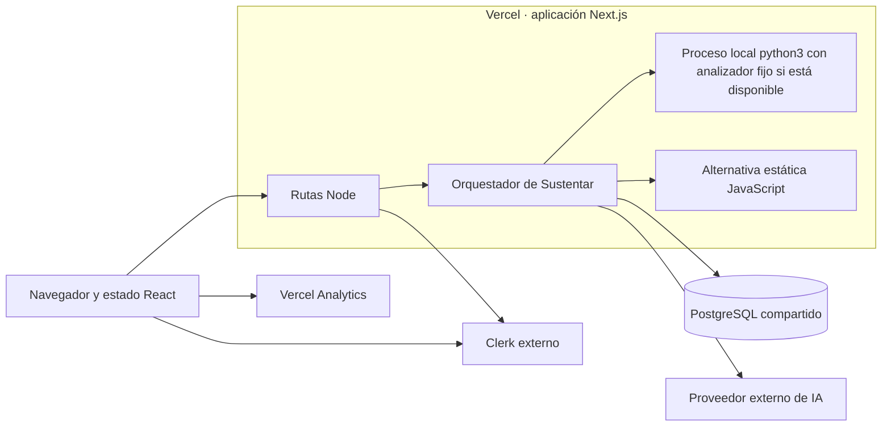
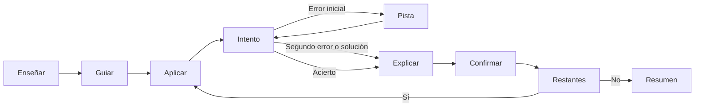
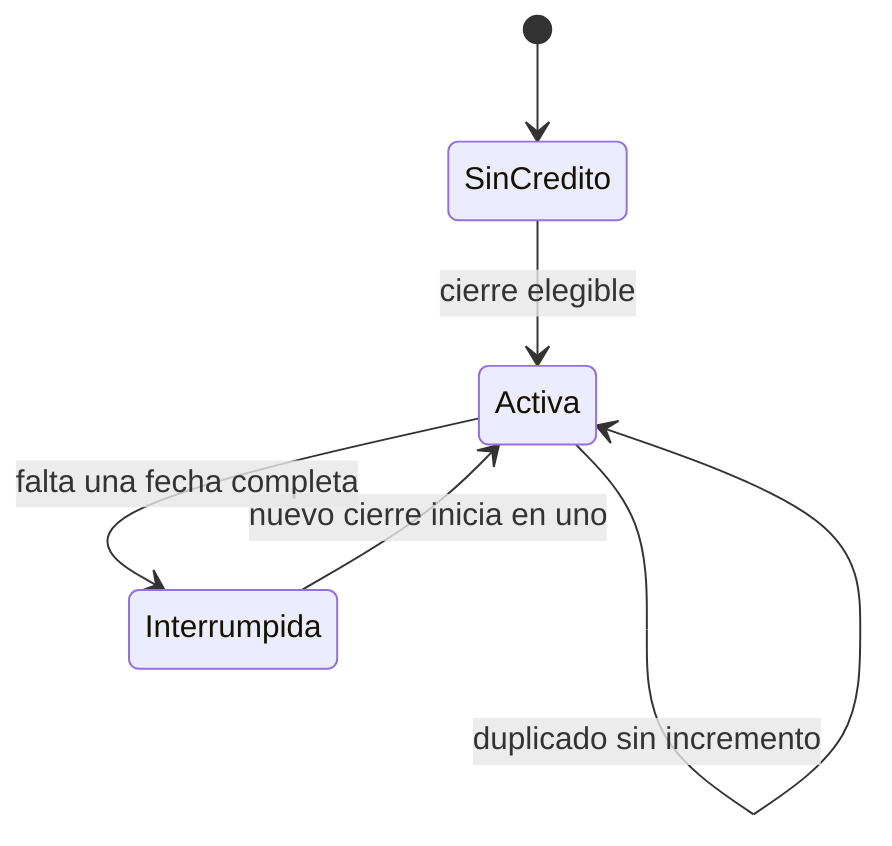
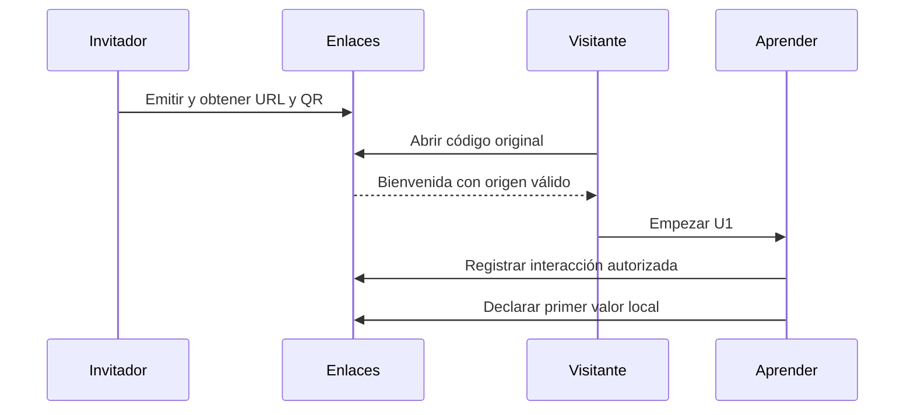
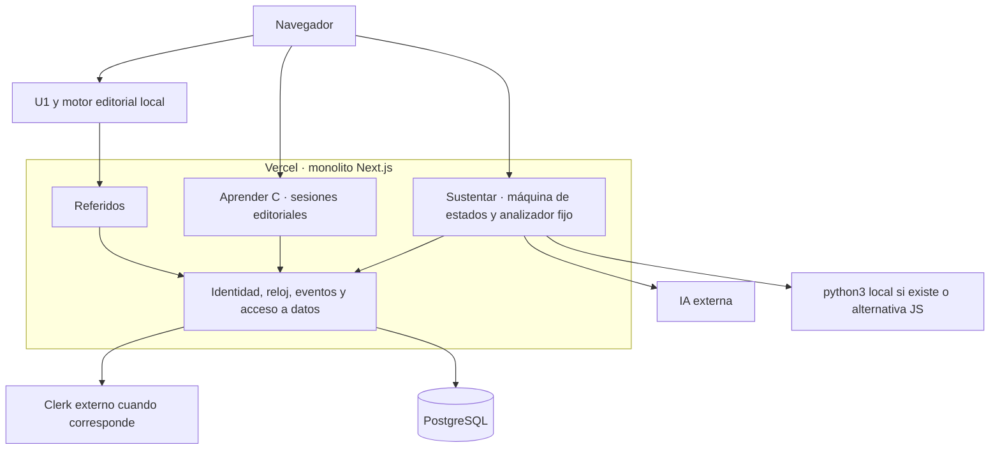
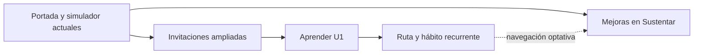

# PyDefense · Plan definitivo para ExpoAndes y el piloto de aprendizaje

Especificación de implementación futura para Claude Code. Base de código revisada en `1dabb095723612ae7c3e63ff9acad7c5a46d5e66`. La fecha de las fuentes del proyecto es 17 de noviembre de 2026. Las reglas de este documento sustituyen las recomendaciones anteriores. Los originales conservan su valor histórico. Las decisiones que debe ratificar producto están en §26.

## Índice

1. [Resumen ejecutivo](#s01)
2. [Objetivos, alcance y prioridades](#s02)
3. [Evidencia y método](#s03)
4. [Arquitectura actual](#s04)
5. [Inventario de lo existente](#s05)
6. [Observaciones del profesor y calidad del feedback](#s06)
7. [Mercado y referencias pedagógicas](#s07)
8. [Propuesta diferencial y segmentos](#s08)
9. [Economía y modelos de acceso](#s09)
10. [Aprender como producto y experiencia curricular](#s10)
11. [Única política de intentos, evidencia, selección y días](#s11)
12. [Premium y publicidad futura](#s12)
13. [Invitaciones y campaña](#s13)
14. [Arquitectura objetivo y dependencias](#s14)
15. [Datos, contratos y consistencia](#s15)
16. [UX, navegación y auditoría por pantalla](#s16)
17. [Fichas funcionales y aceptación por comportamiento](#s17)
18. [Registro de decisiones arquitectónicas y de producto](#s18)
19. [Pruebas y validación educativa](#s19)
20. [Métricas e hipótesis](#s20)
21. [Riesgos y capacidad de servicio](#s21)
22. [Prioridad, checkpoints y reversión](#s22)
23. [Backlog por etapa y responsable](#s23)
24. [Criterios de aceptación y terminado](#s24)
25. [Preparación ExpoAndes](#s25)
26. [Aprobaciones antes de implementar cada alcance](#s26)
27. [Fuentes y trazabilidad](#s27)
28. [Inicio de trabajo para Claude Code](#s28)

[Inventario de textos por superficie](#textos)

<a id="s01"></a>

## 1. Resumen ejecutivo

La persona que escanea el QR empieza una lección real de Python en su teléfono. Al terminar puede explicar una operación, ver por qué su respuesta tiene sentido y continuar con la siguiente lección. Puede invitar a otra persona o entrar directamente en Sustentar con código propio o un ejemplo identificado. Si el tutor de IA alcanza su límite, la ruta editorial sigue disponible. La primera entrega pública incluye una unidad completa y referidos personales. El piloto posterior demuestra continuidad entre días y dispositivos.

<a id="s02"></a>

## 2. Objetivos, alcance y prioridades

| Etapa | Entrega observable | Condición de salida |
|---|---|---|
| A · Base actual | Aislamiento, consigna antes de confianza, feedback comprensible y método de análisis visible | Propiedad verificada en toda lectura, pruebas concordantes y tratamiento académico identificado |
| B · ExpoAndes | U1 con tres lecciones locales, acceso directo a ambos módulos, enlace y QR general y personal, reporte agregado | Visitante completa L1 y otra persona llega desde su invitación. Sustentar en vivo supera su propia puerta de capacidad |
| C · Piloto recurrente | U2 y U3, sincronización para cuentas, misión y repaso espaciado, progreso y racha | Suficiente material por nivel, consentimiento por finalidad y prueba diferida con estudiantes |
| D · Investigación comercial | Entrevistas institucionales e individuales tras experiencia útil | Comprador, problema, frecuencia, presupuesto y alternativa documentados |
| E · Expansión | Más unidades, lenguajes y posibles planes de pago | Aprendizaje, recurrencia y costes observados justifican la inversión |

B es el mínimo del evento. Si falla una condición de B, identificar el piloto reducido por su alcance real y acordar el recorte antes de anunciarlo. La encuesta voluntaria puede empezar durante ExpoAndes. El evento excluye promoción de pago, anuncios simulados y redes publicitarias.

<a id="s03"></a>

## 3. Evidencia y método

Marcas de los apartados conservados: [R] repositorio, [T] prueba local previa, [F] profesor, [E] fuente externa, [P] propuesta y [H] hipótesis.

**Verificado en fuente** significa lectura de código, historial o documento citado. **Prueba histórica local** significa el resultado de las dos auditorías sobre el mismo commit con autenticación y tutor simulados. **Propuesta** identifica toda regla nueva de esta especificación. **Hipótesis** identifica estimaciones de coste, aprendizaje, recurrencia y demanda. El comportamiento de producción y los resultados con estudiantes requieren medición.

Las siete suites del commit registraron 98 éxitos de 99 casos. RAG 7/7, adaptativo 23/24, pedagogía 16/16, interfaz 9/9, estabilidad 22/22, persistencia 10/10 y medición 11/11. En esta consolidación se revisó el cambio en Git. La aserción de `tests/adaptativo.test.cjs:55` conserva el contrato anterior. El caso separado de aislamiento fue observado en local en la auditoría original. Su impacto potencial es exposición de contenido entre cuentas. La frecuencia en producción es desconocida. La mitigación está en §17.

Los tres insumos se identifican en §27. Se contrastaron las afirmaciones con el árbol actual y fuentes primarias de mercado, identidad y capacidad. La matriz hermana registra también las recomendaciones descartadas. La evidencia de interfaz disponible y el alcance de las comprobaciones visuales se explican en §16.

<a id="s04"></a>

## 4. Arquitectura actual

| Área / archivos reales | Responsabilidad e interacción |
|---|---|
| `app/layout.jsx`, `proxy.js` | `ClerkProvider`, navegación, limpieza local, captura de referido y Vercel Analytics. Middleware pone sesión a disposición; cada API decide autorización. |
| `app/page.jsx`, `app/components/landing-*` | Portada de Sustentar, explicación, comparación interactiva, mini reto local y diálogo de ejemplo. CSS Modules y Tailwind. |
| `app/simulador/page.jsx` | Cliente de 508 líneas con estado React local, editor, consentimiento, confianza, pregunta, feedback, cierre, refuerzo y recuperación. |
| `app/simulador/components.jsx`, `ux.jsx`, `compartir.jsx` | Feedback, resumen, revisión de refuerzo; progreso, código resaltado, exportación; compartir con Web Share/portapapeles/enlace manual. |
| `app/api/sustentacion/route.js` | POST autenticado al orquestador; cuerpo limitado, errores controlados y `no-store`. |
| `app/api/participacion/route.js` | POST autenticado: estado, consentimiento, retiro y código de referido. |
| `app/api/generar-preguntas/route.js`, `evaluar-respuestas/route.js` | Contratos heredados por lotes, no consumidos por la interfaz actual. Generación/evaluación con IA y nota en el contrato heredado. |
| `lib/sustentacion.js`, `pedagogia.js`, `temas.js`, `perfil.js` | Máquina de estados, selección determinista de preguntas, diagnóstico cualitativo, política introductoria, fragmentación. |
| `lib/evaluacion.js`, `contratos-ia.js`, `afirmaciones.js`, `llm.js` | Evaluación, citas localizadas, esquema JSON, guardas estáticas acotadas y llamada compatible con Chat Completions. |
| `lib/python-static.js`, `.py`, `python-fallback.js` | AST en proceso Python fijo o reconocimiento conservador JS. Nunca ejecución del código aportado. |
| `knowledge/python/nivel_1.json` … `nivel_8.json`, `knowledge/schema.json`, `knowledge/evaluacion/rubrica_general.json`, `lib/knowledge.js` | 92 registros de competencias; recuperación heurística por señales, hasta cinco seleccionados; no vector DB ni curso de ocho niveles implementado. |
| `lib/db.js`, `esquema.js`, `almacen.js`, `secretos.js`, `huellas.js` | PostgreSQL/PGlite, esquema v2, transacciones, cifrado AES-GCM, HMAC y deduplicación. |
| `lib/participacion.js`, `consentimiento.js`, `referidos.js` | Identidad interna ligada a Clerk, consentimiento, borrado y atribución básica. |
| `lib/medicion.js`, `experimento.js`, `manifiesto.js`, `scripts/experimento.cjs` | Protocolo de retorno, versiones congeladas, cohorte, incidencias, adjudicación de novedad y exportación operativa. |
| `tests/`, `scripts/comprobar-proveedor.cjs` | Suites Node/VM y dobles; prueba opcional Chromium; verificación real del proveedor separada. |
| `public/config.png`, `public/cargando.gif` | Recursos locales; el GIF se usa en cargas. |

Versiones **declaradas**, no auditoría de seguridad del árbol resuelto: Next `16.4.3`; React/React DOM `^19.3.1`; Clerk `^7.9.22`; Monaco React `^4.7.0`; `pg ^8.23.1`; PGlite `^0.5.13`; Vercel Analytics `^2.0.1`; Lucide `^1.64.0`; Tailwind `^3.4.19`; PostCSS `^8.5.32`; Autoprefixer `^10.6.2`; override DOMPurify `3.4.17`. Lenguaje JavaScript/JSX; Python para el analizador. No Redux, ORM ni framework de tests de navegador agregado en `package.json`. No se observaron pipelines de CI en los archivos del repositorio inspeccionados.




El editor, los borradores por cuenta y el indicador de envío viven en el cliente. La revisión de sesión y la fase confirmada pertenecen al servidor. Ante un conflicto, recuperar la vista autorizada antes de reintentar. El borrador local de código tiene plazo de 24 h y no está cifrado por la aplicación. En servidor los contenidos están cifrados con AES-GCM. La práctica ordinaria tiene vigencia de dos horas. La purga física de contenidos vencidos se realiza por lotes de manera oportunista. Revisar también copias y política de secretos antes de prometer plazos físicos. En local existe PGlite y en Vercel se requiere conexión PostgreSQL configurada.

<a id="s05"></a>

## 5. Inventario de lo existente

En la tabla, el objetivo describe el resultado esperado, R identifica lectura del commit y T identifica pruebas locales previas. Los nombres de archivo abreviados corresponden a §4.

| ID / objetivo y flujo | Archivos / reglas / dependencias | Esperado frente a comprobado | Problema y recomendación |
|---|---|---|---|
| I01 Descubrir valor: portada → ejemplo → práctica | `app/page.jsx`, `landing-interactions.jsx`, `landing-showcase.jsx`; React, CSS Modules | R: mini reto con respuesta fija y modal sin envío; T: contratos parciales de portada | Mantener; separar “vista previa” de práctica real y agregar dos entradas cuando exista Aprender. |
| I02 Entrar y consentir | `layout.jsx`, `proxy.js`, APIs, `participacion.js`, `consentimiento.js`; Clerk | R: rutas requieren autenticación. T: consentimiento para iniciar; no login real probado | Mantener para código propio; añadir acceso editorial anónimo separado, renovar alcance del consentimiento. |
| I03 Aportar código | `page.jsx`, `archivo-python.js`; pegar, subir `.py`, arrastrar, ejemplo | T: lectura y límites; R: editor con cinco temas y fallback | Ampliar preferencias; medir carga móvil, no introducir otro editor. |
| I04 Declarar temas | `temas.js`, `page.jsx`; opcional, no seguro = básico; ausente = introductorio presente | T: pertinencia y exclusión avanzada | Mantener; arreglar semántica del radio que se desmarca por clic, probar teclado. |
| I05 Iniciar práctica | `sustentacion.iniciar`, analizador, huellas, BD; UUID idempotente | T: límites, AST, concurrencia y rechazo sintaxis; caso confianza falla | Mantener; corregir aislamiento y alinear test con la consigna visible y versionar el estudio. |
| I06 Responder y recibir feedback | `evaluacion.js`, `contratos-ia.js`, `afirmaciones.js`, LLM/RAG | T: estructura y guardas con dobles; no precisión semántica real | Modificar presentación/calibración, sin retirar evidencia ni regalar aciertos. |
| I07 Adaptar y omitir | `pedagogia.siguientePregunta`, `sustentacion.aplicar`; tres preguntas, un reemplazo | T: estados, cierre y omisiones | Mantener; historial intersesión para diversidad solo donde proceda. |
| I08 Aclarar/reparar | `aclarar`, `reparar`, `revisarAfirmacionesTutor`; dos aclaraciones, una reparación | T: versiones, citas y fallos simulados | Mantener; distinguir cambio de redacción de revisión de contenido; texto “revisar feedback”. |
| I09 Resumir/exportar | `resumir`, `Resumen`, `GuardarResumen`; evidencia y siguiente paso | T: HTML y texto generado; no descarga/clipboard en navegador | Mantener; historial descargable no equivale a historial permanente de cuenta. |
| I10 Practicar refuerzo | `TAREAS`, `elegirRefuerzo`, `evaluarPractica`, `EvaluacionRefuerzo` | R: cuatro tareas fijas; T: alternativas, firma, casos razonados y no ejecución | Ampliar banco e historial; destacar ejemplo y acción; admitir corrección posterior con revisión versionada. |
| I11 Recuperar y gestionar errores | `page.enviar`, `http.js`, BD y leases | T: revisiones, expiración, cuotas y fallos; recuperación de cuenta simulada | Mantener; explicar dos plazos; conflictos concurrentes recuperan estado, no borran borrador. |
| I12 Compartir y atribuir | `compartir.jsx`, `captura-referido.jsx`, `referidos.js` | R: HMAC 16 caracteres, emisión deduplicada y primer referido guardado; pruebas de share parciales | Ampliar; falta QR, visita atribuida completa y reporte. Clic temprano puede compartir sin código. |
| I13 Retirarse | `participacion.retirar`, FK en `esquema.js`, limpieza local | T: cascadas básicas y censura de estudio | Mantener con alcance claro; resolver vínculo de invitador en eventos ajenos y cuenta Clerk separada. |
| I14 Medir estudio | `medicion`, `experimento`, `manifiesto`, script operador | T: cohorte, ventana 168 h, novedad y decisión con datos sintéticos | Preservar protocolo histórico; nuevo experimento para gamificación. Sin panel administrativo web actual. |
| I15 APIs heredadas | `generar-preguntas`, `evaluar-respuestas`, `legado`, `calcularEvaluacion` | T: auth/cuota/cuerpo; contrato todavía devuelve puntaje | Conservar compatibilidad inicialmente; inventariar consumidores y luego deprecar, no usarlas para Aprender. |
| I16 Perfil y monetización | Usuario/temas existen; no ruta, racha ni facturación | R: ausencia de modelo/flujo correspondiente | Crear solo tras aprobación de implementación; no anunciar funciones ausentes. |

<a id="s06"></a>

## 6. Observaciones del profesor y calidad del feedback

### 6.1. Primero el resultado

[F] El profesor perdió el hilo por advertencias antes del feedback. [R] `EvaluacionRefuerzo` presenta estado, controles estructurales, interpretación y luego casos en `details`; la limitación aparece antes de `cierre`. `Retroalimentacion` también antepone algunos avisos/correcciones. No todos son ruido: una rectificación factual debe mantenerse visible.

[P] Primer bloque: **qué se observó**, un acierto si existe, un problema concreto si existe, una acción recomendada y etiqueta breve del método (“Revisión por IA; código no ejecutado”). Segundo bloque visible: un ejemplo que ilustre el problema, con entrada, salida esperada y explicación estimada. Después: “Ver todas las observaciones”, “Cómo se revisó” y versiones. Si el código es sintácticamente inválido, falta contexto o se retiró una afirmación errónea, esa limitación va junto al resultado y prevalece sobre un texto de éxito. No usar “funciona” para una presencia de `return`.

Aceptación: en 390 px se puede identificar resultado y siguiente acción sin abrir detalles; no hace falta ocultar información crítica para lograrlo. Un docente puede distinguir método y alcance con una sola lectura. Las pruebas de render deben verificar orden semántico, además de presencia de frases.

### 6.2. Rigor y equivalencias semánticas

[F] Necesitó respuestas muy específicas. [R] Los prompts actuales ya piden aceptar equivalencias; la pregunta inicial exige propósito, entradas y estrategia, lo que puede ser más amplio de lo que el alumno interpreta. `localizarCita()` normaliza prosa; no es una comparación con respuesta modelo. El modelo asigna niveles 0–2 por criterio y el servidor los convierte a categorías. Guardas rechazan estructuras inconsistentes, no prueban que todo juicio sea correcto. El catálogo heredado usa pesos 0.40/0.35/0.25 y puntaje, pero no gobierna la UI secuencial actual.

[P] Modelo recomendado, con dos ejes: **cobertura de lo solicitado** y **validez conceptual**. Evita llamar “error conceptual” a una simple omisión.

| Categoría presentada | Regla propuesta | Feedback y siguiente acción |
|---|---|---|
| Comprensión correcta | Criterios aplicables completos, evidencia localizada y sin afirmaciones falsas relevantes | Reconocer explicación con sus propias palabras; variar contexto para confirmar transferencia. |
| Parcialmente correcta | Idea pertinente correcta y alguna relación poco desarrollada; sin contradicción grave | Señalar la relación concreta que falta; pedir ejemplo o causa. |
| Respuesta incompleta | Lo dicho puede ser correcto, pero falta una parte solicitada | Identificar esa parte, no exigir términos exactos ni requisitos ajenos. |
| Error conceptual | Afirmación específica contradice código/hecho y se puede explicar la contradicción | Citar la frase, aportar contraejemplo y orientar corrección. |
| Evidencia insuficiente | Respuesta evasiva, ambigua, cita no localizada o contexto insuficiente | No inferir incapacidad; pedir aclaración acotada o permitir continuar. |

“Parcial” e “incompleta” pueden coexistir internamente; se elige un mensaje principal y se conservan ambos ejes. No se agrega automáticamente una nueva llamada al modelo a todas las respuestas. La aclaración sigue siendo solicitada y acotada; la señal `trasFeedback` evita contar una reformulación posterior como dominio independiente. Una equivocación técnica fuera de la consigna pero pertinente puede señalarse, separada del cumplimiento de la consigna. No penalizar longitud, acento, vocabulario informal o falta de comentarios en código cuando no se solicitaron.

Ejemplo de calibración: para `return precio * cantidad`, “multiplica lo que vale cada unidad por cuántas compré” debe demostrar lo mismo que “producto del precio unitario por la cantidad”. “Suma precio y cantidad” es conceptual; “devuelve el total” es incompleto respecto a la operación, no necesariamente falso. Validar con docentes antes de modificar prompts o umbrales. Ver corpus y puertas de calidad en §19.


El profesor informó repeticiones y dificultad para ver los casos. El mapa `TAREA_DE` concentra propósito, entradas y operaciones en la misma familia de compra. La primera pregunta de propósito aumenta la exposición potencial. Para B, elegir entre variantes pedagógicamente equivalentes y permitidas, registrar la última variante por cuenta y familia mediante un evento mínimo, priorizar la menos reciente y mantener la elección al recargar. Si existe una sola, identificarla como repaso y permitir omitirla. Para C ampliar el banco, admitir una corrección versionada de la entrega y mostrar qué cambió. Nunca rotar hacia un concepto ajeno al diagnóstico.

La revisión principal ya muestra acierto, pendiente y próximo paso. Concentrar el cambio en `EvaluacionRefuerzo`. Mostrar primero lo observado y qué puede hacer el alumno. A continuación, una entrada de ejemplo con salida esperada y motivo. Una rectificación o limitación que cambie la interpretación queda junto al resultado. Los controles detallados pueden desplegarse. Distinguir ejemplo editorial, estimación IA, propiedad estática demostrada bajo un contrato y ausencia de verificación. Si se usó el reconocimiento JS, indicar «Reconocimiento aproximado. Sintaxis sin verificar». Solo la evidencia real de cada control habilita su etiqueta. La verificación de disponibilidad de Python se hace con un programa fijo en el despliegue autorizado. Evaluar un servicio separado únicamente si la pérdida de precisión medida lo justifica.

<a id="s07"></a>

## 7. Mercado y referencias pedagógicas

Consulta web del 17-11-2026. Las páginas oficiales verifican **oferta declarada**, no usabilidad experimentada ni eficacia independiente. No se compraron planes, no se crearon cuentas y no se midieron sesiones. “ND” significa no determinado en las fuentes consultadas, nunca que la funcionalidad no exista. Duraciones no verificadas no se sustituyen por estimaciones presentadas como hechos. Los precios pueden variar por país, impuestos, plataforma y promociones; no se verificó un checkout colombiano.

Se distinguen competidores directos de microaprendizaje de programación (Mimo, SoloLearn), alternativas curriculares/profesionales (Codecademy, DataCamp), referentes de hábito o interacción (Duolingo, Brilliant), alternativas gratuitas de práctica/proyectos (Exercism, freeCodeCamp) y un referente adicional de aprendizaje con programas y juegos (Jiki). Un chat general con IA es sustituto para explicar código, aunque no fue sometido a una comparativa de calidad en esta auditoría.

### 7.1. Matriz educativa y de experiencia [E]

| Plataforma / público | Propuesta, formato y progresión declarados | Personalización / feedback | Sesión / hábito / incentivos observados | Implicación para PyDefense [I] |
|---|---|---|---|---|
| Duolingo; aprendizaje general, referente indirecto | Ruta de lecciones y práctica integrada [E01: Duolingo: ciencia del diseño de la ruta](https://blog.duolingo.com/new-duolingo-home-screen-design/) | Ordenación con repaso; feedback de ejercicios | Racha por lección diaria [E02: Duolingo: qué es una racha](https://www.duolingo.com/help/what-is-a-streak); duración exacta ND | Adoptar claridad del siguiente paso; no trasladar mecánicas lingüísticas sin evaluar transferencia a código. |
| Mimo; principiantes, competidor directo | Rutas de Python y desarrollo; lecciones interactivas y proyectos [E04: Mimo: planes web y móvil](https://mimo.org/pro) | Tutor IA y entornos de práctica según plan | Reparación mensual de racha listada; duración ND | Enseñar programación por móvil ya tiene oferta; diferenciar comprensión contextual. |
| SoloLearn; principiantes, directo | Cursos, práctica, playground y comunidad [E05: SoloLearn: planes y precios](https://www.sololearn.com/en/plans) | MAX añade explicación de respuesta y errores con IA | Corazones y práctica para recuperación; racha/duración ND en página consultada | No presentar ayuda por IA como exclusividad. |
| Codecademy; habilidades/carrera | Cursos, proyectos, rutas de habilidad/carrera [E06: Codecademy: precios](https://www.codecademy.com/pricing); [E07: Codecademy: diferencias de planes](https://help.codecademy.com/hc/en-us/articles/6844743588635-Difference-between-Plus-Pro-and-All-Access-Pass) | Asistencia IA y aprendizaje adaptado a proyectos | Incentivos profesionales; duración y racha ND | No competir inicialmente en amplitud ni empleabilidad certificada. |
| DataCamp; datos, IA y carrera | Cursos, evaluaciones, proyectos y rutas [E08: DataCamp: planes y precios](https://www.datacamp.com/pricing) | Evaluación de nivel y seguimiento | Retos móviles diarios anunciados de cinco minutos | Separación aprender/practicar/aplicar es referente útil. |
| Brilliant; razonamiento STEM | Lecciones y conjuntos de práctica interactiva [E09: Brilliant: planes y coste](https://brilliant.org/help/pricing-and-plans/how-much-does-brilliant-premium-cost/); [E09: FAQ](https://brilliant.org/faq/) | Tutor Koji dentro de cursos | Límite diario gratuito; racha/duración ND | Priorizar interacción que ayude a razonar, no solo recordar sintaxis. |
| Exercism; práctica de programación | Python: 146 ejercicios agrupados en 17 conceptos [E10: Exercism: Python](https://exercism.org/tracks/python) | Análisis automático y mentoría humana voluntaria | Progresión por ejercicios; duración/racha ND | Referente de alternativas válidas y feedback; no es la misma propuesta de sesión breve. |
| freeCodeCamp; formación por proyectos | Proyectos progresivos y certificaciones [E11: freeCodeCamp: preguntas frecuentes oficiales](https://www.freecodecamp.org/news/about/) | Comunidad; adaptación algorítmica ND | Ritmo propio; duración micro y racha ND | Fuerte sustituto gratuito; la biblioteca por sí sola no justifica cobrar. |
| Jiki; principiantes y quienes retoman | Programas, juegos/puzles y avance gradual [E12: Jiki: aprender a programar](https://jiki.io/) | Depuración paso a paso y ayuda contextual | Incentivo de creación; racha/duración ND | Diversión vinculada al comportamiento del programa; candidato para estudiar transferencia. |

### 7.2. Matriz comercial [E]

| Plataforma | Gratis y premium declarados | Precio observado / condición | Publicidad y límite de evidencia |
|---|---|---|---|
| Duolingo | Gratis; suscripción Super; reorganización de Max anunciada [E03: Duolingo: carta a accionistas Q3 2026](https://duolingo.gcs-web.com/static-files/e1ee336e-b024-486f-875c-afd722653067) | Importe local ND | Carta Q3 2026 anuncia dejar de vender nuevas Max ese mes e incorporar Video Call a Super; no usar descripciones antiguas como catálogo definitivo. |
| Mimo | Basic limitado; Pro móvil; Max web y móvil [E04: Mimo: planes web y móvil](https://mimo.org/pro) | Importes no legibles en la página recuperada | Pro/Max ofrecen ausencia de anuncios; no se verificó frecuencia en Basic. |
| SoloLearn | Contenido gratuito; PRO elimina límites y anuncios; MAX añade IA [E05: SoloLearn: planes y precios](https://www.sololearn.com/en/plans) | PRO USD 69.99/año o 12.99/mes; MAX 119.88/año, según página | No se probó experiencia publicitaria; tarifa web, no cotización colombiana. |
| Codecademy | Basic limitado; Plus habilidades; Pro carrera; All Access añade oferta formativa [E06: Codecademy: precios](https://www.codecademy.com/pricing); [E07: Codecademy: diferencias de planes](https://help.codecademy.com/hc/en-us/articles/6844743588635-Difference-between-Plus-Pro-and-All-Access-Pass) | Plus USD 14.99/mes anual o 29.99 mensual; Pro 19.99 anualizado o 39.99 mensual | Sin modelo publicitario confirmado en estas páginas. |
| DataCamp | Primer capítulo gratis; Premium amplía cursos/proyectos [E08: DataCamp: planes y precios](https://www.datacamp.com/pricing) | Página mostró oferta de USD 5/mes facturado anual, frente a otras cifras; tratar como promoción temporal | Precio regular efectivo y renovación pendientes; no inferir sostenibilidad de PyDefense por esta oferta. |
| Brilliant | Gratis con límites diarios; Premium ilimitado, tutor y navegación libre [E09: Brilliant: planes y coste](https://brilliant.org/help/pricing-and-plans/how-much-does-brilliant-premium-cost/); [E09: FAQ](https://brilliant.org/faq/) | Depende de plan/localización; importe ND | Premium se anuncia sin anuncios; no cuantificar anuncios gratuitos. |
| Exercism | Track de Python y mentoría gratuitos [E10: Exercism: Python](https://exercism.org/tracks/python) | USD 0 para la oferta citada | Otros apoyos/ofertas no evaluados; no inferir costes operativos nulos. |
| freeCodeCamp | Cursos/proyectos/certificaciones gratuitos, donaciones [E11: freeCodeCamp: preguntas frecuentes oficiales](https://www.freecodecamp.org/news/about/) | USD 0; donaciones voluntarias | FAQ publicada originalmente en 2019; no usar cifras antiguas de usuarios o duración como actuales. |
| Jiki | Página anuncia acceso gratuito y enlace a Premium [E12: Jiki: aprender a programar](https://jiki.io/) | Precio y límites premium ND | No se verificó publicidad ni suscripción. |

**Retención y adquisición:** tener rachas, proyectos o planes no demuestra su efecto causal. Solo se halló evidencia corporativa cuantitativa reciente utilizable en esta exploración para Duolingo: carta Q3 2026 declara 64.9 millones de usuarios activos diarios y 13.1 millones de suscriptores, y describe experimentación y alianzas de adquisición. Son cifras de otra empresa y sector; no sirven para proyectar la conversión de PyDefense [E03: Duolingo: carta a accionistas Q3 2026](https://duolingo.gcs-web.com/static-files/e1ee336e-b024-486f-875c-afd722653067). No se atribuyen tasas D1/D7 a competidores ni se estimó un TAM sin fuentes.

Se intentó abrir `/learn` y `/donate` de freeCodeCamp y `/pricing` de Codédex: contenido no legible con la herramienta. Para freeCodeCamp se usó FAQ oficial, con advertencia de antigüedad; Codédex se excluyó de la matriz detallada y se añadió Jiki, cuyo sitio sí permitió lectura. Ninguna reseña de comunidad se usó para confirmar precios o defectos del producto.

### 7.3. Ciencia del aprendizaje y límites de extrapolación

La revisión de Dunlosky y colaboradores (2013) respalda especialmente recuperación activa y práctica distribuida; la intercalación requiere atender a material y condiciones. Es base para programar repaso y oportunidades de recordar, no una prueba de que una secuencia concreta de cinco preguntas enseñe Python [E13: Dunlosky et al., 2013: técnicas de aprendizaje](https://pubmed.ncbi.nlm.nih.gov/26173288/); [E13: síntesis editorial APS](https://www.psychologicalscience.org/publications/journals/pspi/learning-techniques.html).

El metaanálisis de Sailer y Homner, publicado en 2019 y en volumen de 2020, encontró efectos positivos agregados y heterogeneidad; los efectos motivacionales y conductuales fueron menos estables en análisis de mayor rigor. Justifica experimentar con gamificación, no afirmar que XP o rankings causan aprendizaje [E14: Sailer y Homner: metaanálisis de gamificación](https://link.springer.com/article/10.1007/s10648-019-09498-w).

Hou, Ericson y Wang estudiaron problemas de ordenar bloques con 89 universitarios; encontraron beneficios en rendimiento durante práctica para alumnos con menor autoeficacia. Apoya estudiar ese andamiaje en una evolución, sin asumir transferencia duradera ni equivalencia a escribir código libremente [E15: Hou, Ericson y Wang: problemas Parsons como apoyo](https://arxiv.org/abs/2311.18115).

La documentación de la ruta de Duolingo explica integrar repaso en la progresión [E01: Duolingo: ciencia del diseño de la ruta](https://blog.duolingo.com/new-duolingo-home-screen-design/). Es una decisión de producto de su equipo; el calendario propio de PyDefense y los umbrales de dominio que siguen son hipótesis explícitas, no algoritmos validados por esas fuentes.


| Referente adicional | Público, formato, progresión y ayuda | Consecuencia para la propuesta |
|---|---|---|
| Platzi | Ruta en español de fundamentos a cursos avanzados y proyectos. La duración publicada corresponde a cursos. Racha, duración por sesión, publicidad y retención de esa ruta quedan sin verificar. [Ruta oficial](https://platzi.com/ruta/programacion-python/) | El español y un catálogo de Python ya tienen oferta. Probar si el estudiante valora practicar una explicación concreta desde el móvil. |
| ChatGPT en modo de estudio | Tutor general que guía con preguntas según objetivo y nivel. La fuente describe acceso con cuenta y acompañamiento paso a paso. No ofrece datos comparables de retención de un curso Python. [Presentación oficial](https://openai.com/index/chatgpt-study-mode/) | Comparar diferenciación de Sustentar mediante evidencia localizada, calibración docente y transferencia, sin atribuir exclusividad a la conversación guiada. |

La página oficial de SoloLearn volvió a mostrar PRO USD 69,99/año y MAX USD 119,88/año. Una tienda móvil puede tener otro precio. Para un presupuesto en Colombia hace falta una cotización local. [Planes web](https://www.sololearn.com/en/plans)

<a id="s08"></a>

## 8. Propuesta diferencial y segmentos

Para quien comienza, Aprender ofrece una ruta desde «qué valor cambia» hasta «cómo explicaría por qué funciona». Para quien recibe código generado por IA, Sustentar hace preguntas sobre ese programa y devuelve evidencia. Quien prepara una sustentación puede ir directamente al editor. Para estudiantes que desean mantener habilidades, el piloto ofrece recuperación espaciada. Para un docente, el valor por validar es el uso formativo en clase y la reducción del tiempo de preparación. Una ventaja sostenible requeriría contenido revisado y evidencia de transferencia a programas nuevos.

<a id="s09"></a>

## 9. Economía y modelos de acceso

Ruta inicial, soluciones, repaso y resumen propio gratuitos. Sustentar conserva acceso sujeto a capacidad. Validar en paralelo quién compraría para un curso y quién pagaría por prácticas adicionales. Dar prioridad de investigación a docentes por acceso al segmento. Ni un clic ni una entrevista constituyen una venta. Hacer dos preguntas al acabar voluntariamente: «¿Para qué curso o situación volverías a usarlo?» y «¿Quién decidiría y con qué presupuesto o alternativa?». Registrar rol y respuesta categorizada con permiso, sin recopilar código. Comparar patrocinio por cohorte, créditos por entrega y suscripción. Para valorar disposición individual, tarjetas exploratorias de COP 9.900, 19.900 y 29.900/mes en entrevistas posteriores. Pago y capacidad adicional requieren una decisión comercial independiente.

Variables a medir: usuarios activos mensuales `U`, sesiones Sustentar/usuario `s`, llamadas/sesión `l`, tokens entrada/salida `ti,to`, factor de reintentos `r`, tarifas por millón `pi,po`, coste fijo `F`, coste plataforma variable `v`, conversión `q`, precio `P`, fracción de comisiones/impuestos reembolsos según caso `f`, y soporte/editorial `E`.

```text
coste_IA_mes = U × s × l × (1+r) × (ti×pi + to×po) / 1.000.000
coste_total = F + U×v + coste_IA_mes + E
ingreso_neto_modelado = U × q × P × (1-f)
margen_contribucion = ingreso_neto_modelado - U×v - coste_IA_mes
resultado_operativo_modelado = margen_contribucion - F - E
```

**Referencia externa:** Groq publica para GPT-OSS 120B USD 0.15 entrada y 0.60 salida por millón de tokens en la página consultada [E16: Groq: modelos y precios por tokens](https://console.groq.com/docs/models). Es una referencia de escenario; no se confirmó que sea el proveedor activo. No se verificaron cuotas de la cuenta ni se usan comentarios históricos de “8000 tokens/minuto” como garantía vigente.

**Ejemplo numérico, totalmente hipotético salvo esa tarifa:** `s=4`, `l=3`, `ti=3000`, `to=1500`, `r=0.10`. Coste por llamada USD 0.00135; por sesión USD 0.004455. Aprender editorial no necesita IA en tiempo de respuesta. Un flujo con refuerzo/reparación puede superar tres llamadas; esos costes van en `l`, no se omiten.

| U mensual supuesto | Sesiones supuestas | Llamadas incl. 10% reintento | IA mensual base | Sensibilidad ×10 coste/token | Solo ingreso bruto con q=2%, P=USD 4 hipotéticos |
|---:|---:|---:|---:|---:|---:|
| 100 | 400 | 1320 | USD 1.782 | USD 17.82 | USD 8 |
| 1000 | 4000 | 13200 | USD 17.82 | USD 178.20 | USD 80 |
| 10000 | 40000 | 132000 | USD 178.20 | USD 1782.00 | USD 800 |


<a id="s10"></a>

## 10. Aprender como producto y experiencia curricular

| Unidad y requisito | Tres lecciones y evidencia observable | Producto del alumno |
|---|---|---|
| U1. Inicio libre | L1 distingue valor, variable y salida. L2 sigue una reasignación. L3 combina cantidades y explica qué calcula el programa. | Construir y explicar el importe de una merienda. |
| U2. Habilidades U1 preparadas | L1 compara cantidades. L2 sigue ambas ramas de un condicional. L3 explica el efecto de incluir el umbral. | Aplicar un descuento y justificar qué ocurre exactamente en el límite. |
| U3. Habilidades U2 preparadas | L1 interpreta una lista. L2 sigue un recorrido y un acumulador. L3 identifica por qué el total se inicializa antes del bucle. | Resumir gastos semanales y explicar un resultado inesperado. |

En B, cada lección de U1 se abre al completar la anterior. El progreso local distingue actividades asistidas y autónomas. C incorpora el criterio de preparación entre unidades de §11. Después siguen funciones y parámetros, diccionarios y modelado de datos, errores y pruebas, diseño con objetos y luego recursión y complejidad. Un nuevo lenguaje necesita sus propios prerrequisitos y validadores aunque comparta la interfaz.

Cada microlección presenta un objetivo, una explicación breve con alternativa ampliada, un ejemplo resuelto, una actividad guiada y dos aplicaciones con feedback. Una aplicación cambia el contexto. Ejemplo de L2: después de enseñar `saldo = 4` y `saldo = saldo + 2`, preguntar qué valor se mostraría y cuál explicación describe la segunda asignación. El distractor «la segunda línea muestra el saldo» confunde asignación con salida. Pista: «¿Qué línea le daría una orden de mostrar algo a Python?». Después del acierto explicar por qué se leyó primero el valor previo. El alumno puede elegir «Ver explicación» desde el inicio. Registrar la resolución asistida.

| Interacción | Dificultad y validación | Feedback, accesibilidad y esfuerzo |
|---|---|---|
| Seleccionar salida, explicación causal o pieza que falta | Básica si sigue un paso, moderada si contrasta razones. Selección por ID con distractores revisados. | Explicar la confusión de la alternativa elegida. Radios con etiqueta. Bajo coste de UI, revisión editorial por distractor. B. |
| Completar con fichas | Básica al reconocer una operación, moderada al trasladarla a otro contexto. Claves admitidas explícitas. | Mostrar efecto de la ficha y ejemplo. Botones con teclado. Coste medio. B. |
| Localizar línea | Moderada cuando exige seguir dos asignaciones ya enseñadas. Validar contra el conjunto de líneas correctas. | Explicar dónde cambia el dato. Botones numerados y código legible sin color. Coste medio. B. |
| Ordenar pasos de una explicación o líneas | Moderada. Validar órdenes equivalentes con restricciones de precedencia. | Indicar la dependencia incumplida. Controles subir/bajar. Coste medio-alto. E. |
| Salida breve o relación concepto-fragmento | Básica o moderada según pasos. Normalizar por tipo o aceptar pares válidos. | Ejemplo comparado con el resultado. Entrada etiquetada y alternativa táctil. Candidato C. |
| Explicar o escribir libremente | Transferencia alta. Rúbrica humana para el piloto. | Retroalimentación causal. Sin evaluación automática de texto libre en Aprender. Coste docente alto. |

**Banco y autoría.** Para B presupuestar 30 actividades revisadas en tres habilidades. Por habilidad reservar una guía, dos aplicaciones de lección, dos transferencias inéditas para piloto y cinco de práctica. Metadatos obligatorios: ID canónico, versión, familia conceptual, formato, usos permitidos, requisito, clave, pista, justificación de cada alternativa, nivel relativo, procedencia y revisor. Rechazar referencias rotas, ambigüedad, pistas reveladoras y distractores equivalentes a la clave. B admite fichas fijas. Para C, materializar combinaciones finitas de plantillas de autores en CI con ejemplos de referencia, probar cada combinación publicada y revisar los distractores por rango y límites. Ejecutar únicamente las referencias editoriales revisadas en el entorno editorial. Conservar versiones inmutables y su hash. Una variación numérica comparte familia y no acredita transferencia inédita.

**Diversión y regreso.** Mostrar cómo cada decisión del alumno cambia el miniproyecto y cerrar con «Ya puedes explicar por qué el total pasó de 4 a 6». Microanimación prescindible y movimiento reducido. En C, meta visible de una sesión significativa al día. Día 2 recuperar una idea y aplicarla en una situación nueva. Día 7 contrastar una explicación inicial con otra más completa. Tras una ausencia, proponer una actividad breve sobre lo ya aprendido y preservar el avance. Ofrecer un recordatorio local de calendario solo mediante acción explícita y fuera de una cohorte incompatible. Son hipótesis de motivación que deben contrastarse con retorno y aprendizaje. Clasificaciones, sonidos, XP, insignias y pausas ganadas quedan fuera de B y C. Evaluar una meta semanal flexible si romper la racha provoca abandono.

<a id="s11"></a>

## 11. Única política de intentos, evidencia, selección y días

1. **Intentos en B y C.** El primer acierto sin ayuda deja evidencia autónoma. El primer fallo muestra una pista y deja un segundo intento. Un acierto después de ayuda es asistido. El segundo fallo o «Ver solución» cierra el ítem como revisado, explica y habilita continuar. Una práctica similar opcional queda fuera del puntaje y del cómputo de ítems obligatorios de esa sesión. Confirmar el feedback antes de avanzar. Un error de red recuperable conserva la operación pendiente.
2. **Progresión.** Introducida tras enseñanza, en práctica tras aplicación, preparada tras completar la lección y acertar autónomamente en dos actividades de familias distintas, una con transferencia. Consolidada tras dos recuperaciones autónomas adicionales en fechas distintas, una al menos siete días después de preparación. Error posterior prioriza repaso y mantiene unidades abiertas. La comprobación está integrada en las actividades. No hay sesión ni premio de examen de unidad. Programar revisiones orientativas a 1, 3, 7 y 14 días desde la última recuperación, con retorno a un día tras error. No castigar ausencia con una cola ilimitada.
3. **Misión C.** Tras completar L1 y disponer de material enseñado, asignar una vez por cuenta y día. Preferir cinco ítems (3 básicos, 2 moderados), después cuatro (3+1), después tres (2+1). Moderado implica conectar pasos aprendidos. Priorizar hasta dos habilidades vencidas, luego errores, luego cobertura. Orden de ítems/opciones estable desde la asignación. Primero familias distintas, sin repetir instancia en la sesión, preferir siete días sin exposición. Solo para repaso explícito permitir instancias con al menos 24 h desde la exposición. Sin tres aptas ofrecer lección o repaso, sin emitir misión vacía. Preservar las transferencias reservadas.
4. **Repaso C.** Sesión de tres ítems distintos sobre habilidades introducidas, con al menos una recuperación vencida o un error pendiente. Las tres deben cubrir al menos dos familias, evitar la misma instancia en las últimas 24 h y mostrar el motivo de selección. Al terminar la ruta, si no hay vencimientos, permitir repaso de mantenimiento sobre las tres familias menos recientes. Si no hay cobertura se ofrece material de consulta y se registra déficit del banco. Publicar la racha solo después de simular trayectorias de siete y catorce días que permitan una sesión acreditable diaria, incluso al final de ruta.
5. **Crédito C.** Una lección nueva completa, misión completa o repaso completo acredita una sola fecha al confirmar el cierre en servidor, con independencia del número de aciertos. Zona fija `America/Bogota`, día pedagógico = fecha del instante de confirmación convertido a hora local y desplazado tres horas hacia atrás. A las 02:59:59 corresponde al día anterior y a las 03:00:00 comienza el siguiente. La misión se asigna por día pero puede terminarse dentro de 24 h desde su creación. Una lección o repaso admite reanudación durante siete días. Priorizar reanudar sesión abierta. Cerrar una misión anterior y otra actual el mismo día da un solo crédito. Vencimiento se evalúa en servidor, sin retroactividad offline. El historial queda consultable. Los días acreditados consecutivos determinan la racha. El último crédito ayer conserva la racha hasta terminar hoy. Un día ausente rompe la secuencia y conserva el récord. B muestra únicamente progreso local.
6. **Defectos editoriales.** Suspender la versión para nuevas asignaciones. Para un ítem invalidante activo, sustituirlo por otro pertinente, guardar motivo y conservar historial sin penalización. Si falta sustituto, interrumpir y ofrecer otra sesión. Tras cierre, retirar evidencia de habilidad afectada y conservar la constancia. Publicar una revisión no modifica silenciosamente el material congelado.





**Motivación y personalización por alcance.** En B el alumno elige cuándo parar, puede reducir movimiento y repetir una explicación. En C puede ocultar la racha, consultar objetivos y seleccionar el próximo repaso recomendado. La recomendación explica qué error o intervalo la motivó. Mantener accesibles las unidades abiertas. Metas de tiempo, retos colaborativos voluntarios y recordatorios más frecuentes requieren un experimento separado.

<a id="s12"></a>

## 12. Premium y publicidad futura

La ayuda tras errores forma parte de la enseñanza. Considerar en E mayor capacidad de IA, tutorías o informes de grupo agregados. El coste del proveedor, la revisión humana y la disposición a pagar se miden por separado. Si hubiera interés por promoción interna, ensayar una tarjeta opcional tras el resumen, con omisión inmediata y máximo una por semana. Comparar salida, utilidad y retorno con grupo sin tarjeta. Para anuncios recompensados, la web puede comunicar concesión/cierre sin ofrecer la misma verificación que un SDK nativo. Sin inventario, consentimiento apropiado, verificación de la concesión y beneficio educativo demostrado, descartar integración. Fórmula exploratoria de ingreso = impresiones elegibles × tasa de ocupación × ingreso neto por mil / 1000. Preservar siempre la alternativa educativa gratuita y no acreditar dominio por exposición. [Google Publisher Tag](https://developers.google.com/publisher-tag/samples/display-rewarded-ad) · [AdMob SSV](https://support.google.com/admob/answer/9603226?hl=en)

<a id="s13"></a>

## 13. Invitaciones y campaña

`/expo` pertenece a la campaña. `/r/:codigo` identifica el enlace compartido y conserva su propietario al reenviarlo. En B todo visitante puede copiar el QR general. Para respetar el requisito de enlace propio, un visitante puede además pulsar «Crear mi invitación en este navegador». El servidor entrega una capacidad opaca en cookie HttpOnly, Secure, SameSite=Lax y guarda su hash. Solo sirve para administrar su enlace. No crea cuenta, perfil de aprendizaje ni fusión. Un usuario autenticado puede emitir un enlace de cuenta independiente. Si rechaza la cookie, ofrecer enlace general. Al perderla se pierde control local. El stand reinicia el navegador entre demostraciones.

Crear código público aleatorio de 96 bits con unicidad y reintento por colisión. Para cuentas con código histórico emitido, reconocer el alias HMAC original y asociarlo al mismo destino. Priorizar alias ya persistido frente a recalcularlo al rotar secretos. El GET resuelve el origen pero no acredita interacción. Tras acción explícita y permiso de medición conservar origen firmado de vida corta en cookie de primera parte. En el salto a otro navegador, ofrecer copiar **el enlace original** con su código público. Una cookie no cruza aplicaciones. Rechazar destinos externos. El origen nunca otorga permiso para editar una invitación.

Primera invitación personal válida gana durante siete días desde la interacción. El QR general conserva la campaña y no reemplaza la invitación válida. Tras expirar la ventana, una nueva interacción puede iniciar otra atribución para conversiones futuras. No reasignar conversiones históricas. Autorreferido conocido por cuenta o capacidad se excluye. Entre navegadores sin cuenta no se puede resolver identidad con certeza. Para campaña se incluyen primeras interacciones entre apertura del evento y cierre oficial más 48 h, ambos instantes configurados por operador, intervalo semiabierto. Separar visitantes del stand y tráfico posterior. Retornos D7 se calculan después de madurar la cohorte, aunque cierre la ventana de adquisición.



Si falta código personal mostrar «Preparando enlace» o permitir compartir expresamente el general. Web Share, portapapeles y copia manual son mecanismos alternativos. Copiar, abrir, interactuar, terminar y crear cuenta tienen denominadores separados. Reporte por script de operador, sin nombres ni lista pública de referidos.

El dominio público y la campaña se fijan en configuración del servidor. Enlaces históricos con ?ref= conservan el código mediante resolución compatible, sin destinos elegidos por el cliente. El stand distribuye QR con margen y contraste y URL debajo. El PDF o la impresión deberá decodificarse en los dispositivos de §16 antes de distribuirla.

<a id="s14"></a>

## 14. Arquitectura objetivo y dependencias





Aprender posee banco, progreso, intentos y repaso. Sustentar posee código, evaluación, refuerzo y sus exposiciones. Referidos posee enlaces y atribuciones. Plataforma posee autenticación, errores neutrales, reloj y acceso transaccional. Cada módulo puede consumir solo contratos de plataforma y eventos mínimos del otro. Probar importaciones en ambas direcciones, incluidos alias y reexportaciones. Ejecutar U1 con el proveedor desconectado y Sustentar con Aprender apagado. La BD compartida es una dependencia común para las partes persistentes. Mantener `/simulador`, los dos contratos principales y los dos endpoints heredados. Cargar Monaco solo donde se usa.

<a id="s15"></a>

## 15. Datos, contratos y consistencia

**B local.** Un único registro de navegador por sesión editorial, con versión de formato, versión y hash de catálogo, ID de lección, orden de actividades y opciones, cursor, ordinal por ítem, ayuda y acuse del feedback. Escribir el estado completo en una operación tras cada acción. Restaurar solo con formato y catálogo compatibles. Conservar el catálogo previo durante la vigencia de la sesión. Ante JSON corrupto o almacenamiento denegado ofrecer empezar en memoria y explicar el alcance. Permitir «Borrar mi avance de este navegador». En dos pestañas, una única escritora mediante Web Locks cuando esté disponible. Si no existe Web Locks, usar sessionStorage por pestaña para poder recargar sin sobrescribir el avance de otra. Indicar que la persistencia acaba al cerrar esa pestaña. Si tampoco existe sessionStorage usar memoria. En un equipo compartido habilitar modo demostración efímero. El cliente puede inspeccionar o modificar el contenido editorial. Sus resultados sirven para orientación personal y analítica declarada, nunca para certificar o importar dominio. Al acceder a C se ofrece continuar con la lección sugerida y comenzar evidencia verificada en cuenta. Preservar por separado el avance local anterior.

| Etapa y entidad propuesta | Campos y restricciones | Propietario y ciclo de vida |
|---|---|---|
| B · ref_enlaces | UUID, código público UNIQUE, alias histórico UNIQUE si existe, usuario FK nullable o hash de capacidad UNIQUE, campaña, creado, revocado. Solo un tipo de propietario por enlace activo. Un enlace por cuenta/campaña. | Referidos. Reintentar alta tras colisión, revocar al retirar permisos. Buscar por código indexado. |
| B · ref_atribuciones | UUID, clave seudónima de visitante, enlace FK nullable, campaña, inicio, fin, política, conversión opcional. Un origen personal vigente por visitante. | Referidos. Usar una fila canónica por visitante, insertada con clave única y bloqueada en transacción para resolver primer toque, conservar origen histórico de la conversión. |
| B · eventos existentes | Usar secuencia, clave_dedup única, fecha de servidor, visita_id, usuario opcional, tipo y datos reducidos. Marcar módulo, fuente, versión y personal de prueba. | Plataforma. Eventos Expo sin experimento_id, validar lista permitida. El retiro elimina enlaces personales en datos cruzados y aliases. |
| C · ap_sesiones | UUID, usuario FK, tipo lección/misión/repaso, fecha asignada, expira, estado, revisión, catálogo/hash, snapshot JSON de ítems/orden/ayudas, cierre. UNIQUE parcial usuario/fecha para misión. | Aprender. Seleccionar y guardar una vez. Índice usuario/estado. Retener contenido versionado mientras haya sesiones vigentes. |
| C · ap_operaciones | usuario, clave UUID, sesión, acción, digest, respuesta autorizada, revisión, fecha. UNIQUE usuario/clave. | Aprender. Guardar en la misma transacción. Necesaria para replay también en asignar, solicitar solución, confirmar y cerrar. |
| C · ap_intentos | sesión FK, ítem, ordinal, selección tipada, tipo de ayuda, resultado, familia, habilidad, fecha, retirada opcional. UNIQUE sesión/ítem/ordinal. | Aprender. Las resoluciones y evidencias se derivan de intentos y cierres válidos. Sin tablas de caché inicialmente. |
| C · ap_creditos_dia | usuario FK, fecha pedagógica, sesión origen, instante de confirmación, versión de política. PK usuario/fecha. | Aprender. Fuente única para racha y récord. La eliminación de cuenta alcanza registros dependientes. |

Reutilizar el registro de usuario autenticado por Clerk. Conservar decisiones sobre estudio y medición por separado, con finalidad, versión, fecha y revocación persistidas como eventos de consentimiento. La credencial técnica de invitador no permite leer progreso. Tokens aleatorios de alta entropía, cifrado de transporte, hash de capacidad en BD, comprobación de origen/CSRF, límites por capacidad y globales con tolerancia a una red compartida. No guardar código en eventos. Para B proponer 30 días de datos identificables de campaña y 90 para agregados con celdas pequeñas suprimidas. Para C proponer eliminar la selección concreta y cualquier acuse recuperable a los 30 días del cierre. Conservar como evidencia mínima habilidad, familia, versión, clase de ayuda/resultado y fecha en la fila del intento, hasta retiro o 12 meses de inactividad. La purga debe cubrir también respuestas idempotentes y eventos asociados. Ensayar borrado y reconstrucción de progreso antes de abrir el piloto persistente. Versionar los límites con el responsable de datos.

| Contrato nuevo | Entrada y efecto | Respuesta, autorización y errores específicos |
|---|---|---|
| GET /expo y /r/:codigo | Campaña general o código. Renderizar U1 pública. | Código inválido/revocado → bienvenida general. Un GET no produce conversión. URL copiable para abrir en navegador externo. |
| POST /api/referidos/enlaces | Campaña permitida y solicitud explícita de enlace personal. Adoptar cuenta o capacidad de invitador, nunca propietario del cuerpo. | 200 código, URL canónica y método de revocación. QR local generado a partir de la misma URL. Reutilizar enlace activo. |
| DELETE /api/referidos/enlaces/propio | Resolver titular desde Clerk/cookie. | 204 incluso en repetición autorizada, revoca e invalida el enlace. |
| POST /api/expo/eventos | Evento de navegador permitido, origen firmado, ID de interacción, versión de lección y permiso. | 204 también en repetición. Cupos y orden causal mínimo. Eventos de cierre local quedan etiquetados como declarados. |
| POST /api/aprender/sesiones | C, Clerk. Tipo, referencia editorial opcional y clave de idempotencia. | 201 o replay. Devuelve ID, revisión, ítem visible, intentos y caducidad. 422 si falta cobertura o prerrequisito. |
| GET /api/aprender/sesiones/:id | Recuperar revisión bajo identidad confirmada. | Vista propia sin claves. 404 para recurso ajeno o inexistente, 410 con historial propio si venció. |
| POST /api/aprender/sesiones/:id/pasos | C, acción responder/ver_solucion/confirmar_feedback/finalizar, ítem y revisión esperada. | Resultado confirmado y revisión. 409 para revisión obsoleta, digest conflictivo o cierre incompleto. |
| GET /api/aprender/progreso | C, identidad autenticada. | Habilidades, agenda, siguiente lección, días acreditados y récord derivados. Respuestas individuales privadas no-store. |

Para B, la primera creación de capacidad usa dos pasos dentro del mismo contrato: sin cookie ni cuenta emitir únicamente la cookie y devolver `establecer_capacidad`. Con cookie confirmada solicitar el enlace idempotente. Expiración propuesta de la capacidad de gestión: 30 días. El enlace anónimo caduca al vencer esa capacidad, y la visita posterior recibe la bienvenida general. Borrar el hash al revocar. Si la cookie no se retiene, detener tras un intento y ofrecer el general. Para medición opcional utilizar otra cookie seudónima tras permiso. Ninguna depende del token del invitador en la URL. Permitir solicitar retiro de la visita mientras se conserve su cookie.

Ejemplo de respuesta en C y paso siguiente:

```json
{"sesion":"80fa8907-c915-40e9-ac5a-ff2c519aa9eb","revision":3,"tipo":"mision","total":4,"posicion":2,"item":"i2","opciones":[{"id":"a","texto":"Multiplica cantidad por precio"},{"id":"b","texto":"Muestra el precio"}],"intentosRestantes":2}
```

```json
{"accion":"responder","revisionEsperada":3,"item":"i2","opcion":"b"}
```

Mutaciones C usan cabecera Idempotency-Key. En transacción, comprobar propietario, buscar clave/digest, devolver resultado anterior si coincide, bloquear sesión o usuario/fecha en orden estable, validar estado y reloj, aplicar paso y persistir respuesta. El cierre escribe última revisión, crédito único y evento obligatorio en el mismo commit. Diferir analítica opcional. La revisión del recurso se exige para pasos sobre una sesión existente. La asignación se deduplica por usuario/clave y por usuario/día para misión. El TTL del diario debe cubrir al menos siete días después de expirar la sesión. La unicidad de sesión y crédito persiste después. Dos dispositivos con respuestas distintas para la misma revisión producen un commit y un conflicto. Tras caída antes del commit reintentar, después del commit devolver el acuse. La política de retención incluye acuses repetibles. Un GET no consume intentos. Límite propuesto 8 KiB por mensaje nuevo, errores JSON con código estable, mensaje accionable, referencia y espera si aplica. No aumentar límites actuales de Sustentar. Probar en PostgreSQL de prueba además de PGlite.

<a id="s16"></a>

## 16. UX, navegación y auditoría por pantalla

La inspección de JSX, CSS y pruebas de render permite juzgar orden, textos y controles. Se intentó compilar el commit en una copia aislada con las dependencias disponibles. Falta el paquete declarado @vercel/analytics y Next no pudo resolver @vercel/analytics/next. Por tanto los dos anchos de pantalla de la tabla son criterios pendientes. No se generaron capturas ni se verificó el flujo con cuenta en un navegador.

Cuatro recorridos de aceptación. **Visitante** escanea, elige comenzar sin cuenta, descubre qué cambia una asignación, termina L1 y comparte su enlace. **Principiante** abre Aprender desde inicio, sigue ejemplo, pide pista, revisa solución y abre L2. **Recurrente C** reanuda en otro dispositivo, completa misión o repaso y ve en qué habilidad mejoró. **Usuario de Sustentar** entra por enlace directo, inicia sesión, consiente, trae código o elige un ejemplo, responde y consulta evidencia y próximos pasos.

```text
Inicio             [Aprender Python]   [Sustentar mi código]
U1 · La merienda   Lección 2 de 3 · Seguir un cambio de valor
                   Ejemplo resuelto → Probar → Explicar por qué
Primer fallo       Pista concreta · [Volver a intentar] [Ver explicación]
Resumen            Lo explicaste sin ayuda / Conviene volver a practicar
                   [Siguiente lección] [Compartir invitación]
Sustentar          Resultado · Un ejemplo · Próximo paso · Método observado
                   [Continuar] [Terminar y ver resumen] [Cómo se revisó]
```

| Pantalla/estado actual | Evidencia de fuente y prioridad | Cambio y comprobación a 390 y 1440 px |
|---|---|---|
| Portada y vista previa | app/page.jsx orienta a Sustentar. P1. | Dos entradas. Al abrir el ejemplo, título y texto dejan claro que es ilustrativo. Escape cierra y devuelve foco. |
| Login y consentimiento | layout.jsx fuerza regreso a /simulador. P1. | Preservar destino interno. Desde navegador integrado ofrecer abrir enlace original y probar método de Clerk habilitado. Antes de enviar código, alumno identifica destinatario, plazo y retiro. |
| Editor y temas | page.jsx usa Monaco, 15 px, cinco temas y textarea. P2. | Mantener modo sencillo y control de tamaño. Archivo inválido conserva texto, temas operables con teclado y opción explícita «No estoy seguro». |
| Confianza y pregunta | vista muestra consigna durante confianza. P1. | Leer consigna, indicar confianza o pasar y después responder. Foco y orden comprobados con teclado. |
| Espera, error o cuota | Carga animada, pausa compartida. P1. | Estado accesible y movimiento reducido. Un envío no duplica trabajo. Mostrar espera del servidor y conservar borrador. |
| Feedback y aclaración | Retroalimentacion ya resume. P1. | Mostrar evidencia y siguiente acción, mantener corrección factual visible. Petición de aclarar identifica el concepto preciso. |
| Reparación y cierre | Versiones y resumen existen. P1. | Conservar historial y ofrecer «Revisar esta retroalimentación» y «Terminar y ver resumen». Exportación recuperable tras fallo. |
| Refuerzo y evaluación del refuerzo | La interpretación sigue a controles técnicos. P1. | Resumen y caso visibles antes de detalles. Docente distingue expectativa, observación estática y juicio IA. |
| Invitación y retiro | Compartir antes de recibir código puede dar enlace general. P1. | Verificar Web Share, cancelación, copia manual y borrado. Ningún mensaje de éxito anticipado. |
| U1 y resumen propuestos | Riesgo de confundir ayuda con acierto y progreso local con cuenta. P1. | Mostrar avance y ayuda en texto, confirmar «En este navegador». Modo sin persistencia explícito. |

Objetivo WCAG 2.2 AA, texto normal 4,5:1, componentes 3:1, teclado, foco, reflujo, alternativas a arrastre, mensajes de estado y controles frecuentes de 44 px como objetivo de diseño. Probar Safari iOS, Chrome Android, cámaras y enlaces en WhatsApp e Instagram. Verificar en dispositivos reales y con lector antes de apertura. La regla de Google restringe agentes incrustados bajo control del desarrollador. No asumir que todos los enlaces de mensajería seguirán el mismo camino ni que código por correo está habilitado en Clerk. [Política OAuth](https://developers.google.com/identity/protocols/oauth2/policies) · [WCAG 2.2](https://www.w3.org/TR/WCAG22/)

<a id="s17"></a>

## 17. Fichas funcionales y aceptación por comportamiento

Cada fila identifica al actor, el disparador, la obligación y la evidencia observable. Contratos, propiedad y persistencia están en §15. Cada tarea tiene dependencia y responsable en §23.

| Función | Escenario dado / cuando / entonces |
|---|---|
| Sustentar · S1 aislamiento | Dadas dos cuentas, cuando existan operaciones en curso, cada lectura de estado o resultado verifica primero la propiedad. Incluir usuario en la deduplicación y preservar la idempotencia propia. Cero contenido cruzado en las pruebas de autorización. |
| S2 evidencia | Dado un refuerzo revisado por reconocimiento JS, cuando se abre el resultado se ve primero la interpretación, el ejemplo y el límite de sintaxis. La etiqueta de ejecución solo corresponde a ejecución realmente observada. |
| S3 confianza y calibración | Dada la consigna visible, cuando el estudiante registra confianza, se abre la respuesta. Si explica correctamente con otra redacción, el juicio evalúa criterios solicitados y evidencia localizada. Registrar incertidumbre y ofrecer aclaración antes de afirmar un déficit. |
| S4 refuerzo | Dado diagnóstico genérico con alternativas permitidas, al volver a practicar se prioriza otra variante pertinente. Si solo existe una, se identifica la repetición y se puede omitir. |
| Aprender · A1 currículo | Dada L1 sin requisitos, cuando una principiante abre U1 ve enseñanza y ejemplo antes de la guía. Al cerrar las dos aplicaciones puede explicar qué aprendió y continuar L2. |
| A2 intentos | Dado un primer error, cuando vuelve a fallar se explica la solución y puede continuar. Revisar otra variante mantiene el registro original de ayuda. |
| A3 misión | Dada una cuenta C con tres ítems completados de cinco, al recargar o cambiar de dispositivo se reabre el cuarto con la revisión y los intentos previos. Se aplica §11 incluso si cruza las 03:00. |
| A4 repaso y racha | Dada la ruta terminada, al cerrar un repaso elegible se guarda una fecha. Un segundo cierre válido el mismo día conserva la evidencia adicional y el único crédito. |
| Referidos · R1 | Dado un enlace personal reenviado, cuando otra persona lo abre y consiente medir su primera interacción se conserva su origen. Un segundo invitador no sobrescribe el primer toque vigente. |
| R2 informe | Dado un robot, una copia y una primera lección terminada declarada, cuando el operador genera el reporte aparecen en categorías distintas y se indica qué usuarios quedaron sin medir. |

<a id="s18"></a>

## 18. Registro de decisiones arquitectónicas y de producto

| Decisión y estado | Alternativa considerada | Fundamento, coste o riesgo y criterio para revisarla |
|---|---|---|
| Monolito modular, propuesta técnica | Servicios independientes | Reutiliza Next, Clerk y BD. El fallo de BD sigue siendo compartido. Separar infraestructura solo con evidencia de carga o aislamiento necesario. |
| U1 local en B, propuesto a producto | Muestra única o nueve lecciones en el stand | Entrada inmediata con aprendizaje real. Limita sincronización y fiabilidad del reporte. Medir L1 terminada y explicación autónoma. |
| Invitación personal por capacidad, propuesta | Solo cuentas o identidad anónima con fusión | Cumple el requisito de cada visitante sin perfil académico nuevo. Puede perder la cookie y emitir más de un enlace. No premiar por volumen. |
| Evidencia curricular de cuenta en C | Importar dominio local sin verificación | Integridad y menor coste de fusión. El alumno puede repetir una aplicación para acreditar comprensión. Revisar si la repetición frustra conversiones. |
| JSON editorial inmutable + snapshot y diario idempotente | Catálogo SQL duplicado o solo ordinal de intento | Menos entidades. Se conserva replay de acciones sin intento, a coste de una tabla. Ensayar publicación y rollback con sesiones abiertas. |
| Misiones variables y crédito al cierre, propuesta | Cinco obligatorias y corte a medianoche | Puente hasta cubrir más habilidades. Zona y umbral son hipótesis locales. Probar cobertura y operación a ambos lados del límite. |
| Consigna antes de confianza, verificado | Volver al contrato antiguo | UI, servidor e historial coinciden. El responsable académico determina la comparabilidad de cohortes. |
| Uso del analizador disponible, propuesta | Añadir otro runtime de inmediato | Etiquetado por evidencia evita dependencia operativa adicional. Revisar si JS pierde controles esenciales en el despliegue. |
| Espera por Retry-After, propuesta | Cola persistente con posición y tiempo estimado | Un 429 demuestra indisponibilidad temporal, no una posición en cola. Mostrar espera y reintento conservando texto. Diseñar cola solo si hay capacidad de servicio y demanda medible. |
| Racha de días reales y repaso gratuito, propuesta | XP, pausa ganada y recompensa por anuncio | Menos estados y significado claro. Piloto mide abandono tras ausencia, retorno y transferencia. |
| Institución y B2C, hipótesis | Cerrar Sustentar tras pago | Preservar valor de ambos módulos mientras se identifica comprador. Requiere entrevistas y coste completo para decidir. |

<a id="s19"></a>

## 19. Pruebas y validación educativa

En A ejecutar las siete suites por nombre y acumular sus códigos de salida en un solo informe. Usar el entorno Node con módulos VM del repositorio. No incorporar pruebas con credenciales o PostgreSQL externo por descubrimiento indiscriminado. Alinear la aserción obsoleta sin eliminar comprobaciones de fases posteriores. Verificar cuotas, borrado, recuperación y compatibilidad de ambas APIs heredadas.

En B probar reanudación local, datos corruptos, cookies bloqueadas, doble clic, cambio de cuenta, navegador nuevo, QR impreso, enlace revocado, bot y autorreferido. Probar también sin Clerk disponible en U1, sin Monaco y sin llamadas al tutor. En C cubrir concurrencia entre procesos con dos conexiones PostgreSQL de prueba, replay antes/después del commit, rechazo ajeno, cambio de día, expiración y versión editorial retirada. Simular el banco por habilidad a 14 días y reservar problemas realmente inéditos.

Crear un corpus inicial de **60 respuestas**: 12 correctas con paráfrasis, 12 parcialmente correctas, 12 incompletas, 12 con error conceptual y 12 insuficientes/ambiguas; cruzar varios programas y estilos, no repetir un solo promedio. Añadir 20 casos de robustez: intentos de cambiar rúbrica en comentarios, negaciones, hipótesis, correcciones posteriores, citas inexistentes, salidas truncadas y requisitos no solicitados. Dos docentes califican a ciegas por criterio y justifican desacuerdos. Si no concuerdan, adjudicar o conservar etiqueta incierta; no usar un “gold” arbitrario.

Separar 40 casos para ajuste y 20 retenidos para comprobación, estratificados por categoría; los de robustez forman guardas separadas. Ejecutar cada caso tres veces con modelo/prompt/contrato congelados, registrar tokens, latencia, clasificación, cobertura y evidencia; comparar con docente y entre paráfrasis. No almacenar textos personales en telemetría general. La repetición no debe gastar la cuota de estudiantes reales.

Puertas iniciales propuestas, **no resultados**: al menos 90% de acuerdos por criterio adjudicado en conjunto retenido; ≤5% de falsos errores conceptuales sobre respuestas correctas; ≥90% consistencia de categoría en repeticiones; 100% de guardas estructurales/inyección sin obedecer cambio de rúbrica, sin inventar prueba ejecutada; reporte separado de abstención/no verificable. Con 20 casos retenidos la precisión es limitada: publicar denominadores y ampliar antes de certificaciones. No optimizar un único acuerdo global que oculte errores dañinos o alto rechazo. Contrastar tasa de abstención y cobertura; no mejorar exactitud absteniéndose siempre.

Comparar modelo actual contra ajuste de prompt/rúbrica primero; modelo nuevo solo si aporta calidad/coste en igual corpus. Un JSON válido puede ser semánticamente erróneo. Una respuesta con cita real puede sostener un razonamiento falso. Tests de contrato no sustituyen revisión docente y transferencia real.

### Piloto de usabilidad y aprendizaje Validación pequeña con estudiantes

**Usabilidad antes del evento:** 6–8 participantes, al menos dos principiantes absolutos, dos con curso inicial y dos que usan IA. Tareas: llegar por QR, explicar diferencia entre módulos, completar L1, equivocarse/recuperar, reanudar L1 en B o retomar 3/5 en C, iniciar Sustentar. Observar sin guiar primero, anotar confusiones, acciones y tiempo hasta valor; después entrevista breve. Incluir teclado/lector si hay participantes voluntarios con esas necesidades; no fingir cobertura inclusiva si no los hay.

**Aprendizaje piloto:** 12–20 estudiantes voluntarios; preprueba breve de habilidades U1–U2 con variantes inéditas, práctica durante siete días y posprueba inmediata/diferida con dificultad equivalente. Medir explicación causal y transferencia con rúbrica docente, no solo opción correcta. Si hay capacidad, asignar aleatoriamente dos condiciones de igual tiempo/contenido (microlección con repaso vs material habitual), sin privar al control de solución educativa. Con muestra pequeña reportar cambios individuales, medianas e intervalos descriptivos; no afirmar causalidad robusta ni extrapolar a mercado. Captar uso previo de Python/IA de forma mínima para interpretar resultados, no estigmatizar.

**Retención:** observar retorno útil D1/D7 separado del día de exposición. Personal del stand y cuentas de prueba excluidos. Medir incentivos y asistencia recibida; los usuarios de este piloto no se mezclan con la cohorte histórica de retorno espontáneo sin premios. Una encuesta de satisfacción positiva no prueba aprendizaje; una mejora de prueba puede deberse a familiaridad si se repiten los mismos ítems. Reservar formas equivalentes y revisión ciega reduce esa amenaza.

<a id="s20"></a>

## 20. Métricas e hipótesis

| Indicador | Cálculo y frecuencia | Fuente y límite |
|---|---|---|
| Alcance y atribución | Interacciones medibles por origen / solicitudes elegibles. Diario en ventana §13. | GET incluye bots. Copiar no acredita entrega. Excluir stand y pruebas. |
| Primer valor | Visitas con primera aplicación respondida y feedback abierto / visitas que empiezan. Cierre L1 / interacciones medibles. Diario. | B registra declaraciones de cliente. Separar no medidos, reintentos y recargas. |
| Conversión a cuenta | Altas nuevas comprobables atribuidas / interacciones elegibles. Durante ventana personal. | Una cuenta previa que practica por primera vez se cuenta aparte. Sin prueba de alta informar solo acceso autenticado. |
| Valor de Sustentar | Cuentas con respuesta y feedback visto / cuentas que inician. Semanal. | Eventos y acuses. Desglosar abandonos por 429. |
| D1, D7 y W1 | Activados con actividad educativa en día +1, día +7 o algún día de +1 a +7 respectivamente / cohorte activada con ventana madura. | Informar pérdidas de identidad. Estudio de 168 h con código nuevo se informa aparte. |
| Aprendizaje | Aciertos iniciales autónomos / aplicaciones elegibles. Transferencias correctas diferidas / transferencias inéditas presentadas. Semanal. | Desglosar por habilidad, familia, ayuda y abandono. |
| Novedad | Simular trayectorias por nivel, registrar primer día sin misión inédita, primer día con repetición y días con repaso viable. Por publicación. | 15 instancias de práctica U1 / 5 permiten a lo sumo 3 misiones nuevas antes de filtrar dificultad. Con 45 serían 9. Cambiar números no multiplica las familias. |
| Hábito | Retornos tras ruptura / alumnos cuya racha se rompió. Semanal. | Registrar presión, disfrute y aceptación voluntaria de recordatorio por separado. |
| Servicio y negocio | Tokens y llamadas por sesión, 429 / solicitudes, latencia p50/p95 y coste por práctica útil. Por turno. | Encuestas, comprador identificado, acuerdo de piloto e ingresos son resultados distintos. |

<a id="s21"></a>

## 21. Riesgos y capacidad de servicio

Para el minuto pico estimar llamadas = personas activas × envíos por persona/min × llamadas por envío. Medir p95 de tokens por llamada según el método de cómputo del proveedor. Comparar RPM, TPM, concurrencia, reintentos y cuotas diarias. Ejemplo hipotético: 6 personas × 1 envío/min × 1 llamada × 3500 tokens = 21.000 TPM. Bajo el supuesto histórico de 8000 TPM caben unas dos evaluaciones/min. Con 40 llamadas por cuenta y prácticas de 3–6 llamadas cabrían de 6 a 13 prácticas completas. El valor predeterminado global es 600/día UTC. Usar cuentas individuales para código real. La cuota y el modelo efectivos se comprueban en la cuenta contratada. [Límites oficiales de Groq](https://console.groq.com/docs/rate-limits)

Operaciones confirma aforo y presupuesto máximo en dinero y llamadas antes de cualquier ensayo posterior. Usar datos sintéticos y un entorno dedicado, subir hasta el pico previsto durante diez minutos y cortar al llegar a presupuesto o pausa. Registrar tokens, p95, 429, recuperación y pérdidas. Meta propuesta para autorizar IA en vivo: ocupar como máximo 80% de cada límite, p95 inferior a 40 s, cero pérdida de envío y reintento que respete Retry-After. Si falla, mantener U1 y ofrecer un ejemplo preparado identificado como tal. El presupuesto y el pico aún requieren datos del propietario.

| Riesgo | Probabilidad / impacto | Responsable y mitigación |
|---|---|---|
| IA saturada | Alta bajo escenario gratuito / alto | Operaciones condiciona el vivo al ensayo. Mostrar espera verificable. |
| Acceso entre cuentas | Baja estimada, sin frecuencia medida / alto | Ingeniería aplica S1 antes de exposición. |
| Python o calibración insuficientes | Desconocida / alto | Docente y operaciones verifican método y corpus. |
| Pérdida de progreso local, red o login embebido | Media / medio | Explicitar navegador, copia del enlace original y uso del stand en modo efímero. |
| Escasez editorial o repetición | Media / alto | Docente prueba cobertura y pertinencia antes de publicar. |
| Contaminación de cohorte o participación de menores | Desconocida / alto | Responsables académico y de datos deciden elegibilidad y finalidades antes de recolectar. |
| Revocación incompleta o rotación de secretos | Media / alto | Ingeniería verifica alias, referencias cruzadas y prueba de borrado. |
| Plazo o dominio de QR inestables | Desconocida / alto | Producto confirma calendario y dominio antes de imprimir. |

<a id="s22"></a>

## 22. Prioridad, checkpoints y reversión

A y autoría de U1 pueden avanzar en paralelo. B necesita U1 completa, referidos, privacidad, red y comprobaciones de §24. C depende del consentimiento aplicable, catálogo suficiente y PostgreSQL dedicado de prueba. D aprovecha entrevistas voluntarias. E requiere una decisión de inversión. Una regresión de propiedad, pérdida de progreso o afirmación falsa de verificación detiene la exposición afectada. Desactivar la función mediante configuración de servidor, mantener las rutas actuales y el QR impreso resolviendo a bienvenida, y conservar sesiones y versiones anteriores. Ensayar migraciones futuras aditivas y reversión de binario sobre datos sintéticos. No borrar el esquema para volver a la versión anterior.

<a id="s23"></a>

## 23. Backlog por etapa y responsable

Estimaciones exploratorias en jornadas de una persona técnica, además de trabajo docente. Actualizar tras construir y probar L1 en privado. Son nuevos los módulos Aprender, Expo, sus contratos y el reporte de feria.

| Orden y equipo | Dependencia | Archivos, tarea y resultado | Evidencia de salida | Jornadas |
|---|---|---|---|---:|
| A0 Producto/operación | §26 | Revisar README, manifiesto, dominio, aforo, tratamiento y presupuesto. | Guion de operación y responsables | 0,5–1 |
| A1 Sustentar/backend | Base | lib/sustentacion.js y pruebas de estabilidad. Verificar propiedad antes de deduplicar. | S1, incluido reintento propio | 0,5–1 |
| A2 Sustentar/academia | A0 | tests/adaptativo.test.cjs y manifiesto. Corregir expectativa y recoger todas las suites. | Secuencia confianza/respuesta y decisión sobre cohorte | 0,5–1,5 |
| A3 Sustentar/UX | A1 | components.jsx, ux.jsx y analizador. Método, resultado y texto por estado. | S2 y dos anchos de pantalla | 1–2 |
| A4 Sustentar/pedagogía | A2 | pedagogia.js y almacenamiento de exposición. Seleccionar variante pertinente o informar repetición. | Dos prácticas consecutivas y caso sin alternativa | 1–2 |
| A5 Operaciones | A0,A1,A3 | Usar scripts/comprobar-proveedor.cjs como base. Verificar Python, capacidad y pausa. | Decisión de servicio vivo según §21 | 1–2 |
| B1 Aprender/docentes | A0 | Nuevo knowledge/aprender/python/u1. Redactar lecciones, fichas, claves y justificaciones. | Banco revisado por dos perfiles, técnico y docente | 0,5–1 de apoyo técnico |
| B2 Aprender/frontend | Primera lección B1 | Nuevo app/aprender y lib/aprender. Primer recorrido vertical y tres interacciones. | fichas curriculares A1 y A2 en móvil y teclado | 2–4 |
| B3 Plataforma | B2 | limpieza-local.jsx y nuevo almacén local. Restringir limpieza a borradores conocidos y conservar purga de otras cuentas. | Recarga, denegación de almacenamiento y cambio de cuenta | 1–2 |
| B4 Referidos/backend | A0 | lib/referidos.js y rutas nuevas /r y /expo. Añadir datos y contratos B. | Emisión, revocación, alias, consentimiento y primer toque | 2–4 |
| B5 Referidos/frontend | B4 | compartir.jsx y bienvenida. QR local, URL visible y copia. | Cámara, mensajería y cambio de navegador | 1–2 |
| B6 Datos | B4,B2 | Nuevo scripts/reporte-expo.cjs, exclusiones y retiro. | Informe sobre datos de prueba con bot, duplicado y cuenta previa | 1–2 |
| B7 QA/producto | B1–B6,A3 | Integrar tres lecciones y ensayar stand, impresión y accesibilidad. | Acta de §24–25 | 2–3 |
| C1 Aprender/docentes | B7 | U2/U3 y validador editorial de plantillas y transferencias. | Simulación durante 14 días y revisión de variantes | 2–4 + edición |
| C2 Plataforma/backend | B7 y consentimiento | Persistencia y API de cuenta en §15, separadas del progreso local. | Replay y rollback en PostgreSQL dedicado | 3–5 |
| C3 Aprender | C1,C2 | Asignación, agenda, calendario y vistas de progreso. | Misión reanudable, repaso de fin de ruta y cierre concurrente | 3–6 |
| C4 Pedagogía | C1,C3 | Corpus de calibración, corrección versionada de refuerzos y piloto de transferencia. | Informe por categoría con denominadores | 2–4 + estudio |
| D1 Producto | Primer valor B | Entrevistas con estudiantes y decisores de curso. | Problema, uso, condiciones y alternativa gratuita documentados | 1–2 |
| E1 Arquitectura/producto | C4,D1 | Evaluar nuevas unidades, planes o fusión solo con demanda demostrada. | Caso de inversión y revisión de datos | Reestimar |

Tres lecciones × 1,5–3 h de escritura y explicación ampliada + 30 ítems × 0,5–1 h de autoría + 30 × 0,25–0,5 h de revisión + tres lecciones × 0,5–1 h de revisión integral = **28,5–57 h editoriales para B**. Añadir piloto y retrabajo. Para dos unidades equivalentes en C presupuestar inicialmente el doble y medir el ahorro real de plantillas. Las dependencias y la disponibilidad docente determinan el calendario.

<a id="s24"></a>

## 24. Criterios de aceptación y terminado

A requiere pruebas relevantes en verde, propiedad confirmada y taxonomía verificable en ambos modos del analizador. B exige completar y reanudar U1, invitar de un dispositivo a otro por QR, distinguir eventos declarados en el reporte y terminar una lección con IA desconectada. Objetivo exploratorio: al menos cuatro de cinco principiantes observados llegan a la primera aplicación en 90 s e identifican qué aprendieron. Medir mediana y p90 de duración antes de anunciar minutos.

C exige recuperar el cuarto ítem después de resolver 3/5 en otro dispositivo, continuar tras dos errores, acreditar un día con dos pestañas y mantener constancia tras invalidación editorial. Revisar criterios §11 con ambos lados de las 03:00. Ensayar carga editorial aparte de IA. Objetivos iniciales para bienvenida y Aprender: LCP ≤2,5 s, INP ≤200 ms y CLS ≤0,1, en perfil móvil acordado. Terminado implica evidencia de QA, revisión editorial, privacidad, observabilidad y reversión efectiva.

<a id="s25"></a>

## 25. Preparación ExpoAndes

- [ ] Confirmar fecha, aforo, equipo y dominio estable. README cita pydefense-dev.vercel.app. Si se conserva, confirmar control y permanencia antes de imprimir.
- [ ] Ensayar borrado, reinicio del stand, consentimiento y tratamiento del estudio.
- [ ] Verificar QR general y personal impreso desde cámara y mensajería. Ofrecer URL legible.
- [ ] Probar U1 sin IA, con red del evento, lector, teclado y móvil. Comprobar si las personas entienden cuándo su avance solo existe en el navegador.
- [ ] Habilitar IA en vivo solo tras A1–A5 y §21. Tener ejemplo identificado ante saturación.
- [ ] Operador distingue demos y participantes, revoca enlace y prueba reversión preservando URL.

<a id="s26"></a>

## 26. Aprobaciones antes de implementar cada alcance

| Decisión del propietario | Recomendación | Consecuencia de cambiarla |
|---|---|---|
| Alcance y recursos del evento | Aprobar U1 completa, guardado local y QR personal para visitantes y cuentas. Confirmar fecha, aforo, personas y revisores. | Un piloto menor exige redefinir qué se anuncia y qué se mide. |
| Guion y presupuesto de Sustentar | Aprobar máximo de gasto y pico objetivo. Aceptar demostración identificada cuando la capacidad real sea insuficiente. | Garantizar IA en vivo podría exigir plan de pago y nueva calibración. |
| Finalidades y estudio | Aprobar con los responsables ventanas, retención, población, QR bajo control del navegador y medición voluntaria. Decidir cierre o nueva versión de cohorte para confianza. | Sin aprobación solo procede la preparación local que no recolecta datos. |
| Alcance del piloto posterior | Cuenta para sincronizar, reglas §11, misión 3–5, crédito por repaso y racha de días reales. | Cambiar reglas después requiere versionar calendario y separar cohortes. |
| Investigación de negocio | Aprobar entrevista optativa institucional y B2C, sin anuncios ni cobros en ExpoAndes. | Si se cambia el objetivo comercial, redefinir encuesta y criterio de éxito. |

B puede aprobarse ahora y C antes de iniciar el piloto recurrente. El método de análisis, el plan contratado y los dispositivos compatibles requieren verificación operativa, independiente de estas elecciones.

<a id="s27"></a>

## 27. Fuentes y trazabilidad

Base de proyecto: plan original, auditoría independiente y prompt maestro. Los hashes y el registro de resoluciones están en el documento hermano. Los enlaces de §§7, 9, 12, 16 y 21 remiten a las fuentes primarias por afirmación. Las cifras de mercado describen las páginas consultadas. Los efectos educativos y la disposición a pagar en el público de PyDefense siguen siendo hipótesis.

<a id="s28"></a>

## 28. Inicio de trabajo para Claude Code

Leer §§2, 11, 13–15, 23 y las aprobaciones de §26. Revisar HEAD, Git e instrucciones locales vigentes. Iniciar por A1 y A2 en cambios pequeños. Preparar en paralelo contenido y L1 privada. En cada checkpoint registrar versión, pruebas, dispositivo, coste consumido y procedimiento de reversión. Para implementar, desplegar o cambiar el estudio se usa la autorización correspondiente a la fase.

<a id="textos"></a>

### Anexo de textos de la interfaz

| Pantalla y texto actual | Texto o regla editorial propuesta | Motivo y condición |
|---|---|---|
| Cierre · «Cerrar con lo que descubriste» | «Terminar y ver resumen» | Expresa acción y consecuencia. |
| Resumen · «Identificaste que necesitas repasar» | «Conviene repasar» seguido de la relación concreta | Evita atribuir al alumno una conclusión del sistema. |
| Refuerzo · «Comprobaciones verificables de estructura» | «Cómo se revisó el código» con el método real en cada control | Diferenciar análisis aproximado y comprobación del AST. |
| Reparación · «Puedes pedir una reparación» | «Revisar esta retroalimentación» | Presentar motivos concretos y si queda una revisión. |
| Conflicto · «Este paso ya tiene otro envío.» | «Ya enviaste este paso. Recupera la última respuesta.» | Recuperar estado autorizado y conservar borrador. |
| Revisión inválida · «Recupera el último estado de la práctica.» | «La práctica cambió. Actualiza para continuar.» | Mostrar acción y texto retenido. |
| Ejemplo · «No cuenta para el estudio» | «Vista previa. Tu respuesta no se envía a evaluar.» | Distinguir ejemplo local y práctica real. |
| Consentimiento · «Solo se pide una vez» | «Revisa cómo se usan tus datos en esta práctica» | La aceptación se vincula a una versión y finalidad aprobadas. |
| Mensaje de contenido caducado | «Ya no puedes recuperar el contenido de esta práctica» | Evitar afirmar purga física cuando solo se ha comprobado expiración. |

### Inventario estático por superficie

Se agrupan por archivo los fragmentos literales de JSX, etiquetas accesibles, textos de interfaz identificados y mensajes literales de exigir. La línea identifica la aparición de referencia en el commit auditado. Una frase compuesta puede ocupar varias entradas. El inventario conserva textos descriptivos y ejemplos para revisión contextual. Respuestas generadas, interpolaciones y pantallas de Clerk requieren inspección por estado en la validación visual.

**app/components/landing-interactions.jsx**

- L10 «Pega tu código»
- L11 «Selecciona el código que quieres practicar.»
- L12 «Puedes usar un fragmento o un script de tu entrega.»
- L15 «Responde hasta tres preguntas»
- L16 «Antes de cada una indicas qué tan seguro te sientes.»
- L17 «Explica con tus palabras. Puedes cerrar después de cada retroalimentación o decir que aún no has visto un tema.»
- L20 «Detecta qué debes repasar»
- L21 «Recibes lo que explicaste, lo que falta y un siguiente paso.»
- L22 «No hay nota ni porcentaje. Si el tutor se equivoca, puedes pedir que lo revise.»
- L45 «Ver menos»
- L45 «Explorar paso»
- L89 «Practica con tu propio código»
- L90 «Hasta tres preguntas sobre tu programa y un cierre con lo que descubriste.»
- L93 «Quiero probar con mi código»
- L94 «Ver pregunta de ejemplo»
- L100 «Pregunta de sustentación»
- L101 «Cerrar pregunta de ejemplo»
- L103 «if len(aprobados) == 0: return 0»
- L104 «¿Por qué necesitas comprobar que la lista está vacía antes de calcular el promedio?»
- L106 «Tu explicación»
- L107 «Escribe cómo lo explicarías…»
- L108 «Este espacio es para practicar; tu respuesta no se envía ni se evalúa.»
- L111 «Cerrar»
- L112 «Probar el simulador»
- L121 «Para agregar la nota aprobada a la lista»
- L121 «aprobados»
- L122 «Para eliminar notas menores a 3.»
- L123 «Para ordenar automáticamente las notas.»
- L133 «Mini reto: ¿qué hace este código?»
- L134 «Calienta en 10 segundos. En la práctica con tu código respondes con tus propias palabras.»
- L138 «¿Por qué se usa append() en esta parte?»
- L148 «Correcto. append() agrega un nuevo elemento al final de la lista.»
- L148 «No exactamente. Piensa qué cambio ocurre en la lista»
- L160 «(prefers-reduced-motion: reduce)»

**app/components/landing-showcase.jsx**

- L9 «Sin PyDefense»
- L9 «Antes de practicar...»
- L11 «Una pregunta te sorprende»
- L11 «Cuesta explicar una línea.»
- L12 «Profesor:»
- L12 «“¿Por qué verificaste que la lista estuviera vacía antes de dividir?”»
- L12 «Respuesta:»
- L12 «“...no estoy seguro.”»
- L13 «Quieres explicar tus decisiones»
- L13 «Tu código funciona; quieres explicar por qué.»
- L14 «“Sé que el código funciona, pero no sabría explicar por qué tomé esta decisión.”»
- L15 «Aún no has ensayado»
- L15 «Falta practicar tu explicación.»
- L16 «“El programa corre correctamente, pero nunca practiqué cómo defender mis decisiones.”»
- L20 «Con PyDefense»
- L20 «Con PyDefense...»
- L22 «Practicas posibles preguntas»
- L22 «Ensaya una sustentación simulada.»
- L23 «Pregunta:»
- L23 «“¿Qué ocurriría si intentaras calcular el promedio de una lista vacía?”»
- L24 «Revisas tu propia entrega»
- L24 «Explica el propósito de cada decisión.»
- L25 «“Uso esta validación para evitar una división entre cero.”»
- L26 «Detectas tus dudas»
- L26 «Identifica qué necesitas repasar antes de presentar.»
- L27 «“Debo repasar manejo de listas antes de sustentar.”»
- L34 «Antes, PyDefense, después»
- L35 «Antes»
- L38 «PyDefense»
- L40 «Después»
- L56 «Escape»
- L81 «Ocultar ejemplo»
- L81 «Ver ejemplo»
- L87 «Ejemplo de sustentación»
- L112 «(min-width: 1024px) and (hover: hover) and (pointer: fine) and (prefers-reduced-motion: no-preference)»
- L152 «(prefers-reduced-motion: reduce)»
- L177 «Ejemplo de una práctica en la web»
- L180 «Así avanza una práctica (ejemplo)»
- L183 «1. Pegas tu código y eliges los temas que has visto.»
- L184 «2. Indicas qué tan seguro te sientes con esa parte.»
- L185 «3. Pregunta: ¿qué representa el resultado de tu función?»
- L186 «4. Lo que explicaste, lo que falta y un siguiente paso.»
- L187 «5. Sigues o cierras. Hasta tres preguntas.»

**app/components/logo-link.jsx**

- L18 «PyDefense - ir al inicio»
- L21 «Py»
- L22 «Defense»

**app/layout.jsx**

- L9 «PyDefense - Practica tu sustentación de código Python»
- L10 «Practica la explicación de tu código Python con hasta tres preguntas e identifica qué necesitas repasar.»
- L25 «Iniciar sesión»
- L32 «Practicar»

**app/page.jsx**

- L17 «Grupo 4 - IA para Programación»
- L19 «Descubre qué necesitas repasar para»
- L20 «explicar tu código»
- L22 «Para programación inicial en Python. Pegas el código que hiciste, con o sin ayuda de IA, y respondes hasta tres preguntas sobre él. Recibes lo que explicaste, lo que falta y un siguiente paso; no hay nota.»
- L25 «Puedes cerrar después de cada explicación. Necesitas iniciar sesión para que tu práctica quede guardada.»
- L27 «Practicar con mi código»
- L30 «Hasta tres preguntas sobre tu propio programa»
- L40 «Cómo funciona PyDefense»
- L47 «Vista previa»
- L48 «Así se ve una práctica»
- L56 «PyDefense · MVP académico · Grupo 4»
- L65 «def»
- L65 «calcular_promedio(notas):»
- L66 «if not»
- L66 «notas:»
- L67 «return»
- L68 «sum(notas) / len(notas)»
- L72 «Vista ilustrativa de PyDefense»
- L74 «PyDefense»
- L75 «Vista ilustrativa · preguntas de ejemplo»
- L79 «codigo.py»
- L83 «Python · tu punto de partida»
- L86 «Pregunta de sustentación»
- L87 «Para [2, 4], ¿qué representan la suma 6 y la cantidad 2 en el resultado 3?»
- L89 «Retroalimentación de ejemplo»
- L90 «Explicaste cómo sumas las notas. Falta relacionar esa suma con cuántas notas hay. Siguiente paso: compara [2, 4] con [1, 2, 3].»

**app/simulador/compartir.jsx**

- L19 «¡Practica la explicación de tu código Python conmigo en PyDefense!»
- L56 «Invita a otras personas a practicar con PyDefense.»
- L58 «Compartir»
- L61 «Enlace copiado. Pégalo en un mensaje para invitar a tus amigos.»
- L62 «Usa las opciones de tu dispositivo para enviar la invitación.»
- L63 «Copia este enlace y envíalo para invitar a otras personas.»
- L65 «Enlace de invitación»

**app/simulador/components.jsx**

- L1 «Explicado»
- L1 «Parcial»
- L1 «No observado en tu respuesta»
- L3 «Lo explicaste con evidencia»
- L4 «Corregiste una duda y lo confirmaste»
- L5 «Por repasar»
- L6 «Sin evidencia suficiente todavía»
- L17 «Lo que explicaste»
- L18 «Lo que falta o conviene revisar»
- L19 «Siguiente paso:»
- L20 «Dicho de otra forma:»
- L22 «Ver detalle de la observación»
- L26 «No verificado»
- L29 «Ver la versión anterior de esta retroalimentación»
- L30 «Versión»
- L32 «Comprobaciones estáticas del código»
- L38 «En esta práctica explicaste:»
- L38 «(pregunta»
- L39 «En esta práctica todavía no quedó una explicación que podamos confirmar. Eso no significa que no sepas: solo que no hay evidencia en estas respuestas.»
- L40 «Identificaste que necesitas repasar:»
- L42 «Qué observamos por tema»
- L43 «· pregunta»
- L53 «Comprobaciones verificables de estructura»
- L54 «Cumple»
- L54 «Por corregir»
- L55 «Interpretación de la IA»
- L55 «Para seguir practicando:»
- L56 «Razonamiento sobre ejemplos y casos adicionales (IA)»
- L56 «Caso»
- L56 «Coincidencia estimada»
- L56 «Diferencia estimada»
- L56 «Sin evidencia suficiente»
- L57 «No se ejecutaron pruebas. Se verificaron las rutas mediante una demostración estática acotada al contrato.»
- L57 «No se ejecutaron pruebas. Los valores de salida y la terminación del programa no están verificados mediante ejecución.»

**app/simulador/page.jsx**

- L62 «Variables, operaciones y funciones»
- L62 «También condicionales»
- L62 «También ciclos y listas»
- L62 «No estoy seguro»
- L63 «Nada seguro»
- L63 «Poco»
- L63 «Algo seguro»
- L63 «Bastante»
- L63 «Muy seguro»
- L124 «No fue posible leer el borrador local. Puedes comenzar una nueva práctica.»
- L135 «El navegador no permite guardar el borrador. Mantén esta pestaña abierta para conservar el progreso.»
- L145 «No se pudo cargar tu participación. Recarga la página.»
- L150 «No se pudo conectar. Recarga la página para continuar.»
- L155 «(min-width: 1024px)»
- L229 «Se agotó el tiempo. Tu texto se conserva; vuelve a intentar o recupera el estado guardado.»
- L229 «El servidor devolvió un progreso inconsistente. Recupera el estado guardado.»
- L229 «No se pudo conectar. Tu texto se conserva; reintenta.»
- L241 «La práctica guardada ya no está disponible. Tu código sigue en el editor.»
- L244 «Tu sesión de usuario terminó. Vuelve a iniciar sesión; tu texto se conserva.»
- L244 «No se pudo completar el paso.»
- L250 «No se pudo registrar tu aceptación. Reintenta.»
- L254 «Se borrarán tus prácticas, tareas y eventos. ¿Quieres retirarte?»
- L258 «No se pudo completar el retiro. Reintenta.»
- L261 «Tus prácticas y eventos se borraron. Puedes cerrar esta página.»
- L293 «Files»
- L303 «Cargando…»
- L305 «Practica la explicación de tu código»
- L306 «Ensaya tu sustentación antes de la entrega: respondes hasta tres preguntas sobre tu propio programa y descubres qué te conviene repasar.»
- L308 «Pega tu código»
- L308 «O usa el ejemplo para conocer la práctica.»
- L308 «Explica con tus palabras»
- L308 «Hasta tres preguntas; puedes cerrar cuando quieras.»
- L308 «Descubre qué repasar»
- L308 «Lo que explicaste, lo que falta y un siguiente paso.»
- L311 «Iniciar sesión para practicar»
- L312 «Tu práctica queda en tu cuenta para que puedas recuperarla si se interrumpe. No hay nota.»
- L314 «Preparando tu práctica…»
- L316 «Antes de practicar»
- L317 «Solo se pide una vez. Esta prueba registra tus usos durante siete días; así se usan tus datos:»
- L319 «Proveedor de IA configurado:»
- L319 «no informado por el servidor»
- L319 «. Responsable:»
- L319 «el equipo del Grupo 4»
- L321 «Acepto y quiero practicar»
- L334 «Tu solución del refuerzo»
- L334 «Código Python para explicar»
- L338 «Practica tu sustentación»
- L339 «Pega tu código y practica explicarlo. Hasta tres preguntas, sin nota.»
- L343 «Tu código Python»
- L346 «¿Qué has trabajado ya en clase?»
- L346 «(opcional)»
- L348 «Temas trabajados en clase»
- L350 «Vuelve a hacer clic en la opción elegida para quitarla. Si no indicas nada, solo se preguntan temas introductorios presentes en tu código.»
- L353 «Preferencias del editor»
- L353 «Editor»
- L355 «Editor de texto sencillo»
- L356 «Tema»
- L356 «Oscuro»
- L356 «Claro»
- L356 «Alto contraste»
- L356 «Dracula»
- L356 «Monokai»
- L361 «Subir archivo Python»
- L362 «Subir archivo .py»
- L363 «o arrastra un archivo al editor»
- L371 «Leyendo archivo…»
- L371 «Archivo cargado:»
- L374 «ring-2 ring-blue-400»
- L375 «Suelta tu archivo .py para cargarlo en el editor»
- L376 «Pega aquí tu código»
- L377 «Cargando editor… Si tarda, usa el editor sencillo (botón Editor).»
- L382 «Código de ejemplo: reemplázalo por el tuyo. No cuenta para el estudio.»
- L383 «Usar el código de ejemplo»
- L384 «/12000 caracteres»
- L385 «Código de esta práctica»
- L385 «· la parte de la pregunta está resaltada»
- L386 «Consultar el código original»
- L387 «Privacidad»
- L387 «No se ejecuta tu código. Tu código, tus respuestas y la retroalimentación se guardan cifrados y se borran 24 horas después de cerrar o de tu última actividad. Máximo 200 KB y 12000 caracteres.»
- L390 «Comenzar práctica»
- L391 «Continuar la práctica abierta»
- L393 «Python no puede interpretar el programa»
- L393 «. Revisa esa línea y la anterior; tu código se conserva y no se registró ninguna práctica.»
- L394 «Puedes revisar esa parte con calma y volver cuando la tengas. Si quieres, practica con un fragmento más pequeño que sí funcione.»
- L398 «Práctica»
- L398 «order-first lg:order-none»
- L400 «Práctica guiada»
- L403 «Podrás enviar de nuevo en»
- L403 «s. Puedes seguir editando tu texto.»
- L405 «Reintentar»
- L406 «Recuperar el estado guardado»
- L409 «Pega»
- L409 «tu código»
- L409 «Responde»
- L409 «hasta 3 preguntas»
- L409 «Recibe ayuda»
- L409 «sin nota»
- L412 «Esta práctica caducó (2 horas). Puedes revisar lo que hiciste o iniciar una nueva.»
- L414 «Pregunta»
- L415 «Esta pregunta reemplaza la anterior, que no cuenta en tu contra.»
- L418 «Antes de responder: ¿qué tan seguro te sientes para responder esta pregunta?»
- L422 «Tecla 1–5 como atajo.»
- L424 «Prefiero no responder»
- L425 «No he visto este tema»
- L426 «Terminar aquí»
- L432 «Qué se observará»
- L434 «Cuéntalo con tus palabras»
- L436 «Enter»
- L437 «Por ejemplo: «Recibe…, hace…, y devuelve…». Un ejemplo pequeño ayuda.»
- L438 «/4000 caracteres · Ctrl + Enter para enviar · tu borrador se guarda en este navegador»
- L439 «Enviar respuesta»
- L441 «Usa una de las tres preguntas y no cuenta como error»
- L441 «No sé / prefiero pasar»
- L442 «La reemplaza una vez sin usar una pregunta»
- L442 «La retira sin contarla en tu contra»
- L443 «Mantiene la misma pregunta»
- L443 «Necesito una aclaración»
- L450 «¿Te sirvió esta observación?»
- L453 «¿Algo no encaja con lo que quisiste decir?»
- L454 «Puedes pedir una reparación por pregunta. No cambia ninguna nota, porque no hay nota.»
- L456 «No entendí la explicación»
- L457 «Esto no refleja lo que quise decir»
- L458 «Creo que hay un error en el análisis del código»
- L461 «Explica brevemente qué quisiste decir»
- L461 «Qué crees que está mal (opcional)»
- L463 «/300 caracteres»
- L464 «Enviar»
- L468 «Explorar otra parte»
- L469 «Cerrar con lo que descubriste»
- L470 «Ver el cierre»
- L473 «Práctica completada»
- L477 «Si quieres, practica la misma idea con un ejercicio pequeño. Es opcional y no cambia tu cierre.»
- L478 «Probar un ejercicio opcional»
- L481 «Practicar con otro programa»
- L482 «Repetir con este código»
- L486 «Refuerzo opcional»
- L489 «Objetivo:»
- L490 «Entradas:»
- L490 «Salida:»
- L492 «Ejemplos»
- L494 «Enviar mi solución»
- L496 «Volver a ver el cierre»
- L497 «Terminar por ahora»
- L499 «Tus respuestas en esta práctica»
- L503 «Retirar mi participación»
- L504 «Se borrarán tus prácticas, tareas y eventos de uso. Si participas en el estudio, solo quedará constancia de tu retiro, sin datos tuyos.»
- L505 «Retirar y borrar mis datos»

**app/simulador/ux.jsx**

- L16 «en curso»
- L16 «no usada»
- L17 «Progreso de la práctica»
- L22 «Cierre»
- L37 «Analizando tu código y preparando la primera pregunta…»
- L37 «Mostrando la pregunta…»
- L37 «El tutor está leyendo tu explicación. Puede tardar unos segundos…»
- L38 «Revisando de nuevo la retroalimentación…»
- L38 «Revisando tu solución…»
- L38 «Preparando el siguiente paso…»
- L38 «Preparando la siguiente pregunta…»
- L38 «Preparando tu cierre…»
- L38 «Recuperando tu práctica…»
- L43 «Procesando el paso…»
- L49 «PyDefense · Resumen de la práctica»
- L50 «Todavía no quedó una explicación que se pueda confirmar.»
- L53 «(omitida)»
- L70 «Copiado»
- L70 «Copiar resumen»
- L71 «Descargar .txt»

**lib/almacen.js**

- L28 «No se pudo recuperar esta práctica.»
- L47 «El experimento configurado no existe.»
- L50 «La versión desplegada no coincide con la versión congelada del experimento.»
- L73 «Elige una de tus tareas o describe otra.»
- L111 «Se alcanzó el límite diario de evaluaciones. Tu respuesta se conserva.»

**lib/archivo-python.js**

- L5 «Solo se permiten archivos con extensión .py»
- L6 «El archivo supera el tamaño máximo de 200 KB»
- L9 «No se pudo leer el archivo. Tu código se conserva.»
- L10 «El archivo está vacío. Tu código se conserva.»
- L11 «El código supera el límite de 12000 caracteres de la práctica. Tu código se conserva.»

**lib/consentimiento.js**

- L5 «Para qué: practicar la explicación de tu propio código Python. Si participas en el estudio del curso, también se registra durante siete días si vuelves a practicar por tu cuenta.»
- L6 «Qué se envía al proveedor de IA: tu código y tus respuestas, solo para generar la retroalimentación.»
- L7 «Qué se guarda: tu código, tus respuestas y la retroalimentación se guardan cifrados hasta 24 horas después de cerrar la práctica o de tu última actividad, y luego se borran. Se registran eventos de uso sin ese contenido (por ejemplo, cuándo iniciaste o cerraste) y una huella cifrada del código que permite saber si un programa es nuevo sin guardar el programa.»
- L8 «No afecta tus calificaciones. No recibirás recordatorios ni premios por volver.»
- L9 «Puedes retirarte cuando quieras desde esta página: se borran tus prácticas, tareas y eventos.»

**lib/evaluacion.js**

- L59 «La evaluación contradice el análisis estático.»
- L149 «Esta retroalimentación no contiene afirmaciones del tutor que revisar.»
- L194 «Se añadió un requisito no solicitado.»

**lib/participacion.js**

- L14 «Inicia sesión para practicar.»
- L15 «Solicitud inválida.»
- L21 «La versión del consentimiento cambió. Recarga la página.»
- L36 «Acepta el consentimiento para invitar a otras personas.»
- L39 «Acción desconocida.»
- L40 «Identificador de visita inválido.»

**lib/secretos.js**

- L19 «Falta configuración del servidor.»

**lib/sustentacion.js**

- L30 «Inicia sesión para practicar.»
- L31 «Solicitud inválida.»
- L38 «No encontramos esta práctica en tu cuenta.»
- L41 «Acción desconocida.»
- L55 «El contenido de esta práctica ya se borró. Puedes iniciar una nueva.»
- L57 «Esta práctica pertenece a una versión anterior. Inicia una nueva.»
- L63 «Tarea inválida.»
- L65 «Elige una de tus tareas o describe otra.»
- L68 «Describe el propósito y las entradas y salida de la tarea (máximo 160 caracteres cada uno).»
- L77 «Antes de practicar, revisa y acepta cómo se usan tus datos.»
- L78 «Envía entre 1 y 12000 caracteres de código.»
- L81 «Opción de temas inválida.»
- L83 «Identificador de solicitud inválido.»
- L84 «Identificador de visita inválido.»
- L87 «Este inicio ya pertenece a otro código.»
- L140 «Acuse inválido.»
- L144 «Esta pregunta no se ha mostrado.»
- L148 «Esta retroalimentación no existe.»
- L151 «Valoración inválida.»
- L164 «Recupera el último estado de la práctica.»
- L165 «Elige un valor del 1 al 5 o «Prefiero no responder».»
- L166 «Escribe entre 1 y 4000 caracteres.»
- L167 «Motivo de omisión inválido.»
- L169 «Tipo de reparación inválido.»
- L170 «Escribe hasta 300 caracteres.»
- L172 «Escribe entre 1 y 12000 caracteres de código.»
- L185 «Este paso ya tiene otro envío.»
- L204 «La práctica avanzó. Recupera el último estado.»
- L205 «Hay un envío en curso. Espera unos segundos y reintenta; tu texto se conserva.»
- L218 «Esta práctica caducó (2 horas). Inicia una nueva con tu código.»
- L234 «Otro envío tomó este paso. Recupera el último estado.»
- L256 «La confianza se indica antes de responder la pregunta.»
- L263 «Primero indica tu confianza o continúa al siguiente paso.»
- L275 «Solo puedes omitir la pregunta actual.»
- L289 «Primero revisa la retroalimentación.»
- L295 «Podrás cerrar después de ver la primera retroalimentación.»
- L301 «El refuerzo opcional se ofrece después del cierre.»
- L303 «Esta práctica no tiene un refuerzo disponible dentro de tus temas.»
- L308 «El código del refuerzo se envía después de abrirlo.»
- L318 «Puedes responder u omitir; esta pregunta ya se aclaró dos veces.»
- L363 «La reparación se hace sobre la retroalimentación actual.»
- L365 «Esta pregunta no tiene una valoración que reparar.»
- L366 «Ya usaste la reparación de esta pregunta. Puedes continuar o cerrar.»
- L376 «El tutor no pudo reinterpretar tu respuesta. Puedes continuar o cerrar.»
