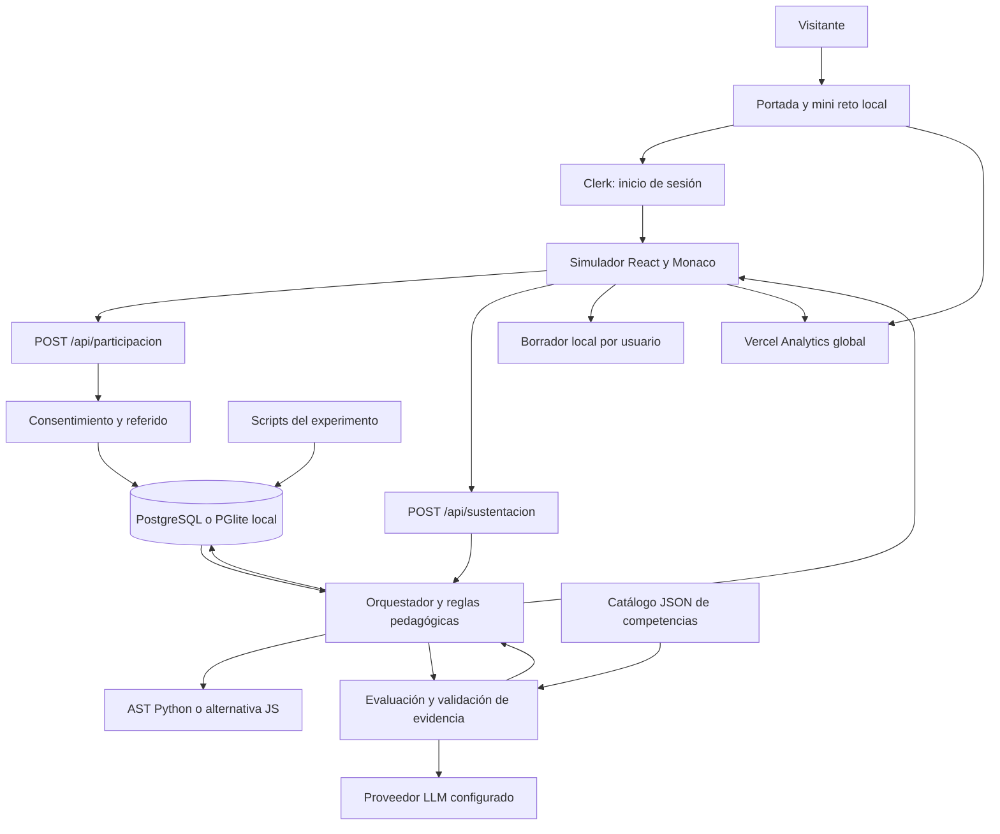
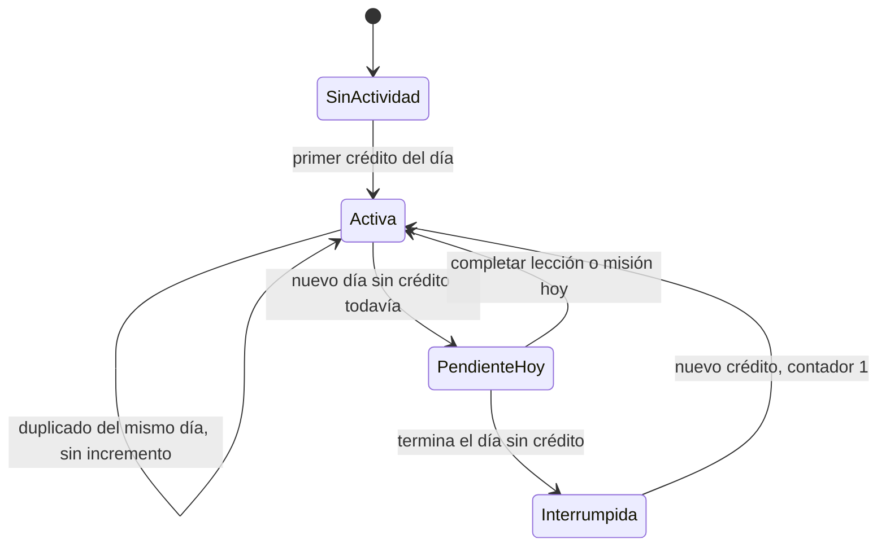
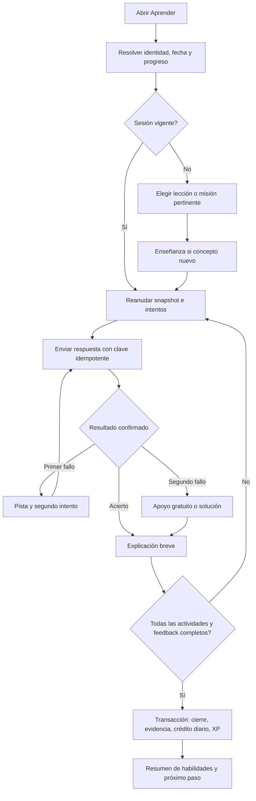
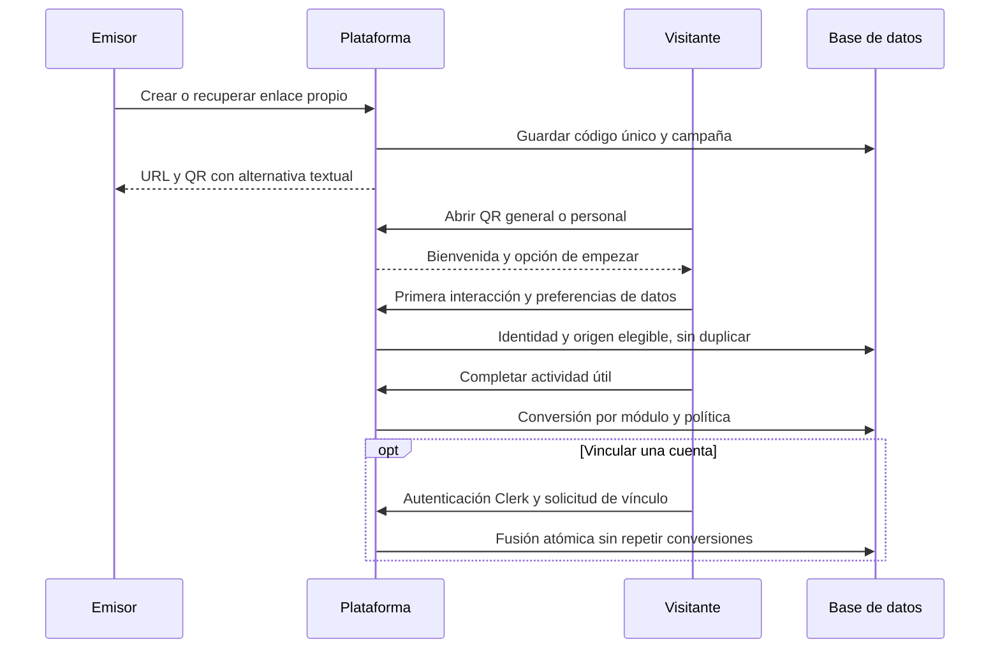
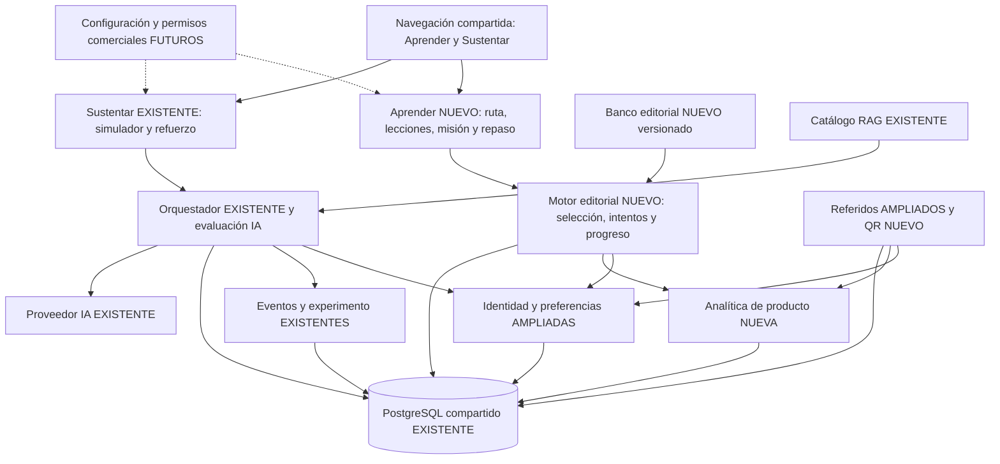
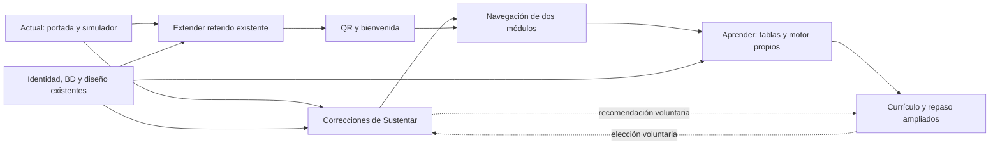

# Plan maestro de la siguiente iteración de PyDefense para ExpoAndes

**Estado:** investigación y especificación; ninguna implementación autorizada por este documento.  
**Fecha de consulta y cierre:** 17 de noviembre de 2026, America/Bogota.  
**Repositorio auditado:** `/home/melisamo2305/Escritorio/Landing_Grupo4`.  
**Commit de referencia:** `1dabb095723612ae7c3e63ff9acad7c5a46d5e66`.  
**Único entregable nuevo:** `docs/PLAN_ITERACION_PYDEFENSE_EXPOANDES.md`.

## Índice

1. [Resumen ejecutivo](#s01)
2. [Contexto, objetivos y alcance](#s02)
3. [Metodología y evidencia](#s03)
4. [Estado actual](#s04)
5. [Inventario y problemas](#s05)
6. [Feedback del profesor](#s06)
7. [Mercado y competidores](#s07)
8. [Diferenciación](#s08)
9. [Propuesta de valor y negocio](#s09)
10. [Aprender: diseño de producto](#s10)
11. [Preguntas, intentos, progreso y rachas](#s11)
12. [Premium y publicidad](#s12)
13. [Referidos y QR](#s13)
14. [Arquitectura y límites](#s14)
15. [Datos y contratos](#s15)
16. [UX/UI y recorridos](#s16)
17. [Especificaciones funcionales y no funcionales](#s17)
18. [Decisiones y alternativas](#s18)
19. [Pruebas y validación educativa](#s19)
20. [Métricas](#s20)
21. [Riesgos](#s21)
22. [Prioridades y fases](#s22)
23. [Backlog ejecutable](#s23)
24. [Aceptación y Definition of Done](#s24)
25. [Preparación para ExpoAndes](#s25)
26. [Pendientes](#s26)
27. [Referencias y trazabilidad](#s27)
28. [Continuación con Codex](#s28)

<a id="s01"></a>
## 1. Resumen ejecutivo

PyDefense puede evolucionar conservando su aplicación Next.js, Clerk y PostgreSQL/PGlite. La propuesta recomendada es **un monolito modular con dos productos independientes**: Aprender enseña mediante una ruta; Sustentar ayuda a explicar código propio. Identidad, preferencias, referidos y servicios técnicos pueden compartirse; sus reglas pedagógicas, sesiones y evidencias deben tener propietarios distintos. No es necesario introducir microservicios, otra base de datos ni reconstruir Sustentar.

**Hallazgos actuales [R/T]:** la práctica exige cuenta y consentimiento, plantea hasta tres preguntas seleccionadas por reglas del servidor, interpreta respuestas con IA, permite aclaraciones y reparación del feedback, y ofrece un refuerzo opcional. No ejecuta el programa del estudiante. Ya existen cinco temas de editor y códigos personales de invitación. No existen ruta curricular, misión diaria persistente, rachas, QR ni suscripciones. Las 92 competencias del catálogo no equivalen a 92 lecciones disponibles.

Hay dos prioridades anteriores a ampliar producto:

- **Aislamiento de cuentas:** una comprobación local confirmó que el mapa de operaciones en curso puede devolver la respuesta de una práctica ajena a otra cuenta cuando conoce sesión, revisión y carga y coincide en la misma instancia durante el envío. La consulta SQL normal sí verifica propiedad; el atajo en memoria ocurre antes. Debe corregirse antes de ampliar exposición.
- **Coherencia y pedagogía:** 98 de 99 pruebas existentes ejecutadas aprobaron. Una espera ocultar la pregunta antes de registrar confianza, mientras el código actual la muestra. El refuerzo tiene cuatro tareas fijas y no consulta historial entre prácticas; esto explica plausiblemente la repetición reportada. La calibración real de la IA todavía no está demostrada por las pruebas simuladas.

**Diseño recomendado [P]:** Aprender tendrá una ruta inicial de tres unidades, nueve microlecciones, tres interacciones principales y un banco editorial de 90 actividades. Cada microlección enseña, demuestra, guía y permite aplicar. La misión diaria de cinco actividades, con mezcla relativa 3 básicas + 2 de transferencia moderada, es una opción de repaso y consolidación; no sustituye la ruta. Una lección completa o una misión completa puede acreditar un día de práctica. Acierto, asistencia, dominio y constancia se registran por separado. Tras dos errores se ofrece apoyo gratuito y avance; no se vende el derecho a comprender ni se bloquea la racha detrás de anuncios.

**ExpoAndes [P/H]:** mínimo obligatorio = Sustentar confiable, bienvenida rápida, vista previa útil sin cuenta, enlaces y QR generales/personales, atribución verificable y métricas agregadas. Aprender completo es una ampliación condicionada por calendario y capacidad editorial, todavía desconocidos. Si no supera su puerta de calidad, se presenta como trabajo futuro; una vista previa o un quiz no se anunciarán como la plataforma curricular terminada. No se introducirán cobros, bloqueos comerciales ni redes publicitarias en la demostración.

**Mercado [E]:** Mimo, SoloLearn y otros ya combinan rutas, práctica y ayuda por IA. La diferenciación defendible es una hipótesis sobre explicación contextualizada de código universitario en español y calidad pedagógica verificable, no la ausencia de competidores. Las fuentes comerciales muestran cambios recientes: incluso la estructura de planes de Duolingo está en transición. Precios observados no prueban disposición a pagar local.

**Incertidumbres principales:** fecha y aforo de ExpoAndes, disponibilidad del equipo y de revisores docentes, estado del experimento académico activo, proveedor y cuotas reales, rendimiento de producción, aprobación de visitantes menores, y mejoras de aprendizaje y retorno con estudiantes. Ninguna métrica de negocio o aprendizaje se presenta como ya obtenida.

<a id="s02"></a>
## 2. Contexto, objetivos y alcance

### 2.1. Decisiones del propietario del producto [O]

1. Esta etapa solo investiga y crea este Markdown; no cambia aplicación, configuración, dependencias, esquemas ni despliegues; no realiza commits ni push.
2. Aprender y Sustentar deben aportar valor por separado. No se exige completar uno para utilizar el otro.
3. Aprender debe enseñar de forma progresiva: microlecciones, currículo, práctica, feedback, repaso y hábito. Cinco preguntas son una hipótesis de misión, no una definición del producto.
4. Se deben atender las observaciones del profesor, preparar adquisición por QR y evaluar sostenibilidad futura.
5. ExpoAndes debe permitir demostrar las capacidades existentes sin bloqueos comerciales.

### 2.2. Objetivos de la próxima implementación [P]

- Reducir confusión entre resultado pedagógico, análisis estático e interpretación del modelo.
- Evitar falsos déficits por redacción alternativa y exigir evidencia al señalar errores.
- Dar primera experiencia de valor desde móvil y QR sin registro previo para el contenido editorial.
- Conservar prácticas actuales, datos y contratos durante la introducción de Aprender.
- Medir transferencia a problemas nuevos, no equiparar puntos o rachas con aprendizaje.
- Poder apagar Aprender, referidos o promociones sin impedir Sustentar.

No se incluyen en el primer alcance ejecución libre de Python, voz, videollamadas, rankings, economía de monedas, certificaciones de dominio, notificaciones comerciales, publicidad real, pagos ni más lenguajes. La defensa oral es una posible evolución: actualmente solo hay respuestas escritas.

### 2.3. Dos alcances para ExpoAndes

| Alcance | Compromiso recomendado | Qué se puede afirmar públicamente |
|---|---|---|
| Mínimo A+B | Correcciones críticas, Sustentar, bienvenida con ejemplo editorial, QR, atribución y reporte agregado | “Practica explicar tu código” y “Prueba una actividad de aprendizaje” |
| Ampliación C | Tres unidades, nueve lecciones, misión, repaso, progreso y racha persistentes; solo si pasan criterios | “Comienza una ruta de Python y continúa mañana” |
| D opcional | Pantalla de concepto premium y demostración de recuperación expresamente simulada | “Estamos explorando estas opciones”; ninguna suscripción activa |
| E posterior | Currículo intermedio, adaptación más fina, transferencias abiertas y monetización validada | No prometer fechas o funciones aún inexistentes |

La fecha del evento no fue aportada. No se presupone que sea inminente ni se fija una fecha inventada. La selección de alcance se hará en función del tiempo disponible, con A+B como prioridad y C como unidad coherente de producto.

<a id="s03"></a>
## 3. Metodología de investigación y auditoría

### 3.1. Convenciones de evidencia

| Marca | Significado | Límite |
|---|---|---|
| **[O]** | Decisión explícita del propietario en la solicitud | No equivale a implementación |
| **[R]** | Hecho encontrado en código/documentación del commit auditado | Lectura no acredita producción ni resultado visual |
| **[T]** | Comprobado ejecutando pruebas locales aisladas | IA y autenticación simuladas; no usuarios reales |
| **[F]** | Observación del profesor transcrita en la solicitud | Sin capturas originales, sesión, versión ni logs disponibles |
| **[E]** | Fuente externa consultada | Producto declarado o resultado de estudio, con alcance propio |
| **[I]** | Inferencia técnica o de experiencia | Debe confirmarse con instrumentación o uso real |
| **[P]** | Propuesta recomendada por Codex | Toda ruta, entidad o archivo nuevo se entiende propuesto |
| **[H]** | Hipótesis pendiente de validación | No se comunica como resultado |

Las secciones de diseño 9–26 son propuestas salvo marcas explícitas. Los valores de latencia, cohortes, precios de PyDefense, volumen editorial e intervalos de repaso son objetivos/hipótesis, no datos observados. Las citas del profesor son las reproducidas por el propietario; no se le atribuyen los hallazgos nuevos.

### 3.2. Procedimiento realizado

Se leyó la solicitud completa por bloques; se revisaron árbol, `package.json`, documentación, rutas API, componentes, analizador, catálogo, evaluación, persistencia, medición y pruebas. No se encontraron instrucciones `AGENTS.md` en el proyecto ni sus ancestros inspeccionados. Se consultaron páginas oficiales de competidores, publicaciones académicas y documentación técnica. Se ejecutaron las suites existentes con sus dobles de IA y almacenamiento de prueba y una comprobación puntual de concurrencia con datos sintéticos.

`git status --short` estaba vacío al comenzar. No se leyó el contenido de `.env`, no se usaron credenciales del README, no se consultó la base real ni se llamó al proveedor. No se instalaron paquetes ni se ejecutaron build, servidor de desarrollo, migraciones operativas o despliegues. Las suites inicializan su **esquema de prueba existente en PGlite efímero**; no se creó una migración nueva ni se migró el almacén de la aplicación. Sus temporales y las salidas de auditoría se limitaron a `/tmp`. Al cierre, `git status --short` mostró únicamente `?? docs/PLAN_ITERACION_PYDEFENSE_EXPOANDES.md`; `git diff --name-only` no mostró cambios en archivos ya versionados.

Se inspeccionó el código fuente de todas las pantallas y estados relevantes. **No hubo validación visual en navegador ni medición de contraste, lector de pantalla o rendimiento.** Por ello, los hallazgos visuales son revisión heurística del marcado/CSS, no una certificación UX. No se ejecutó `test:recorrido`: necesita build y no cubre la práctica autenticada real. No se ejecutaron `test:postgres`, `test:proveedor` ni comandos del experimento contra infraestructura. `tests/migracion.tmp.cjs` se leyó, pero no forma parte de `npm test` y no se contabiliza.

### 3.3. Resultado reproducible de pruebas [T]

Entorno observado: Node `v24.13.0`, Python `3.12.3`; dependencias ya disponibles. `npm test` ejecutó RAG y adaptación y se detuvo por el fallo de adaptación. Las cinco suites restantes se ejecutaron directamente con `node --experimental-vm-modules tests/<suite>.test.cjs`, sin modificar pruebas.

| Suite | Casos ejecutados | Aprobados | Fallidos |
|---|---:|---:|---:|
| RAG | 7 | 7 | 0 |
| Adaptativo | 24 | 23 | 1 |
| Pedagogía | 16 | 16 | 0 |
| Interfaz | 9 | 9 | 0 |
| Estabilidad | 22 | 22 | 0 |
| Persistencia | 10 | 10 | 0 |
| Medición | 11 | 11 | 0 |
| **Total, sin duplicar casos** | **99** | **98** | **1** |

Fallo: `tests/adaptativo.test.cjs:50`, aserción en línea 55, espera `pregunta === null` en fase `confianza`; `vista()` de `lib/sustentacion.js` devuelve la primera pregunta. No se corrigió. El resto del caso tras esa aserción no se alcanzó; aprobar otros casos no permite darlo por validado. Las pruebas de interfaz contienen tanto renderizado estático como búsquedas de cadenas; no reemplazan pruebas de interacción en navegador.

Comprobación adicional, **fuera del recuento de 99**: dos identidades ficticias, mismo proceso, transporte del tutor retenido, mismo UUID/revisión/carga. Mientras A esperaba el tutor, B envió el mismo paso; después se resolvió el doble. Ambos recibieron respuesta exitosa; B recibió la sesión y el código de A. Resultado local observado: `otroRecibioSesion=true`, `otroRecibioCodigo=true`. Precondiciones y solución se documentan en S-01. No acredita explotación remota ni acceso a sesiones sin conocer su identificador.

### 3.4. Documentación histórica

`docs/AUDITORIA_ESTABILIDAD.md` y `docs/auditoria-estrategica/Auditoria_Estrategica_PyDefense.tex` aportan contexto, pero corresponden a versiones anteriores. No se importaron sus “72 pruebas aprobadas”, versiones antiguas de Next, ausencia histórica de autenticación o resultados de entrevistas como resultados actuales. Hay divergencias concretas: el arriendo actual es 90 s, no 120 s; una cita no localizada queda no verificable, no se limita simplemente a nivel 1; los secretos pueden generarse en BD aunque el README los presenta como obligatorios. El experimento de retorno espontáneo descrito históricamente sí tiene soporte actual, pero su estado desplegado no fue consultado.

<a id="s04"></a>
## 4. Estado actual de PyDefense

### 4.1. Estructura y tecnologías [R]

| Área / archivos reales | Responsabilidad e interacción |
|---|---|
| `app/layout.jsx`, `proxy.js` | `ClerkProvider`, navegación, limpieza local, captura de referido y Vercel Analytics. Middleware pone sesión a disposición; cada API decide autorización. |
| `app/page.jsx`, `app/components/landing-*` | Portada de Sustentar, explicación, comparación interactiva, mini reto local y diálogo de ejemplo. CSS Modules y Tailwind. |
| `app/simulador/page.jsx` | Cliente de 508 líneas con estado React local, editor, consentimiento, confianza, pregunta, feedback, cierre, refuerzo y recuperación. |
| `app/simulador/components.jsx`, `ux.jsx`, `compartir.jsx` | Feedback, resumen, revisión de refuerzo; progreso, código resaltado, exportación; compartir con Web Share/portapapeles/enlace manual. |
| `app/api/sustentacion/route.js` | POST autenticado al orquestador; cuerpo limitado, errores controlados y `no-store`. |
| `app/api/participacion/route.js` | POST autenticado: estado, consentimiento, retiro y código de referido. |
| `app/api/generar-preguntas/route.js`, `evaluar-respuestas/route.js` | Contratos heredados por lotes, no consumidos por la interfaz actual. Generación/evaluación con IA y nota en el contrato heredado. |
| `lib/sustentacion.js`, `pedagogia.js`, `temas.js`, `perfil.js` | Máquina de estados, selección determinista de preguntas, diagnóstico cualitativo, política introductoria, fragmentación. |
| `lib/evaluacion.js`, `contratos-ia.js`, `afirmaciones.js`, `llm.js` | Evaluación, citas localizadas, esquema JSON, guardas estáticas acotadas y llamada compatible con Chat Completions. |
| `lib/python-static.js`, `.py`, `python-fallback.js` | AST en proceso Python fijo o reconocimiento conservador JS. Nunca ejecución del código aportado. |
| `knowledge/python/nivel_1.json` … `nivel_8.json`, `knowledge/schema.json`, `knowledge/evaluacion/rubrica_general.json`, `lib/knowledge.js` | 92 registros de competencias; recuperación heurística por señales, hasta cinco seleccionados; no vector DB ni curso de ocho niveles implementado. |
| `lib/db.js`, `esquema.js`, `almacen.js`, `secretos.js`, `huellas.js` | PostgreSQL/PGlite, esquema v2, transacciones, cifrado AES-GCM, HMAC y deduplicación. |
| `lib/participacion.js`, `consentimiento.js`, `referidos.js` | Identidad interna ligada a Clerk, consentimiento, borrado y atribución básica. |
| `lib/medicion.js`, `experimento.js`, `manifiesto.js`, `scripts/experimento.cjs` | Protocolo de retorno, versiones congeladas, cohorte, incidencias, adjudicación de novedad y exportación operativa. |
| `tests/`, `scripts/comprobar-proveedor.cjs` | Suites Node/VM y dobles; prueba opcional Chromium; verificación real del proveedor separada. |
| `public/config.png`, `public/cargando.gif` | Recursos locales; el GIF se usa en cargas. |

Versiones **declaradas**, no auditoría de seguridad del árbol resuelto: Next `16.4.3`; React/React DOM `^19.3.1`; Clerk `^7.9.22`; Monaco React `^4.7.0`; `pg ^8.23.1`; PGlite `^0.5.13`; Vercel Analytics `^2.0.1`; Lucide `^1.64.0`; Tailwind `^3.4.19`; PostCSS `^8.5.32`; Autoprefixer `^10.6.2`; override DOMPurify `3.4.17`. Lenguaje JavaScript/JSX; Python para el analizador. No Redux, ORM ni framework de tests de navegador agregado en `package.json`. No se observaron pipelines de CI en los archivos del repositorio inspeccionados.

### 4.2. Flujo de información actual



La primera pregunta viene de `primeraPregunta()`. `siguientePregunta()` filtra candidatos por conceptos presentes y permitidos, excluye expuestos dentro de esa práctica y prioriza estados cualitativos. El LLM no genera esas preguntas en el flujo actual. Interpreta texto y refuerzo mediante `evaluarRespuesta()` y `evaluarPractica()`; el servidor valida formato, IDs, citas y algunas contradicciones, arma feedback y confirma la transición junto a eventos.

Estados de Sustentar: `confianza → pregunta → feedback → confianza… → cierre → refuerzo → refuerzo_revisado`. Máximo tres registros de preguntas, un reemplazo por tema no visto, hasta dos aclaraciones por pregunta y una reparación por feedback. Omitir no es un error. El cierre es opcional tras feedback; no exige refuerzo. Tras entregar refuerzo, la interfaz no ofrece corregir y reenviar en la misma práctica.

### 4.3. Datos, identidad y persistencia

- Toda práctica exige Clerk; no hay identidad anónima persistente de producto. La vista previa es local y la captura de `ref` usa `sessionStorage`.
- `usuarios.clerk_id` es único. `leerFila()` incorpora usuario propietario en SQL. **Excepción confirmada:** el mapa `enCurso` no incluye usuario y se consulta antes de esa lectura.
- Sesiones, revisiones, operaciones, eventos y cuotas son compartidos en BD. `DATABASE_URL` activa `pg`; sin ella se usa PGlite local; en Vercel sin URL se rechaza configuración. No usar PGlite de disco como almacenamiento distribuido.
- Contenido cifrado de la práctica en `contenidos_sesion`; metadatos en `sesiones`, `artefactos`, `tareas`, `eventos`. Una transacción guarda revisión, contenido y eventos. Una operación usa arriendo de 90 s y digest; llamadas IA fuera de transacciones largas. Una caída tras llamar a IA y antes de guardar puede repetir coste al reintentar.
- **Dos plazos diferentes:** práctica activa durante dos horas desde inicio; contenido accesible durante 24 h desde actividad guardada. La eliminación física es oportunista en lotes de 50 y también operativa, no un borrado automático exacto a las 24 h.
- Borrador `pydefense-v4:<userId>` en `localStorage` con código, respuesta, refuerzo, temas, tema del editor e ID de sesión; no cifrado por la app. Caducidad comprobada al recuperar. `LimpiezaLocal` limpia otras claves `pydefense-*` al cambiar identidad; esto debe acotarse antes de crear preferencias/estado anónimo nuevos.
- `retirar` borra usuario y cascadas de prácticas/eventos; conserva una fila de participante desvinculada. No borra la cuenta Clerk. Los IDs de invitadores dentro de JSON de eventos de otras cuentas no se eliminan automáticamente por esa cascada [I/R]; se requiere política explícita.

### 4.4. IA, seguridad, errores y operaciones

`LLM_BASE_URL`/`MODEL`/`API_KEY` configuran un cliente HTTP, no un proveedor demostrado en producción. Timeout 45 s; cliente 55 s; ruta actual declara máximo 60 s. `response_format=auto` usa esquema estricto con la combinación Groq GPT-OSS reconocida; otros reciben esquema en instrucciones y validación local. Se conservan tokens/latencia cuando el proveedor los comunica. Errores de JSON, truncamiento, negativa, red y cuota se distinguen. No hay reintento automático indiscriminado.

Las cuotas compartidas son por día UTC, por defecto 40 llamadas por usuario y 600 globales. **No son una suscripción ni la futura racha.** El endpoint recibe máximo 350000 bytes; código actual 12000 caracteres, respuesta 4000; archivo local hasta 200 KiB y 12000 caracteres. El analizador Python ejecuta un script fijo con `-I -S`, timeout 3 s y salida limitada; procesa AST, no imports o funciones del estudiante. El fallback no demuestra sintaxis válida. Un reconocedor de `costo_envio` admite una demostración estática acotada; no es un sandbox general.

`http.js` devuelve códigos, mensajes y referencia sin divulgar SQL o texto; `Retry-After` se comparte tras 429. Los prompts tratan código/respuestas como datos y validan salida, pero eso no elimina errores semánticos ni inyección. `.env.example` repite variables LLM en un bloque Groq y otro Gemini: no se puede inferir cuál es efectivo desde la plantilla y debe unificarse en una implementación posterior.

`secretos.js` puede generar una clave en la misma BD si no se configura secreto de entorno. Eso facilita arranque pero reduce la protección ante extracción conjunta de BD y clave; preferir secreto externo y rotación diseñada. No se han rotado secretos. La muestra de cuenta de prueba del README es documentación, no evidencia de accesibilidad o seguridad del despliegue.

Vercel Analytics está montado globalmente, mientras los eventos de investigación se registran tras consentimiento. La declaración “solo registramos después de consentir” no describe por sí sola todos los proveedores. Debe inventariarse qué se transmite realmente y ajustar la comunicación, sin presumir incumplimiento legal. La documentación oficial permite configurar exclusiones de datos en analítica; verificar la configuración efectiva [E19: Vercel: privacidad de Web Analytics](https://vercel.com/docs/analytics/privacy-policy); [E19: uso y datos visibles](https://vercel.com/docs/analytics/using-web-analytics).

<a id="s05"></a>
## 5. Inventario de funcionalidades y problemas

Estado “implementado” describe código presente. “T” refiere a pruebas aisladas de §3; “R” solo lectura. En todos los casos el comportamiento de producción queda sin verificar.

| ID / objetivo y flujo | Archivos / reglas / dependencias | Esperado frente a comprobado | Problema y recomendación |
|---|---|---|---|
| I01 Descubrir valor: portada → ejemplo → práctica | `app/page.jsx`, `landing-interactions.jsx`, `landing-showcase.jsx`; React, CSS Modules | R: mini reto con respuesta fija y modal sin envío; T: contratos parciales de portada | Mantener; separar “vista previa” de práctica real y agregar dos entradas cuando exista Aprender. |
| I02 Entrar y consentir | `layout.jsx`, `proxy.js`, APIs, `participacion.js`, `consentimiento.js`; Clerk | T: 401 antes de almacenamiento y consentimiento para iniciar; no login real probado | Mantener para código propio; añadir acceso editorial anónimo separado, renovar alcance del consentimiento. |
| I03 Aportar código | `page.jsx`, `archivo-python.js`; pegar, subir `.py`, arrastrar, ejemplo | T: lectura y límites; R: editor con cinco temas y fallback | Ampliar preferencias; medir carga móvil, no introducir otro editor. |
| I04 Declarar temas | `temas.js`, `page.jsx`; opcional, no seguro = básico; ausente = introductorio presente | T: pertinencia y exclusión avanzada | Mantener; arreglar semántica del radio que se desmarca por clic, probar teclado. |
| I05 Iniciar práctica | `sustentacion.iniciar`, analizador, huellas, BD; UUID idempotente | T: límites, AST, concurrencia y rechazo sintaxis; caso confianza falla | Mantener; corregir aislamiento y decidir contrato de confianza antes de congelar estudio. |
| I06 Responder y recibir feedback | `evaluacion.js`, `contratos-ia.js`, `afirmaciones.js`, LLM/RAG | T: estructura y guardas con dobles; no precisión semántica real | Modificar presentación/calibración, sin retirar evidencia ni regalar aciertos. |
| I07 Adaptar y omitir | `pedagogia.siguientePregunta`, `sustentacion.aplicar`; tres preguntas, un reemplazo | T: estados, cierre y omisiones | Mantener; historial intersesión para diversidad solo donde proceda. |
| I08 Aclarar/reparar | `aclarar`, `reparar`, `revisarAfirmacionesTutor`; dos aclaraciones, una reparación | T: versiones, citas y fallos simulados | Mantener; distinguir cambio de redacción de revisión de contenido; texto “revisar feedback”. |
| I09 Resumir/exportar | `resumir`, `Resumen`, `GuardarResumen`; evidencia y siguiente paso | T: HTML y texto generado; no descarga/clipboard en navegador | Mantener; historial descargable no equivale a historial permanente de cuenta. |
| I10 Practicar refuerzo | `TAREAS`, `elegirRefuerzo`, `evaluarPractica`, `EvaluacionRefuerzo` | R: cuatro tareas fijas; T: alternativas, firma, casos razonados y no ejecución | Ampliar banco e historial; destacar ejemplo y acción; admitir corrección posterior con revisión versionada. |
| I11 Recuperar y gestionar errores | `page.enviar`, `http.js`, BD y leases | T: revisiones, expiración, cuotas y fallos; recuperación de cuenta simulada | Mantener; explicar dos plazos; conflictos concurrentes recuperan estado, no borran borrador. |
| I12 Compartir y atribuir | `compartir.jsx`, `captura-referido.jsx`, `referidos.js` | R: HMAC 16 caracteres, emisión deduplicada y primer referido guardado; pruebas de share parciales | Ampliar; falta QR, visita atribuida completa y reporte. Clic temprano puede compartir sin código. |
| I13 Retirarse | `participacion.retirar`, FK en `esquema.js`, limpieza local | T: cascadas básicas y censura de estudio | Mantener con alcance claro; resolver vínculo de invitador en eventos ajenos y cuenta Clerk separada. |
| I14 Medir estudio | `medicion`, `experimento`, `manifiesto`, script operador | T: cohorte, ventana 168 h, novedad y decisión con datos sintéticos | Preservar protocolo histórico; nuevo experimento para gamificación. Sin panel administrativo web actual. |
| I15 APIs heredadas | `generar-preguntas`, `evaluar-respuestas`, `legado`, `calcularEvaluacion` | T: auth/cuota/cuerpo; contrato todavía devuelve puntaje | Conservar compatibilidad inicialmente; inventariar consumidores y luego deprecar, no usarlas para Aprender. |
| I16 Perfil y monetización | Usuario/temas existen; no ruta, racha ni facturación | R: ausencia de modelo/flujo correspondiente | Crear solo tras aprobación de implementación; no anunciar funciones ausentes. |

### 5.1. Hallazgos transversales priorizados

| Hallazgo | Evidencia y prioridad | Corrección concreta y aceptación |
|---|---|---|
| H01 Atajo concurrente entre cuentas | T; **P0** | Autorizar antes de deduplicar y/o incluir propietario en clave; B nunca recibe datos de A, con misma instancia, otra instancia, mismo y distinto digest. |
| H02 Confianza: prueba/contrato/experimento divergentes | R/T; P1 | Decidir confianza después de leer consigna y antes de responder para nueva UX; si hay experimento abierto conservar tratamiento hasta cierre. Versionar y actualizar pruebas que representan intención aprobada. |
| H03 Refuerzo repetido | R + F; P1 | Seleccionar por familia/habilidad e historial, variantes semánticas y política de agotamiento; mismo perfil en cuatro sesiones obtiene diversidad disponible. |
| H04 Jerarquía técnica y ejemplos ocultos | R + F; P1 | Resumen, evidencia y siguiente acción primero; un caso visible; detalles técnicos expandibles. Advertencia crítica al lado de la afirmación afectada. |
| H05 Evaluador no calibrado externamente | R/T + F; P1 | Corpus docente y repetición por paráfrasis; distinguir error del alumno de resultado inválido del tutor. |
| H06 Consentimiento dice “no premios/recordatorios” | R; P1 | Separar estudio actual y producto recurrente; consentimiento versionado; no contaminar ventanas abiertas con rachas. |
| H07 Retención comunicada como borrado exacto | R; P1 | Invalidar acceso a 24 h y purga programada verificable; describir borrador local y metadatos con plazos distintos. |
| H08 Referido parcial y captura sobrescribible | R; P1 | Persistencia de primer toque válida, ventana y códigos registrados, sin asumir que copiar equivale a enviar. |
| H09 Borrado de vínculo JSON de terceros | R/I; P1 | Buscar y anonimizar referencias al invitador retirado; sustituir eventos como registro principal por FK apropiadas. |
| H10 Observabilidad incompleta de primer visitante | R; P2 | Eventos de llegada/valor versionados y respetando opciones de medición; separar bots y vistas de personas. |
| H11 Preferencias atadas a borrador de 24 h | R; P2 | Tema, tamaño y modo sencillo persistentes; no limpiar con claves genéricas de borradores. |
| H12 Móvil, carga y contraste sin medición | I; P1 antes de exposición | Probar 320–1440 px, teclado y lector, red limitada, GIF/movimiento reducido; documentar resultados reales. |
| H13 Plantilla de entorno ambigua | R; P1 | Una fuente clara por variable, preflight con nombres sin secretos y proveedor efectivo aprobado; no cambiar ahora. |
| H14 Resumen “Identificaste…” atribuye diagnóstico a alumno | R/I; P2 | “Conviene repasar…” cuando la observación viene del tutor; preservar autoría de evidencia. |

<a id="s06"></a>
## 6. Evaluación del feedback del profesor

### 6.1. Primero el resultado

[F] El profesor perdió el hilo por advertencias antes del feedback. [R] `EvaluacionRefuerzo` presenta estado, controles estructurales, interpretación y luego casos en `details`; la limitación aparece antes de `cierre`. `Retroalimentacion` también antepone algunos avisos/correcciones. No todos son ruido: una rectificación factual debe mantenerse visible.

[P] Primer bloque: **qué se observó**, un acierto si existe, un problema concreto si existe, una acción recomendada y etiqueta breve del método (“Revisión por IA; código no ejecutado”). Segundo bloque visible: un ejemplo que ilustre el problema, con entrada, salida esperada y explicación estimada. Después: “Ver todas las observaciones”, “Cómo se revisó” y versiones. Si el código es sintácticamente inválido, falta contexto o se retiró una afirmación errónea, esa limitación va junto al resultado y prevalece sobre un texto de éxito. No usar “funciona” para una presencia de `return`.

Aceptación: en 390 px se puede identificar resultado y siguiente acción sin abrir detalles; no hace falta ocultar información crítica para lograrlo. Un docente puede distinguir método y alcance con una sola lectura. Las pruebas de render deben verificar orden semántico, además de presencia de frases.

### 6.2. Rigor y equivalencias semánticas

[F] Necesitó respuestas muy específicas. [R] Los prompts actuales ya piden aceptar equivalencias; la pregunta inicial exige propósito, entradas y estrategia, lo que puede ser más amplio de lo que el alumno interpreta. `localizarCita()` normaliza prosa; no es una comparación con respuesta modelo. El modelo asigna niveles 0–2 por criterio y el servidor los convierte a categorías. Guardas rechazan estructuras inconsistentes, no prueban que todo juicio sea correcto. El catálogo heredado usa pesos 0.40/0.35/0.25 y puntaje, pero no gobierna la UI secuencial actual.

[P] Modelo recomendado, con dos ejes: **cobertura de lo solicitado** y **validez conceptual**. Evita llamar “error conceptual” a una simple omisión.

| Categoría presentada | Regla propuesta | Feedback y siguiente acción |
|---|---|---|
| Comprensión correcta | Criterios aplicables completos, evidencia localizada y sin afirmaciones falsas relevantes | Reconocer explicación con sus propias palabras; variar contexto para confirmar transferencia. |
| Parcialmente correcta | Idea pertinente correcta y alguna relación poco desarrollada; sin contradicción grave | Señalar la relación concreta que falta; pedir ejemplo o causa. |
| Respuesta incompleta | Lo dicho puede ser correcto, pero falta una parte solicitada | Identificar esa parte, no exigir términos exactos ni requisitos ajenos. |
| Error conceptual | Afirmación específica contradice código/hecho y se puede explicar la contradicción | Citar la frase, aportar contraejemplo y orientar corrección. |
| Evidencia insuficiente | Respuesta evasiva, ambigua, cita no localizada o contexto insuficiente | No inferir incapacidad; pedir aclaración acotada o permitir continuar. |

“Parcial” e “incompleta” pueden coexistir internamente; se elige un mensaje principal y se conservan ambos ejes. No se agrega automáticamente una nueva llamada al modelo a todas las respuestas. La aclaración sigue siendo solicitada y acotada; la señal `trasFeedback` evita contar una reformulación posterior como dominio independiente. Una equivocación técnica fuera de la consigna pero pertinente puede señalarse, separada del cumplimiento de la consigna. No penalizar longitud, acento, vocabulario informal o falta de comentarios en código cuando no se solicitaron.

Ejemplo de calibración: para `return precio * cantidad`, “multiplica lo que vale cada unidad por cuántas compré” debe demostrar lo mismo que “producto del precio unitario por la cantidad”. “Suma precio y cantidad” es conceptual; “devuelve el total” es incompleto respecto a la operación, no necesariamente falso. Validar con docentes antes de modificar prompts o umbrales. Ver corpus y puertas de calidad en §19.

### 6.3. Refuerzo repetido y agotamiento

[R] `TAREAS` contiene `costo_envio`, `contar_pendientes`, `total_compra`, `promedio_lecturas`. `elegirRefuerzo(diagnostico, politica)` selecciona por estado y concepto; no recibe usuario ni historial. `siguientePregunta()` sí evita repetición **dentro** de una práctica, pero eso no cubre refuerzos entre sesiones. [I] Repetir diagnóstico lleva a repetir tarea de manera previsible; no hay evidencia para atribuirlo a un generador aleatorio defectuoso.

[P] Banco propio de Sustentar: mínimo tres variantes semánticas por familia disponible antes de anunciar variedad; `familia_id`, `version`, objetivo, contrato, nivel relativo, variantes y casos revisados. Guardar exposiciones con usuario, familia, versión y fecha sin código. Selección: necesidad pedagógica → temas permitidos → no vistos recientes → menor exposición → desempate estable. Excluir misma variante durante siete días, salvo repaso solicitado; cambiar contexto y operación relevante, no solo constantes. Si no hay variante pertinente, explicar “Ya practicaste los refuerzos disponibles para esta idea. Puedes repetir uno o volver a tu programa”; nunca simular novedad. El historial y contenidos pertenecen a Sustentar aunque Aprender esté apagado.

### 6.4. Tipos de evidencia en la interfaz

| Tipo | Etiqueta y ubicación propuesta | Qué permite afirmar |
|---|---|---|
| Ejemplo del enunciado | “Ejemplo: se espera…” antes de entregar | Especificación; no resultado del código del alumno. |
| Caso sugerido | “Caso para revisar” con entrada y motivo | Prueba pendiente, no aprobada. |
| Interpretación IA | “Según la revisión por IA…” junto al caso | Estimación, susceptible de error. |
| AST | “Estructura comprobada” en detalle; fallo crítico visible | Sintaxis, firma o presencia de nodos, según analizador. |
| Demostración acotada | “Verificado estáticamente bajo estas entradas válidas” | Solo el contrato y patrón reconocidos; sin ejecución. |
| Prueba ejecutada | Solo si existe futura evidencia de ejecución identificada | Entrada, salida real, runner y versión; actualmente nunca disponible. |
| No verificado | Visible en el punto afectado | Sin crédito ni penalización por ese juicio. |

### 6.5. Editor y flujo del simulador

[F] Se sugirió personalizar tema. [R] Ya existe selector `vs-dark`, `vs`, `hc-black`, Dracula y Monokai; tema se guarda en borrador, fuente fija en 15 px, modo sencillo no persistente. [P] Mejorar descubrimiento, persistir preferencias aparte y ofrecer 14/16/18/20 px con vista previa. Mantener Monaco y textarea. La API oficial soporta fuente y accesibilidad; no se justifica añadir editor [E20: Monaco: opciones del editor](https://microsoft.github.io/monaco-editor/typedoc/interfaces/editor_editor_api.editor.IStandaloneEditorConstructionOptions.html); [E20: guía de accesibilidad](https://github.com/microsoft/monaco-editor/wiki/Monaco-Editor-Accessibility-Guide). Validar contraste de cada tema, incluido comentario, selección y foco; no declarar accesibilidad por tener “alto contraste”.

[R] El diálogo de portada dice correctamente que el texto no se envía ni evalúa; es una textarea sin envío. En la práctica autenticada sí se envían y almacenan respuestas. [P] Rotular el primero “Vista previa sin evaluación”; acción “Iniciar práctica con retroalimentación”. El mini reto local explica una opción, pero no es el módulo Aprender. Mantener hasta tres preguntas y cierre opcional en Sustentar; explicar cantidad antes de iniciar y ofrecer resumen al terminar.

### 6.6. Inventario de microcopy [P]

| Texto actual / procedencia real | Texto propuesto | Razón |
|---|---|---|
| “Cerrar con lo que descubriste” — `page.jsx` | “Terminar y ver resumen” | Explicita acción y destino. |
| “un cierre con lo que descubriste” — `ExampleQuestion` | “un resumen de lo que explicaste y de lo que conviene repasar” | Describe el resultado. |
| “Probar el simulador” — diálogo | “Iniciar práctica con retroalimentación” | Distingue demostración local del flujo con IA. |
| “Este espacio es para practicar; tu respuesta no se envía ni se evalúa.” — diálogo | “Vista previa: puedes escribir aquí, pero no guardamos ni evaluamos este texto.” | Conserva la verdad y acota el ámbito. |
| “Puedes pedir una reparación por pregunta” — `page.jsx` | “Puedes pedir una revisión de esta retroalimentación una vez.” | Evita lenguaje técnico. |
| “Comprobaciones verificables de estructura” — `EvaluacionRefuerzo` | “Qué comprobamos en la estructura del código” | Lenguaje accesible en bloque secundario. |
| “Razonamiento sobre ejemplos y casos adicionales (IA)” | “Revisar un ejemplo paso a paso · interpretación por IA” | Hace visible el valor y el método. |
| “Identificaste que necesitas repasar” — `Resumen` | “Conviene repasar” | No atribuye al estudiante una conclusión del tutor. |
| “Solo se pide una vez. Esta prueba registra tus usos durante siete días” | “Revisa cómo usamos tus datos para esta práctica. El estudio del curso tiene condiciones separadas.” | El alcance debe reflejar consentimiento aprobado, no prometer aceptación única permanente. |
| “se borran 24 horas después…” — privacidad | “El contenido deja de estar disponible a las 24 h de la última actividad guardada. Consulta los plazos de borrado y del borrador local.” | Mientras no exista purga puntual verificada, evitar garantía falsa. |
| “No cuenta para el estudio” — ejemplo | “Programa de ejemplo. Puedes reemplazarlo por el tuyo.” + detalle del estudio si aplica | No cargar al visitante con investigación irrelevante. |
| “Practicar” — cabecera | “Sustentar”; añadir “Aprender” al habilitar C | Dos destinos inequívocos. |
| “Enlace copiado…” — compartir | Mantener, añadir “Tu enlace personal” solo si incluye código válido | No afirmar atribución cuando falló la emisión. |

La valoración favorable del profesor se conserva como señal cualitativa, no como prueba de eficacia general. La validación debe incluir principiantes absolutos, estudiantes con algo de Python y usuarios de IA, con errores, respuestas breves y distintos modos de acceso.

<a id="s07"></a>
## 7. Investigación de mercado y matriz de competidores

### 7.1. Alcance y calidad de la comparación

Consulta web del 17-11-2026. Las páginas oficiales verifican **oferta declarada**, no usabilidad experimentada ni eficacia independiente. No se compraron planes, no se crearon cuentas y no se midieron sesiones. “ND” significa no determinado en las fuentes consultadas, nunca que la funcionalidad no exista. Duraciones no verificadas no se sustituyen por estimaciones presentadas como hechos. Los precios pueden variar por país, impuestos, plataforma y promociones; no se verificó un checkout colombiano.

Se distinguen competidores directos de microaprendizaje de programación (Mimo, SoloLearn), alternativas curriculares/profesionales (Codecademy, DataCamp), referentes de hábito o interacción (Duolingo, Brilliant), alternativas gratuitas de práctica/proyectos (Exercism, freeCodeCamp) y un referente adicional de aprendizaje con programas y juegos (Jiki). Un chat general con IA es sustituto para explicar código, aunque no fue sometido a una comparativa de calidad en esta auditoría.

### 7.2. Matriz educativa y de experiencia [E]

| Plataforma / público | Propuesta, formato y progresión declarados | Personalización / feedback | Sesión / hábito / incentivos observados | Implicación para PyDefense [I] |
|---|---|---|---|---|
| Duolingo; aprendizaje general, referente indirecto | Ruta de lecciones y práctica integrada [E01: Duolingo: ciencia del diseño de la ruta](https://blog.duolingo.com/new-duolingo-home-screen-design/) | Ordenación con repaso; feedback de ejercicios | Racha por lección diaria [E02: Duolingo: qué es una racha](https://www.duolingo.com/help/what-is-a-streak); duración exacta ND | Adoptar claridad del siguiente paso; no trasladar mecánicas lingüísticas sin evaluar transferencia a código. |
| Mimo; principiantes, competidor directo | Rutas de Python y desarrollo; lecciones interactivas y proyectos [E04: Mimo: planes web y móvil](https://mimo.org/pro) | Tutor IA y entornos de práctica según plan | Reparación mensual de racha listada; duración ND | Enseñar programación por móvil ya tiene oferta; diferenciar comprensión contextual. |
| SoloLearn; principiantes, directo | Cursos, práctica, playground y comunidad [E05: SoloLearn: planes y precios](https://www.sololearn.com/en/plans) | MAX añade explicación de respuesta y errores con IA | Corazones y práctica para recuperación; racha/duración ND en página consultada | No presentar ayuda por IA como exclusividad. |
| Codecademy; habilidades/carrera | Cursos, proyectos, rutas de habilidad/carrera [E06: Codecademy: precios](https://www.codecademy.com/pricing); [E07: Codecademy: diferencias de planes](https://help.codecademy.com/hc/en-us/articles/6844743588635-Difference-between-Plus-Pro-and-All-Access-Pass) | Asistencia IA y aprendizaje adaptado a proyectos | Incentivos profesionales; duración y racha ND | No competir inicialmente en amplitud ni empleabilidad certificada. |
| DataCamp; datos, IA y carrera | Cursos, evaluaciones, proyectos y rutas [E08: DataCamp: planes y precios](https://www.datacamp.com/pricing) | Evaluación de nivel y seguimiento | Retos móviles diarios anunciados de cinco minutos | Separación aprender/practicar/aplicar es referente útil. |
| Brilliant; razonamiento STEM | Lecciones y conjuntos de práctica interactiva [E09: Brilliant: planes y coste](https://brilliant.org/help/pricing-and-plans/how-much-does-brilliant-premium-cost/); [E09: FAQ](https://brilliant.org/faq/) | Tutor Koji dentro de cursos | Límite diario gratuito; racha/duración ND | Priorizar interacción que ayude a razonar, no solo recordar sintaxis. |
| Exercism; práctica de programación | Python: 146 ejercicios agrupados en 17 conceptos [E10: Exercism: Python](https://exercism.org/tracks/python) | Análisis automático y mentoría humana voluntaria | Progresión por ejercicios; duración/racha ND | Referente de alternativas válidas y feedback; no es la misma propuesta de sesión breve. |
| freeCodeCamp; formación por proyectos | Proyectos progresivos y certificaciones [E11: freeCodeCamp: preguntas frecuentes oficiales](https://www.freecodecamp.org/news/about/) | Comunidad; adaptación algorítmica ND | Ritmo propio; duración micro y racha ND | Fuerte sustituto gratuito; la biblioteca por sí sola no justifica cobrar. |
| Jiki; principiantes y quienes retoman | Programas, juegos/puzles y avance gradual [E12: Jiki: aprender a programar](https://jiki.io/) | Depuración paso a paso y ayuda contextual | Incentivo de creación; racha/duración ND | Diversión vinculada al comportamiento del programa; candidato para estudiar transferencia. |

### 7.3. Matriz comercial [E]

| Plataforma | Gratis y premium declarados | Precio observado / condición | Publicidad y límite de evidencia |
|---|---|---|---|
| Duolingo | Gratis; suscripción Super; reorganización de Max anunciada [E03: Duolingo: carta a accionistas Q3 2026](https://duolingo.gcs-web.com/static-files/e1ee336e-b024-486f-875c-afd722653067) | Importe local ND | Carta Q3 2026 anuncia dejar de vender nuevas Max ese mes e incorporar Video Call a Super; no usar descripciones antiguas como catálogo definitivo. |
| Mimo | Basic limitado; Pro móvil; Max web y móvil [E04: Mimo: planes web y móvil](https://mimo.org/pro) | Importes no legibles en la página recuperada | Pro/Max ofrecen ausencia de anuncios; no se verificó frecuencia en Basic. |
| SoloLearn | Contenido gratuito; PRO elimina límites y anuncios; MAX añade IA [E05: SoloLearn: planes y precios](https://www.sololearn.com/en/plans) | PRO USD 69.99/año o 12.99/mes; MAX 119.88/año, según página | No se probó experiencia publicitaria; tarifa web, no cotización colombiana. |
| Codecademy | Basic limitado; Plus habilidades; Pro carrera; All Access añade oferta formativa [E06: Codecademy: precios](https://www.codecademy.com/pricing); [E07: Codecademy: diferencias de planes](https://help.codecademy.com/hc/en-us/articles/6844743588635-Difference-between-Plus-Pro-and-All-Access-Pass) | Plus USD 14.99/mes anual o 29.99 mensual; Pro 19.99 anualizado o 39.99 mensual | Sin modelo publicitario confirmado en estas páginas. |
| DataCamp | Primer capítulo gratis; Premium amplía cursos/proyectos [E08: DataCamp: planes y precios](https://www.datacamp.com/pricing) | Página mostró oferta de USD 5/mes facturado anual, frente a otras cifras; tratar como promoción temporal | Precio regular efectivo y renovación pendientes; no inferir sostenibilidad de PyDefense por esta oferta. |
| Brilliant | Gratis con límites diarios; Premium ilimitado, tutor y navegación libre [E09: Brilliant: planes y coste](https://brilliant.org/help/pricing-and-plans/how-much-does-brilliant-premium-cost/); [E09: FAQ](https://brilliant.org/faq/) | Depende de plan/localización; importe ND | Premium se anuncia sin anuncios; no cuantificar anuncios gratuitos. |
| Exercism | Track de Python y mentoría gratuitos [E10: Exercism: Python](https://exercism.org/tracks/python) | USD 0 para la oferta citada | Otros apoyos/ofertas no evaluados; no inferir costes operativos nulos. |
| freeCodeCamp | Cursos/proyectos/certificaciones gratuitos, donaciones [E11: freeCodeCamp: preguntas frecuentes oficiales](https://www.freecodecamp.org/news/about/) | USD 0; donaciones voluntarias | FAQ publicada originalmente en 2019; no usar cifras antiguas de usuarios o duración como actuales. |
| Jiki | Página anuncia acceso gratuito y enlace a Premium [E12: Jiki: aprender a programar](https://jiki.io/) | Precio y límites premium ND | No se verificó publicidad ni suscripción. |

**Retención y adquisición:** tener rachas, proyectos o planes no demuestra su efecto causal. Solo se halló evidencia corporativa cuantitativa reciente utilizable en esta exploración para Duolingo: carta Q3 2026 declara 64.9 millones de usuarios activos diarios y 13.1 millones de suscriptores, y describe experimentación y alianzas de adquisición. Son cifras de otra empresa y sector; no sirven para proyectar la conversión de PyDefense [E03: Duolingo: carta a accionistas Q3 2026](https://duolingo.gcs-web.com/static-files/e1ee336e-b024-486f-875c-afd722653067). No se atribuyen tasas D1/D7 a competidores ni se estimó un TAM sin fuentes.

Se intentó abrir `/learn` y `/donate` de freeCodeCamp y `/pricing` de Codédex: contenido no legible con la herramienta. Para freeCodeCamp se usó FAQ oficial, con advertencia de antigüedad; Codédex se excluyó de la matriz detallada y se añadió Jiki, cuyo sitio sí permitió lectura. Ninguna reseña de comunidad se usó para confirmar precios o defectos del producto.

### 7.4. Ciencia del aprendizaje y límites de extrapolación

La revisión de Dunlosky y colaboradores (2013) respalda especialmente recuperación activa y práctica distribuida; la intercalación requiere atender a material y condiciones. Es base para programar repaso y oportunidades de recordar, no una prueba de que una secuencia concreta de cinco preguntas enseñe Python [E13: Dunlosky et al., 2013: técnicas de aprendizaje](https://pubmed.ncbi.nlm.nih.gov/26173288/); [E13: síntesis editorial APS](https://www.psychologicalscience.org/publications/journals/pspi/learning-techniques.html).

El metaanálisis de Sailer y Homner, publicado en 2019 y en volumen de 2020, encontró efectos positivos agregados y heterogeneidad; los efectos motivacionales y conductuales fueron menos estables en análisis de mayor rigor. Justifica experimentar con gamificación, no afirmar que XP o rankings causan aprendizaje [E14: Sailer y Homner: metaanálisis de gamificación](https://link.springer.com/article/10.1007/s10648-019-09498-w).

Hou, Ericson y Wang estudiaron problemas de ordenar bloques con 89 universitarios; encontraron beneficios en rendimiento durante práctica para alumnos con menor autoeficacia. Apoya estudiar ese andamiaje en una evolución, sin asumir transferencia duradera ni equivalencia a escribir código libremente [E15: Hou, Ericson y Wang: problemas Parsons como apoyo](https://arxiv.org/abs/2311.18115).

La documentación de la ruta de Duolingo explica integrar repaso en la progresión [E01: Duolingo: ciencia del diseño de la ruta](https://blog.duolingo.com/new-duolingo-home-screen-design/). Es una decisión de producto de su equipo; el calendario propio de PyDefense y los umbrales de dominio que siguen son hipótesis explícitas, no algoritmos validados por esas fuentes.

### 7.5. Evaluación de mecanismos de hábito y gamificación [P/H]

| Mecanismo | Valor educativo y de regreso esperado | Riesgo / política recomendada | Fase |
|---|---|---|---|
| Próxima lección y progreso curricular | Reduce desorientación; hace visible aprendizaje | Mostrar objetivos, no porcentajes de “ser programador” | C imprescindible |
| Recuperación activa y repaso | Recordar tras tiempo y corregir errores | Evitar repetir exactamente para inflar aciertos | C imprescindible |
| Meta diaria | Plan pequeño y alcanzable | Elegible por lección o misión; no tiempo obligatorio | C imprescindible |
| Racha | Recordatorio de constancia | No confundir con dominio; permitir ocultarla | C básica |
| XP | Reconocimiento de actividad | No usar como prerequisito ni por velocidad; sin multiplicadores | C simple |
| Niveles | Orientación curricular | Niveles por habilidades; XP separado | C |
| Logros | Reconoce hitos diversos | Tres logros claros, sin cientos de insignias | C opcional |
| Recompensa visual | Cierre y percepción de avance | Breve, sin destellos ni sonidos obligatorios, reducible | C |
| Recuperación de racha | Facilita regreso | MVP conserva récord y días activos; sin borrar evidencia de ausencias | E experimental |
| Misiones | Da opción breve al volver | No desplazar lecciones nuevas por farmear puntos | C |
| Desbloqueos | Secuencia de prerrequisitos | Nunca requieren pago o Sustentar; apoyo gratuito para superar bloqueos | C |
| Adaptación | Desafío relativo y pertinente | Reglas auditables primero; no modelo opaco sin datos | C básica / E avanzada |
| Recomendaciones | Siguiente paso pertinente | Explicar “por tu error en…” sin etiquetar incapacidad | C básica |
| Rankings | Competencia social | Diferencias de tiempo/nivel y trampa; no al MVP | E solo si aporta valor |
| Retos colaborativos | Ayuda entre pares | Privacidad y presión; optativos, sin exponer errores | E |
| Notificaciones | Recordatorio elegido | No autorizadas por consentimiento actual; opt-in posterior | E |
| Personalización estética | Autonomía y legibilidad | Preferencias sencillas; no economía de premios | C básica |

<a id="s08"></a>
## 8. Oportunidades de diferenciación

**Hipótesis de posicionamiento:** “Aprende Python paso a paso y practica explicar el código que usas”. Dos puertas independientes y una misma promesa de comprensión. El estudiante universitario que usa IA puede encontrar valor en conectar un concepto con su programa, pero ese cruce se ofrece como sugerencia voluntaria, no como prueba obligatoria de avance.

| Segmento | Necesidad e hipótesis | Entrada más adecuada | Evidencia que falta |
|---|---|---|---|
| Principiante absoluto | Empezar sin preparación ni IDE | Aprender, instrucción antes de ejercicio | ¿Comprende ejemplo sin ayuda del stand? |
| Estudiante de primer curso | Aplicar y explicar conceptos de clase | Ambos, por elección | ¿Transfiere a ejercicio no visto una semana después? |
| Usuario de código generado por IA | Identificar supuestos, límites y relaciones causales | Sustentar | ¿La revisión detecta desconocimiento sin falsos déficits? |
| Preparación de sustentación | Ensayar explicación escrita con evidencia | Sustentar directo | ¿Lo usa de nuevo en otra entrega? |
| Mantenimiento de habilidades | Repaso breve y variado | Misión y repaso | ¿Vuelve por utilidad, no solo contador? |
| Docente/institución | Evidencia formativa y calidad de contenido | Posible oferta futura | Interés, integración, responsabilidad y presupuesto sin verificar |

La combinación puede diferenciar por adecuación al contexto, idioma, feedback trazable y resultados educativos, pero Mimo, SoloLearn, Codecademy y Jiki ya cubren partes relevantes. La defensa escrita sobre código propio y su calibración son la apuesta a validar. La ventaja sostenible sería un corpus docente, contenido de calidad, confianza y distribución universitaria; unir dos menús no constituye una barrera competitiva.

<a id="s09"></a>
## 9. Propuesta de valor y modelo de negocio

### 9.1. Modelo recomendado

Aprender gratuito con ruta inicial completa, repaso, explicaciones y constancia. Sustentar accesible durante ExpoAndes con las cuotas operativas actuales; a futuro, un cupo gratuito y paquete premium de capacidad/servicios avanzados. **No recomendar bloquear todo Sustentar desde el comienzo.** La utilidad episódica antes de una entrega podría encajar mejor con créditos por uso o patrocinio institucional que con suscripción mensual; debe probarse.

| Alternativa | Ventaja | Desventaja | Recomendación |
|---|---|---|---|
| Todo Sustentar premium | Monetiza IA directamente | Impide demostrar diferencial; alta fricción de primer valor | No para ExpoAndes; no recomendada como inicio |
| Aprender gratis + Sustentar con cupo y capacidad premium | Adquisición y valor recurrente; coste controlable | Necesita cupos comprensibles y coste real | Preferida provisional |
| Créditos de Sustentar | Alinea cobro con uso episódico | Complejidad y ansiedad por gasto en errores del tutor | Probar conceptualmente después de medir consumo |
| Institución patrocina acceso | Usuario sin barrera individual | Venta lenta, requisitos de datos y soporte | Entrevistas posteriores, sin portal institucional ahora |
| Ads como principal ingreso | Acceso sin cobro | Escala, privacidad, interrupción y bajo control | No base del caso financiero |
| Donación/patrocinio | Afinidad educativa | Ingreso impredecible | Complemento, no supuesto de sostenibilidad |

### 9.2. Matriz Free / Premium futura, no permisos actuales

| Capacidad | Gratis recomendado | Premium hipotético | ExpoAndes |
|---|---|---|---|
| Ruta inicial, lecciones y soluciones | Acceso completo | Mayor catálogo futuro, sin cortar prerequisitos publicados | Gratuito si C habilitado |
| Misión, repaso, racha y progreso básico | Incluidos | Plan de estudio más personalizable | Sin cobro |
| Sustentar código propio | Cupo por definir tras medir coste | Mayor capacidad y revisión avanzada | Capacidades actuales demostrables |
| Explicación de errores y recuperación | Siempre disponible | No convertir corrección del tutor en extra de pago | Gratis |
| Historial de largo plazo | Progreso de habilidades; contenido según consentimiento | Historial ampliado optativo con nueva retención | No alargar automáticamente el actual |
| Exportación del resumen propio | Mantener gratuita | Análisis longitudinal futuro | Mantener |
| Publicidad | MVP sin redes de terceros | Ausencia de anuncios solo tendría sentido si se introducen | Ningún anuncio real |
| Instituciones | Sin panel de terceros | Agregados/gestión, solo tras definir roles y privacidad | Reporte del evento agregado, interno |

### 9.3. Hipótesis de precio y validación

Explorar con tarjetas neutrales **COP 9.900, 19.900 y 29.900 por mes**, o un paquete de cinco prácticas por **COP 4.900–9.900**. Son precios de investigación inventados deliberadamente como **hipótesis**, no precios actuales, recomendación definitiva, equivalencia con competidores ni intención de cobrar. No mezclar las tarjetas ni usar falsa urgencia. Preguntar alternativa gratuita elegida, frecuencia esperada, quién paga y motivo; medir elección de oferta y objeciones. Entrevistar 8–12 estudiantes y 3 docentes después de una experiencia útil. Intención declarada y clic premium no equivalen a ingreso.

### 9.4. Modelo preliminar de coste y sensibilidad

Variables a medir: usuarios activos mensuales `U`, sesiones Sustentar/usuario `s`, llamadas/sesión `l`, tokens entrada/salida `ti,to`, factor de reintentos `r`, tarifas por millón `pi,po`, coste fijo `F`, coste plataforma variable `v`, conversión `q`, precio `P`, fracción de comisiones/impuestos reembolsos según caso `f`, y soporte/editorial `E`.

```text
coste_IA_mes = U × s × l × (1+r) × (ti×pi + to×po) / 1.000.000
coste_total = F + U×v + coste_IA_mes + E
ingreso_neto_modelado = U × q × P × (1-f)
margen_contribucion = ingreso_neto_modelado - U×v - coste_IA_mes
resultado_operativo_modelado = margen_contribucion - F - E
```

**Referencia externa:** Groq publica para GPT-OSS 120B USD 0.15 entrada y 0.60 salida por millón de tokens en la página consultada [E16: Groq: modelos y precios por tokens](https://console.groq.com/docs/models). Es una referencia de escenario; no se confirmó que sea el proveedor activo. No se verificaron cuotas de la cuenta ni se usan comentarios históricos de “8000 tokens/minuto” como garantía vigente.

**Ejemplo numérico, totalmente hipotético salvo esa tarifa:** `s=4`, `l=3`, `ti=3000`, `to=1500`, `r=0.10`. Coste por llamada USD 0.00135; por sesión USD 0.004455. Aprender editorial no necesita IA en tiempo de respuesta. Un flujo con refuerzo/reparación puede superar tres llamadas; esos costes van en `l`, no se omiten.

| U mensual supuesto | Sesiones supuestas | Llamadas incl. 10% reintento | IA mensual base | Sensibilidad ×10 coste/token | Solo ingreso bruto con q=2%, P=USD 4 hipotéticos |
|---:|---:|---:|---:|---:|---:|
| 100 | 400 | 1320 | USD 1.782 | USD 17.82 | USD 8 |
| 1000 | 4000 | 13200 | USD 17.82 | USD 178.20 | USD 80 |
| 10000 | 40000 | 132000 | USD 178.20 | USD 1782.00 | USD 800 |

Esta tabla **no demuestra rentabilidad**: excluye por falta de datos hosting, BD, Clerk, analítica, revisión docente, soporte, impuestos, pagos y promociones; todos deben añadirse. USD 4 es una unidad de sensibilidad independiente de las tarjetas COP, no una conversión monetaria. Si un usuario intensivo usa 40 llamadas/día durante 30 días, serían USD 1.62 de IA bajo los mismos tokens antes de otros costes; “ilimitado” necesita política explícita. Promediar usuarios no protege ante picos de cuota por minuto.

Estimar contenido como `n_actividades × minutos_creacion_revision / 60 × tarifa_hora`, más lecciones y regresiones. Para 90 actividades, 30–60 minutos por actividad implican **45–90 horas editoriales hipotéticas**, aparte de enseñanza, pilotaje y revisión de software. Es probablemente más decisivo para C que el coste marginal del corrector determinista. Presupuesto del evento debe fijarse antes de implementarlo: gasto máximo de IA, concurrencia prevista y responsable de incidencias. No se contrató servicio alguno.

<a id="s10"></a>
## 10. Diseño de Aprender como producto independiente

### 10.1. Unidades de experiencia y alternativas

| Concepto | Propósito | Duración objetivo [H] | Regla |
|---|---|---|---|
| Ruta | Secuencia curricular con objetivos y prerequisitos | Semanas/meses, sin promesa de dominio total | No se reinicia cada día. |
| Unidad | Conjunto de habilidades relacionadas | Varias sesiones | Desbloqueo por preparación demostrada, no XP. |
| Microlección | Enseñar una idea y practicarla | 4–7 minutos | Explicación → ejemplo → guía → aplicación → feedback. |
| Misión diaria | Consolidar lo ya introducido | 3–6 minutos, cinco actividades como hipótesis | Una asignación estable por día; no es toda la ruta. |
| Repaso | Recuperar conocimientos vencidos o errores | 2–5 minutos | No introduce dificultades sin instrucción; no altera currículo por azar. |
| Comprobación de unidad | Observar aplicación autónoma en variantes nuevas | 4–8 minutos | Evidencia diferenciada de práctica asistida. |
| Sustentar | Comprender/explicar un programa propio | Medir flujo actual; no prometer duración | Producto independiente y siempre opcional. |

Alternativas consideradas: quiz diario solo (rápido, pero incumple visión); ruta obligatoria de exactamente cinco ítems por lección (regular, pero limita enseñanza); ruta + misión opcional + repaso integrado (más estados, pero separa objetivos). Se recomienda la tercera. La misión consolida conocimientos, la ruta enseña y la comprobación aporta evidencia. Una persona puede continuar varias lecciones el mismo día, con pausa sugerida y sin muro artificial.

### 10.2. Mapa curricular inicial y evolución

Ruta `python-fundamentos-v1`, idioma español, lenguaje Python 3 y semántica exacta documentada por contenido. Las habilidades llevan IDs propios; no se confunde el catálogo RAG con la malla. Se puede mapear posteriormente una competencia RAG como referencia editorial sin importarla como regla de aprobación.

| Unidad / prerequisitos | Lecciones propuestas y habilidades | Objetivos observables y comprobación | Alcance |
|---|---|---|---|
| U1 Valores y variables / ninguno | L1 leer valores y `print`; L2 asignación y actualización; L3 operaciones y tipos básicos | Predecir valor tras dos asignaciones; distinguir cadena/número; escoger operación para una necesidad | MVP: tres lecciones; habilidades `py.valor`, `py.asignacion`, `py.operacion` |
| U2 Decisiones / U1 preparada | L4 comparaciones; L5 `if/else`; L6 límites y condiciones | Distinguir `>` de `>=`; seguir rama; localizar condición incorrecta en límite explícito | MVP: tres; `py.comparacion`, `py.rama`, `py.limite` |
| U3 Listas y recorridos / U1+U2 preparadas | L7 lista/índice; L8 `for` sobre lista; L9 acumulador | Leer posición válida; contar pasos; seguir acumulación y detectar actualización equivocada | MVP: tres; `py.lista`, `py.recorrido`, `py.acumulador` |
| U4 Funciones / U1–U3 | Parámetros, `return` frente a `print`, composición simple | Relacionar entrada/salida y reutilizar función; explicar alcance local | C ampliada posterior |
| U5 Diccionarios y conjuntos / U3–U4 | Clave/valor, `.get`, conteos y pertenencia | Elegir estructura para búsqueda; distinguir ausencia de clave y valor | Posterior |
| U6 Errores y pruebas / U4–U5 | Sintaxis/ejecución/lógica, casos límite, aserciones conceptuales | Diseñar caso que revele un defecto; diferenciar esperado de observado | Posterior; sin runner libre por defecto |
| U7 Python intermedio / U4–U6 | Comprensiones, iteración, mutabilidad/alias, módulos, manejo de excepciones | Transformar colección y explicar efectos; elegir manejo de error apropiado | E |
| U8 Diseño intermedio / U7 | Objetos, separación de responsabilidades, contratos, archivos | Comparar alternativas y construir solución pequeña con pruebas | E, con entorno de ejecución evaluado antes |
| U9 Avanzado / evidencia U7–U8 | Recursión, complejidad, estructuras, asincronía como rutas optativas | Trazar llamadas, justificar recursos y límites; no por reconocer términos | Visión, no compromiso de ExpoAndes |

Cada lección declara prerequisitos por habilidad, no solo posición; U2 requiere preparación de U1, U3 de U2. Se permite consultar material ya visto siempre. Futuros diagnósticos de ubicación pueden saltar lecciones con evidencia; el MVP ofrece empezar desde cero o una comprobación introductoria opcional, sin perfilado mediante uso de Sustentar.

### 10.3. Plantilla de microlección que enseña

1. **Objetivo concreto:** “Al terminar podrás seguir el valor de una variable cuando cambia”. Mostrar estimación de duración como orientativa.
2. **Instrucción breve:** 60–100 palabras como límite editorial orientativo, una idea, términos nuevos definidos. Alternativa “Ver explicación ampliada”.
3. **Ejemplo resuelto:** código de 2–6 líneas, explicación paso a paso; entrada y salida inequívocas.
4. **Práctica guiada:** una actividad con ayuda visible; acierto no aporta evidencia autónoma.
5. **Aplicación:** dos actividades nuevas con dos intentos iniciales; una cambia contexto, no solo número.
6. **Feedback y cierre:** explicar el porqué incluso al acertar; registrar apoyo, señalar habilidad y próximo paso. Ofrecer repaso futuro y, sin obligación, otra lección.

No hacer una batería de preguntas antes de enseñar términos desconocidos. Ejemplos resueltos para la primera exposición, recuperación activa después y práctica intercalada solo entre habilidades ya introducidas. Una ayuda se puede abrir sin castigo; marca evidencia asistida. No exigir velocidad ni formato literario para acreditar comprensión.

### 10.4. Interacciones y coste de validación

| Formato | Interacción y propósito | Validación propuesta / accesibilidad | Coste relativo / alcance |
|---|---|---|---|
| Selección múltiple | Elegir comportamiento, salida o corrección entre 3–4 opciones | IDs estables, alternativas justificadas; radios/fieldset, teclado, etiquetas completas | Bajo; MVP. Predecir salida y elegir corrección son variantes del mismo renderizador. |
| Completar código con fichas | Elegir token/fragmento de un conjunto curado | Conjunto de respuestas aceptadas o AST editorial validado; botones y menú, sin arrastre obligatorio | Medio; MVP. No exigir teclado Python móvil. |
| Encontrar error por línea | Seleccionar línea y confirmar | Líneas con ID; uno o varios objetivos válidos explícitos; radio/botón por línea, número audible, Enter/Espacio | Medio; MVP. Enseñar primero el concepto del error. |
| Ordenar líneas (Parsons) | Reconstruir flujo, con indentación explícita | Órdenes aceptados / dependencias; botones subir/bajar además de arrastre | Medio/alto; posterior, útil por evidencia E15. |
| Salida escrita corta | Escribir número/texto exacto | Normalizador por tipo; enteros/espacios definidos, tolerancia numérica solo si procede | Medio; después del MVP si reduce adivinanza. |
| Relacionar concepto y fragmento | Vincular significado a representación | Pares curados; selección secuencial con teclado | Medio; posterior. |
| Explicación libre | Justificar una operación | Rúbrica docente o evaluación calibrada; no comparador de palabras | Alto; comprobaciones humanas del piloto, no corrector IA obligatorio de Aprender. |
| Código libre | Resolver un problema | Requiere runner aislado o revisión explícitamente limitada | Alto; pospuesto. No reutilizar evaluador de Sustentar como dependencia. |

No ejecutar Python enviado por estudiantes para validar MVP. El banco incluye claves revisadas por docentes; la respuesta se comprueba en servidor. Un fragmento fijo publicado puede tener referencia verificada por autores en un entorno editorial controlado futuro, sin ofrecer ejecución arbitraria al público.

### 10.5. Ejemplos representativos originales [P]

**U1, L2 — asignación.** Enseñanza: una variable guarda un valor; una asignación posterior lo reemplaza. Ejemplo `puntos = 2; puntos = puntos + 3` se presenta en líneas separadas y explica que el segundo lado derecho usa el valor anterior.

- Selección básica: `puntos = 2` / `puntos = puntos + 3` / `print(puntos)`. Opciones 2, 3, 5; correcta 5. Pista: “Sustituye `puntos` en la segunda línea por el valor que tenía”. Explicación: se suma antes de asignar; no confundir código fuente con salida.
- Completar: `total = precio ___ cantidad`, con escenario “tres unidades del mismo precio”; fichas `*`, `+`, `-`. Correcta `*`; explicar qué representa cada factor.
- Transferencia moderada: `a = 3; b = a; a = 5; print(b)` con líneas separadas. Correcta 3, solo después de enseñar copia de valores inmutables; no usar como actividad “difícil” global ni introducir alias de listas sin lección.

**U2 — detectar error.** Contrato: “El descuento empieza con 4 artículos, incluidos 4”. Líneas: `cantidad = 4`; `if cantidad > 4:`; `    descuento = True`; `else:`; `    descuento = False`. Seleccionar línea 2. Pista: “Comprueba qué sucede exactamente cuando hay cuatro”. Solución explica `>=`; se acepta solo esa línea porque el contrato fija todas las otras y la actividad pregunta por la condición. Si autores detectan otro defecto válido, se amplía clave o se retira la actividad.

**U3 — recorrido.** Enseñar acumulador inicializado antes del bucle. Básica: predecir suma de `[2, 3]`. Moderada: elegir por qué reiniciar `total = 0` dentro del bucle pierde resultados anteriores. No preguntar por comprensión de listas o complejidad todavía.

Una misión de un alumno que completó U2 podría contener básica U1, moderada U2, básica U2, moderada U1 y básica U1. Todas se refieren a habilidades introducidas; ese orden queda congelado al asignarla. Un alumno nuevo ve primero instrucción y guía; no se le asignan errores de listas porque el banco tenga ese contenido.

### 10.6. Progresión, perfil y personalización

Estados por habilidad: `no_iniciada`, `introducida`, `en_practica`, `preparada`, `consolidada`, con `repaso_pendiente` como indicador adicional. “Preparada” permite la siguiente unidad; “consolidada” necesita recuperación diferida. No se presenta como certificación.

Regla inicial de preparación: completar lecciones pertinentes y obtener al menos dos aciertos autónomos en actividades distintas de la habilidad, al menos uno de aplicación/transferencia. Una corrección en segundo intento tras pista ayuda a aprender pero no cumple ese requisito por sí sola. Si falla, se ofrece explicación y variante sin pagar ni esperar al día siguiente. Consolidación: dos recuperaciones autónomas adicionales en días distintos posteriores a la preparación, una al menos siete días después de la primera evidencia. Estos umbrales son heurísticos a validar.

Unidad preparada cuando todas sus habilidades obligatorias estén preparadas. No exigir “consolidada” para avanzar, porque el repaso diferido se integra después. Un error posterior no bloquea contenidos ya abiertos: activa repaso y comunica la evidencia reciente. No se borra historial por perder racha.

Perfil muestra ruta, siguiente lección, habilidades introducidas/preparadas y pendientes de repaso, días activos y récord de constancia. Preferencias: meta orientativa de tiempo, tamaño de código, tema, movimiento reducido y visibilidad de racha; no pedir género, nombre real, institución o edad exacta para adaptar dificultad. Si el evento incluye menores, el responsable debe determinar condiciones de participación antes de recolectar datos personales.

### 10.7. Banco editorial y MVP concreto

**MVP C:** tres unidades × tres lecciones, nueve habilidades; 90 actividades curadas = **10 por habilidad**: 1 guiada, 5 básicas y 4 de aplicación moderada. Se añade texto de enseñanza y ejemplo por lección; las actividades guiadas no se sortean para comprobación autónoma. Metadatos separan misión, aplicación y repaso; no todas son intercambiables. Reservar por habilidad al menos dos variantes para comprobación y dos para repaso diferido; el editor valida cobertura antes de publicar. No se promete material nuevo indefinidamente si el alumno permanece en U1.

90 es un presupuesto editorial propuesto, no un banco existente ni suficiente demostrado para meses. Mantener al menos tres formatos globales, con variedad apropiada por habilidad; no forzar “detectar línea” en conceptos donde no ayude. Una sesión de cinco no repite la misma actividad; si el banco no puede ofrecer cinco pertinentes, la misión no se asigna y se ofrece una lección válida que puede contar para la racha. No generar contenido sin revisión para rellenar huecos.

Contenido: borrador → revisión técnica → revisión pedagógica/accesibilidad → piloto → publicado → suspendido/retirado. IA puede proponer borradores offline para un humano, nunca publicar ni evaluar automáticamente calidad propia. Versiones inmutables con autor/revisor, objetivo, prerequisitos, distractores explicados, pista, solución, licencia/procedencia, dificultad relativa y hash. Un aviso de defecto no cambia la clave de una sesión ya asignada silenciosamente: retirar/poner en cuarentena y resolver según §11. Los ejemplos se crean originales; no copiar bancos propietarios.

<a id="s11"></a>
## 11. Reglas completas de preguntas, intentos y rachas

### 11.1. Selección diaria estable

Política propuesta `seleccion-v1`:

1. Resolver identidad, zona y fecha en servidor; buscar misión existente por `(usuario, dia_local)` antes de seleccionar.
2. Tomar solo versiones publicadas y habilidades introducidas. Al primer día sin habilidades, recomendar L1; misión disponible después de instrucción pertinente.
3. Reservar tres actividades básicas y dos moderadas **relativas a habilidades actuales**. Básica = una operación/relación con contexto familiar; moderada = aplicar a contexto nuevo o conectar dos pasos ya enseñados. No aumentar longitud, sintaxis desconocida o trampas para simular dificultad.
4. Entre candidatas, priorizar hasta dos de repaso vencido cuando haya material, luego error reciente, luego consolidación de habilidad actual. Respetar siempre cuota 3+2; si no hay repaso, usar consolidación. Registrar motivo de selección.
5. Preferir actividades no expuestas durante los últimos siete días, variar familias y priorizar menor exposición. Si no se alcanza la cobertura 3+2, relajar únicamente esa ventana: admitir primero la actividad pertinente menos reciente, siempre que hayan transcurrido al menos 24 horas desde su última exposición, y etiquetarla como repaso. Registrar la excepción; no repetir dentro de una sesión ni usar variantes reservadas para comprobación diferida antes de tiempo. Si aun así faltan cinco actividades pertinentes con esa mezcla, no crear misión incompleta y ofrecer una lección disponible. Si ya completó toda la ruta y no hay cobertura, permitir repaso libre y explicar que no acredita día en v1; registrar esta carencia editorial para ampliar banco o revisar la política antes de prometer continuidad diaria.
6. Sortear orden y opciones en servidor con semilla opaca, guardar IDs, versiones, orden y ayudas elegidas; respetar dependencias. Una actividad moderada puede aparecer en cualquier posición si el alumno ya recibió enseñanza. No cambiar tras recargar ni después de acertar.
7. Reglas más conservadoras para quien vuelve tras ausencia: microrepaso sugerido antes de asignar, reducir complejidad dentro de la categoría moderada. No reescribir una misión activa por un resultado nuevo de otra lección.

Las cinco actividades son hipótesis inicial de longitud. Comparar después 3 frente a 5 o duración adaptada en un experimento distinto; no mezclar silenciosamente tratamientos de selección. El MVP usa reglas explicables, sin IRT/BKT ni modelos adaptativos que requieren datos aún inexistentes.

### 11.2. Máquina de intentos

| Estado / acción | Respuesta del servidor | Evidencia y avance |
|---|---|---|
| Actividad nueva | Dos intentos ordinarios disponibles | Sin crédito por abrir. |
| Primer acierto | Explicación breve, resultado guardado | `autonoma` si no se abrió ayuda; finalizar ítem. |
| Primer fallo | Pista de razonamiento sin solución | Un intento ordinario restante; conservar selección, permitir cambiarla. |
| Segundo acierto | Explicación completa | `asistida`; finaliza ítem, no cuenta como primer acierto autónomo. |
| Segundo fallo | Ofrecer “Ver solución y continuar” y “Repasar y probar una variante” | No bloquear; marcar `necesita_repaso`. |
| Solicitar apoyo gratuito | Microexplicación y una variante de recuperación preasignada, una oportunidad adicional | Resultado `recuperada` si acierta; conserva errores originales. |
| Fallar recuperación | Solución y ejemplo explicado | `revisada`; continuar habilitado tras confirmar lectura; sin bucle. |
| Abrir solución | Presentar respuesta/razón | Cierra posibilidad de crédito autónomo para ese ítem; no reiniciar intentos. |
| “No sé” | Oferta de pista o solución sin estigmatizar | Si pide solución, cuenta revisada; no acierto. |
| Error de red/servidor | Sin consumir intento hasta commit | Reintentar misma operación o recuperar revisión. |
| Doble clic/repetición HTTP | Mismo resultado idempotente | No restar intentos ni duplicar XP. |

“Actividad completa” significa que tiene resolución educativa terminal (`autonoma`, `asistida`, `recuperada` o `revisada`) y se confirmó feedback; no significa respuesta correcta. En recuperación se utiliza una variante preasignada para que no se premie memorizar una solución revelada. Si no existe variante, solo solución/repaso, sin prometer otro intento. La política comercial no cambia estas salidas.

### 11.3. Completar satisfactoriamente y acreditar un día

Se recomienda medir **participación educativa completada** para racha, no cinco aciertos. Una misión termina cuando sus cinco ítems están resueltos y revisados; una lección cuando se consumió enseñanza, guía y sus dos aplicaciones con feedback. Haber fallado una o todas no bloquea constancia; los errores siguen visibles para seleccionar repaso y nunca suben dominio. Mostrar “Completaste tu práctica; quedan dos ideas por reforzar”, no “Dominaste Python”.

Un crédito diario se obtiene con **una microlección completa o la misión diaria completa**. En el MVP el repaso suelto complementa, pero no acredita día por sí solo; puede optarse por misión de consolidación si no quiere avanzar. Sustentar nunca es requisito ni otorga crédito de Aprender en v1. Abrir pantalla, pulsar compartir, ver promoción o elegir respuestas sin revisar feedback no basta. No usar tiempo mínimo como prueba de atención; reconocer que un clic no demuestra lectura real y medir transferencia por separado.

Una sola concesión de XP de constancia: 20 XP por primer crédito del día. Cinco XP por primera finalización de cada lección publicada, una vez por usuario/ID canónico de lección; no repetir puntos por refrescar, pista, anuncio, racha o cambio cosmético de versión. Unificar crédito diario y recompensas en transacción. XP no desbloquea unidades. Tres logros opcionales: primera lección, primera comprobación de unidad y tres días activos; representan actividad, no certificación.

### 11.4. Calendario, persistencia y sincronización

- Zona IANA elegida inicialmente, propuesta `America/Bogota` para el evento; el usuario puede confirmarla. Servidor calcula límites UTC de cada fecha local y conserva zona/política al asignar. No confiar en reloj del navegador.
- MVP permite corregir zona antes del primer crédito; después queda fija. Viajes/cambio de zona con transición segura se posponen: no usar cambio instantáneo para obtener dos días. Explicar la zona que rige el día.
- Misión asignada para el día D termina a la medianoche local de D. No hay gracia en v1. Una operación recibida y confirmada después del límite devuelve `DIA_CERRADO` sin consumir intento; el usuario puede revisar la sesión anterior y abrir misión D+1. Registrar ambos tiempos de servidor; no retrofechar desde cliente. Es una elección simple, a validar con frustración de uso nocturno.
- Lección puede reanudarse durante siete días; el crédito corresponde al día de **finalización**, no al de inicio. Conservar actividad pedagógica al expirar sesión y ofrecer volver a empezar sin borrar habilidades previas. Una lección ya completada no obtiene otra primera-finalización ni se usa en bucle para XP; para día nuevo se usa nueva lección o misión.
- Repetir acciones sobre sesión completada devuelve estado final; sesión abandonada dentro de su vigencia reabre el ítem exacto, con intentos y ayuda consumidos. Historial servidor es fuente de verdad.
- Otra cuenta no accede. Misma cuenta en dos dispositivos usa revisión optimista; uno confirma y el otro recibe conflicto y recarga, nunca suma intentos o recompensas duplicadas.
- Anónimo tiene progreso persistente solo en su identidad de navegador; sin enlace a cuenta no se promete otro dispositivo ni recuperación tras borrar cookies. Convertir a cuenta usa fusión transaccional (§15).
- Sin red se conserva respuesta pendiente; no se muestra “guardado” ni se adjudica racha. Al volver, reintentar operación; si pasó el límite diario, explicar y conservar repaso, sin aceptar hora manipulable. Offline verificable completo queda fuera del MVP.

### 11.5. Cálculo de racha

Guardar días acreditados como registro primario; contador es derivado o caché reconstruible. Al obtener primer crédito D: si el último fue D−1, incrementar; si no hubo o fue anterior, iniciar en 1; si ya existe D, no cambiar. `racha_visible` mantiene la anterior durante D mientras aún puede continuarse (último crédito D−1); pasa a cero si se abre el día D+1 sin crédito en D. Récord y días totales no se pierden. No se requiere cron para calcular la vista; sí para retención/borrado donde se prometa plazo.

No hay congeladores, reparación pagada ni compra de rachas en MVP. Tras ausencia: “Tu progreso sigue aquí. Puedes empezar una nueva racha hoy”. Evolución posible: meta flexible de 4 días por semana o pausa planificada claramente distinta de días practicados; no convertir ausencia en aprendizaje realizado.



### 11.6. Repaso y contenido defectuoso

Cola por habilidad: primera recuperación orientativa a 1, 3, 7 y 14 días desde evidencia autónoma sucesiva; si falla, volver a explicación y siguiente revisión al día siguiente. No sumar intervalos desde una fecha vieja ni castigar ausencia con cientos de ejercicios atrasados. Al volver, máximo dos repasos prioritarios en misión y resto repartido; ofrecer sesión extra voluntaria. Los intervalos son parámetros versionados para probar, no un calendario científicamente óptimo demostrado.

Actividad defectuosa: alumno puede “Reportar un problema” sin texto personal obligatorio; se guarda ID/versión/motivo. Editor suspende futuras asignaciones. Sesión activa mantiene snapshot salvo defecto invalidante: servidor marca ítem `anulada`, devuelve explicación y sustituto equivalente **registrado**, conserva intentos previos sin penalización y exige resolver sustituto para contar entre las cinco. Si no hay sustituto, permite cerrar sesión como `interrumpida_por_contenido`, no adjudica falso dominio y ofrece lección para acreditar día. Si el defecto se confirma después de cierre, no revocar racha/XP por un error editorial; excluir esa evidencia de dominio y pedir otra comprobación. Auditoría registra razón y versión de rectificación.

### 11.7. Flujo diario



### 11.8. Escenario completo obligatorio

El estudiante recibe misión con IDs/versiones fijos y resuelve tres actividades. Recarga: `GET sesión` devuelve esos tres terminales y cuarta pendiente con revisión actual. En otro dispositivo autenticado ve el mismo estado. Falla cuarta una vez: recibe pista, queda un intento. Falla otra vez: puede revisar o abrir apoyo gratuito; se guarda la variante de recuperación y una oportunidad adicional. Si acierta esa variante, el original se marca recuperado, no autónomo; si falla, se explica y queda revisado. La quinta se resuelve/revisa. Al finalizar se guardan misión, cinco resultados, crédito del día y XP atómicamente; pestaña duplicada no vuelve a incrementarlos. Si se agotó el día antes de confirmar la cuarta, la misión anterior queda consultable y el error de calendario no consume intentos ni se hace pasar por fallo conceptual.

<a id="s12"></a>
## 12. Modelo de publicidad y premium futuro

### 12.1. Promoción interna

Una tarjeta propia no es un anuncio pagado. Texto recomendado: “Estamos explorando una versión con más prácticas y seguimiento. ¿Qué te sería útil?”. CTA “Ver propuesta” y “Ahora no”; sin cuenta regresiva, falsa oferta limitada, precio cobrado ni botón que simule compra completada.

En D, como máximo una exposición por siete días y solo **después** del resumen de una actividad completa; nunca antes del primer valor, entre cada una de las cinco respuestas, tras un error o cubriendo feedback. Se puede cerrar inmediatamente, navegar con teclado y volver al resultado. No usar modal obligatorio. En ExpoAndes se recomienda mantenerla desactivada por defecto y mostrarla solo en recorrido conceptual separado. Medir interés con exposición real y decisión, no cada render. Preferencia de no mostrar persiste; no insistir desde el otro módulo.

### 12.2. Publicidad recompensada: viabilidad y alternativas

| Opción | Compatibilidad y verificación investigadas | Ventajas/riesgos | Decisión |
|---|---|---|---|
| Google Ad Manager / Google Publisher Tag web | Existe formato web recompensado con eventos de disponibilidad, concesión y cierre; el slot puede no estar disponible [E17: Google Publisher Tag: anuncio recompensado web](https://developers.google.com/publisher-tag/samples/display-rewarded-ad); [E17: Ad Manager: configuración web](https://support.google.com/admanager/answer/9116812?hl=en) | Viable técnicamente para web; requiere cuenta, inventario, consentimiento y cumplimiento; un callback del navegador no acredita por sí solo visión al servidor | Investigar proveedor real en E; no integrar ahora |
| AdMob | Documenta verificación de servidor para SDK Android/iOS/Unity [E18: AdMob: verificación del servidor](https://support.google.com/admob/answer/9603226?hl=en) | Útil si hubiera app nativa; no asumir que su SSV se traslada a Next.js web | No añadir SDK móvil a esta web |
| Anuncio/sponsor directo | Pieza editorial identificada, sin red publicitaria | Más control; requiere acuerdo real y rotulación; el clic no es pago confirmado | Alternativa futura, sin ingresos presupuestados |
| Apoyo pedagógico gratuito | Microexplicación + variante de recuperación | Enseña y mantiene equidad; exige contenido revisado | Política principal |
| Pausa y reintento posterior | Sin publicidad, limita fatiga | Puede frustrar si obliga a esperar | Opcional; siempre permitir revisar solución |

Las políticas de Google exigen opción y recompensa claramente informadas y aceptación afirmativa en el formato correspondiente [E21: Google: políticas para anuncios con recompensa](https://support.google.com/admanager/answer/7496282?hl=en). No basta una animación de 15 segundos local para contabilizar un anuncio real. No se promete disponibilidad de inventario, aprobación del sitio, ingreso por mil impresiones ni elegibilidad para menores.

Si algún día se integra: crear oportunidad con nonce, usuario, ítem y expiración; validar prueba firmada del proveedor cuando esté disponible; deduplicar `provider_transaction_id`; verificar emisor, firma, hora, recurso y estado; conceder una sola recuperación en transacción. Si solo existe evento cliente, documentar menor confianza y limitar la recompensa a valor sin dinero, sin dominio ni racha automática; no afirmar resistencia a fraude equivalente a SSV. La API nunca acepta `watched:true` como evidencia fuerte. Fallo de carga, bloqueo de anuncios, abandono o ausencia de inventario conserva el apoyo gratuito. Denegar anuncios no debe perjudicar el acceso a la solución.

### 12.3. Demostración honesta para ExpoAndes

Solo si D se habilita: pantalla separada “Demostración de recuperación. No se reproducen anuncios externos ni se generan ingresos”. Dos acciones: “Probar demostración” y “Continuar con ayuda gratuita”. Botón explícito de simulación; no fingir validación publicitaria. Evento `demo_reward_requested/granted`, nunca `ad_view_completed`. Máximo una concesión de demostración por ítem y sesión; después de revelar respuesta solo se practica una variante, no se cambia el original a correcto. Las métricas del evento excluyen esta demo de conversiones premium e ingresos.

Una recuperación real futura no sustituye las dos oportunidades iniciales ni es requisito de racha; la ruta educativa de §11 prevalece. Publicidad y premium no se insertan en la evaluación de Sustentar.

### 12.4. Sensibilidad financiera publicitaria

`ingreso_ads = impresiones_elegibles × fill_rate × finalizacion × eCPM / 1000` solo si eCPM y definición de impresión coinciden con contrato del proveedor; algunos proveedores ya incorporan finalización en sus reportes, por lo que no se multiplica dos veces. Todos esos parámetros son desconocidos para PyDefense. Coste de consentimiento, desarrollo, soporte y efecto sobre aprendizaje/abandono puede superar ingresos iniciales. No basar la sostenibilidad de ExpoAndes en ads.

<a id="s13"></a>
## 13. Sistema de invitaciones, referidos y códigos QR

### 13.1. Qué existe y qué falta

[R] `codigoDe()` genera HMAC de identidad Clerk, secreto y prefijo, recortado a 16 caracteres base64url. `emitirCodigo()` registra `referral_code_issued`; `registrarReferido()` busca emisor por JSON de eventos y registra `referred_signup` una vez por invitado, excluyendo auto-referido. Esto ya atribuye un usuario que consiente; el evento puede ocurrir también para una cuenta preexistente, por lo que **su nombre no demuestra nuevo registro**. No hay expiración/tabla de enlace, QR, contador de aperturas, panel ni identidad de invitador anónimo.

`CapturaReferido` conserva el último `ref` válido que encuentre en `sessionStorage`; esto puede reemplazar el primer toque antes de registrarlo en servidor. `Compartir` solicita código al montarse; si se pulsa antes de recibirlo o falla, comparte UTM genérico. Resolver Web Share significa interacción con el sistema operativo, no prueba de entrega/lectura del mensaje.

### 13.2. Diseño recomendado y alternativas

| Alternativa | Ventaja | Problema | Decisión |
|---|---|---|---|
| Conservar HMAC solo en eventos | Cambio mínimo, opaco | Revocación y migración de secretos; lookup JSON y semántica débil | Mantener enlaces existentes, no convertir eventos en registro principal futuro |
| UUID visible | Fácil, aleatorio | URL larga, expone identificador técnico si se usa el de usuario | No usar ID de usuario; UUID independiente sería viable |
| Código aleatorio persistente | Estable, revocable, admite anónimos y campañas | Requiere tabla e índice | **Preferido**: 16 caracteres base64url, 96 bits, generado por servidor |
| Token firmado con datos embebidos | Validación sin consulta | Revocación/privacidad/longitud; sigue necesitando registrar conversiones | Innecesario para este tamaño |

Ruta propuesta `/r/<codigo>` con destino interno validado a bienvenida; general del stand `/expo` asociado a campaña versionada. QR contiene URL HTTPS del dominio canónico aprobado, nunca URL de preview efímera. Debajo, URL corta legible; no contratar acortador externo. Código no contiene correo, Clerk ID, nombre ni código del estudiante.

Un código personal por identidad y campaña activa, `UNIQUE(owner,campaña)`; colisiones de código se resuelven regenerando antes del commit. Relación mediante FK nullable para permitir anonimización; revocar enlace al retirar usuario. Los HMAC antiguos se importan como alias de compatibilidad cuando corresponda, sin recalcular todos al rotar secretos. Cambiar secreto no invalida enlaces persistidos activos. Códigos son localizadores públicos, no credenciales.

QR generado localmente en servidor o cliente con biblioteca pequeña evaluada en fase B; no se encontró generador instalado que deba reutilizarse. Comparar biblioteca `qrcode` con generador SVG equivalente al implementar, revisar versión/licencia/peso y fijarla; no instalar ahora. No enviar invitaciones a un API remoto para fabricar QR. Respetar contraste, margen libre y tamaño probado en impresión; validar decodificación en cámaras reales. La imagen descargada lleva URL textual alternativa.

### 13.3. Atribución y privacidad

Política propuesta `atribucion-v1`, ventana **7 días** desde primer toque válido, hipótesis operativa. Separar campaña de evento y referidor: QR general registra campaña ExpoAndes; QR personal puede incluir esa campaña y propietario. Primer código personal válido gana durante la ventana; QR general no sobrescribe el personal. Un enlace vuelto a compartir conserva propietario original. Si el receptor genera su propio enlace, ese nuevo enlace le pertenece a él.

1. `GET /r/<codigo>` valida sintaxis, existencia, vigencia y destino; registra como máximo una **solicitud de enlace** sin crear automáticamente una persona ni premio. Vista previa de mensajería/bot no es visitante activado.
2. Página de bienvenida pide empezar; al interactuar se emite identidad anónima funcional y se registra apertura interactiva si se aceptó medición. Origen pendiente puede guardarse como dato necesario del recorrido según política aprobada; si no se autoriza atribución persistente, se usa solo agregado no vinculable o se descarta. Rechazar analítica no impide aprender.
3. Mismo navegador/identidad dentro de ventana no crea nuevos visitantes por recarga. IP compartida en stand nunca es identidad; no fingerprinting ni seguimiento entre sitios.
4. Al vincular cuenta se asocia identidad del navegador en servidor, deduplica conversiones y excluye auto-referido. Cuenta preexistente se registra como retorno atribuido, no nueva adquisición.
5. Una primera interacción significativa y una primera sesión completa generan conversiones diferentes por módulo, con claves únicas. Nuevos dispositivos sin cuenta no se pueden deduplicar con certeza; declararlo en reporte.
6. Al vencer ventana no se arrastra indefinidamente el referido a futuras conversiones. La sesión cuyo primer valor ocurrió dentro de ventana puede registrar su cierre posterior ligado a esa sesión, con ambos tiempos y regla explícita; no cambiar el origen retroactivamente.
7. Retiro del invitador revoca códigos y borra/anonimiza FK y JSON de atribución que lo identifiquen; retiro del invitado elimina sus eventos identificables. Mantener solo agregados realmente no reidentificables si la política lo permite.

No se implementan premios por referidos ni se prometen. La prevención básica evita inflar métricas casuales; no garantiza unicidad de persona física en anónimos. Con futuras recompensas se necesitarían controles adicionales proporcionados, sin convertir el QR en vigilancia.

### 13.4. Eventos observables y panel

| Evento propuesto | Qué demuestra | Qué no demuestra |
|---|---|---|
| `referral_link_created` | Servidor emitió enlace | Que alguien lo compartió |
| `share_sheet_opened` / `share_api_resolved` | Acción local y resolución Web Share | Entrega o lectura por otro usuario |
| `link_copied` | Portapapeles confirmó copia | Envío |
| `referral_http_requested` | Petición HTTP a enlace | Persona real; puede ser bot |
| `referral_landing_engaged` | Interacción de identidad consentida en bienvenida | Persona única global |
| `identity_created` | Identidad nueva en sistema | Cuenta Clerk nueva, ni persona nunca vista |
| `account_linked` | Anónimo vinculado a cuenta verificada | Aprendizaje |
| `first_value_reached` | Primera acción útil definida por módulo | Sesión finalizada |
| `learn_session_completed` / `sustain_session_completed` | Cierre confirmado | Dominio |
| `attributed_return` | Actividad útil posterior de identidad vinculada | Causalidad exclusiva del referido |

Para B: reporte agregado de campaña mediante script operador o vista interna protegida mínima, con fecha/fuente, solicitudes, aperturas interactivas, primer valor, cierres y retornos; sin nombres ni correos. El script es menor coste y no requiere inventar rol admin que hoy no existe. Panel personal de invitaciones queda posterior; si se crea, muestra solo conteos propios y suprime celdas pequeñas según riesgo, nunca listado de terceros. Un panel público con cifras ficticias está excluido.

### 13.5. Flujos QR



En red deficiente: bienvenida editorial ligera y URL visible; botón de reintento, nada de pantalla vacía esperando Monaco o IA. En A+B la vista previa enseña una idea breve y permite responder localmente, etiquetada sin progreso permanente; después ofrece Sustentar con cuenta. En C la misma entrada continúa L1 con identidad anónima. Si no hay conexión en absoluto y no se cargó antes, no prometer PWA offline: el stand dispone de explicación presencial o material ya cargado explícitamente ilustrativo, sin registrar resultados ficticios.

<a id="s14"></a>
## 14. Arquitectura actual y arquitectura objetivo

La arquitectura actual está diagramada en §4. La decisión objetivo se toma después del diseño de producto: conservar Next.js y BD compartida, añadir límites de módulos y servicios transversales pequeños.

### 14.1. Arquitectura propuesta [P]



No hay flecha de negocio obligatoria Aprender → Sustentar o viceversa. La indisponibilidad de IA puede afectar Sustentar; Aprender editorial continúa si BD/identidad están disponibles. Una caída de BD puede afectar ambos porque la separación es funcional, no aislamiento físico de infraestructura; se comunica ese límite. No se afirma disponibilidad independiente absoluta.

### 14.2. Propietarios y dependencias

| Módulo | Datos y responsabilidad | Dependencias permitidas | Dependencias prohibidas |
|---|---|---|---|
| Aprender | Contenido, sesiones, intentos, evidencia de habilidad, repaso, crédito/racha/XP | Identidad, preferencias, adaptador BD, reloj, eventos, configuración, componentes visuales | `sustentar()`, `evaluarRespuesta()`, tabla de sesiones de Sustentar como motor curricular; exigir práctica previa |
| Sustentar | Código, respuestas, evaluación, cierre, refuerzos e historial de exposición propio | Servicios transversales, analizador, catálogo RAG, LLM | Consultar racha/unidad para autorizar código propio; usar suscripción hipotética para bloquear ExpoAndes |
| Referidos | Enlaces, campañas, toques, atribuciones y conversiones | Identidad, eventos de integración reducidos, BD | Leer código/respuestas o decidir dominio; exigir racha para compartir |
| Plataforma | Identidad, consentimiento por finalidad, preferencias, autorización, límites, reloj, datos transversales | Adaptadores técnicos | Importar evaluador de Sustentar para validar datos genéricos; editar progreso desde cliente |
| Comercial futuro | Configuración de exposición/interés, eventuales derechos | Identidad, catálogo de capacidades | Ser dependencia obligatoria de arranque en ExpoAndes; otorgar dominio por pagar |
| Investigación existente | Manifiestos, cohorte y protocolo congelado | Eventos y datos propios de Sustentar | Mezclar usuarios estimulados por premios con retorno espontáneo sin nuevo protocolo |

Actualmente `http.js`, `almacen.js` y `participacion.js` están ligados a contratos de Sustentar; no basta reutilizarlos sin revisar imports. Extraer solo utilidades neutrales necesarias (errores, validación, inserción de eventos versionados), conservando fachadas para importaciones actuales. `lib/db.js` sí es buen adaptador compartido. No mover todos los archivos de golpe ni renombrar `/simulador` si basta cambiar etiqueta de navegación.

### 14.3. Mapa de reutilización y archivos propuestos

| Necesidad | Reutilización | Nuevo trabajo propuesto, no existente |
|---|---|---|
| Ruta/lecciones/contenido | Estilos, patrones de botones/foco, conocimientos como referencia docente | `app/aprender/page.jsx`, `app/aprender/components/`, `knowledge/aprender/python/`, `lib/aprender/contenido.js` |
| Selección/dificultad/repaso | Patrón de reglas versionadas, no lógica concreta de Sustentar | `lib/aprender/seleccion.js`, `repaso.js`, `progreso.js` |
| Sesiones e intentos | Transacciones, revisiones/idempotencia como patrón | `lib/aprender/sesiones.js`, `evaluacion.js`, `rachas.js` |
| Identidad/preferencias | Clerk, `usuarios`, adaptadores BD | `lib/plataforma/identidad.js`, `preferencias.js`, `autorizacion.js`, `eventos.js`, `reloj.js` |
| Referidos/QR | Enlace compartido y compatibilidad `?ref=` | `lib/referidos/enlaces.js`, `atribucion.js`, `app/r/[codigo]/route.js`, `app/expo/page.jsx` |
| Promoción/recuperación demo | Componentes básicos y estado persistente | `lib/comercial/demo.js`, componente de propuesta premium, solo D |
| Métricas del evento | `eventos` como base y script operador como patrón | `scripts/reporte-expo.cjs`; no reescribir `experimento.cjs` |
| Suscripción real | Ninguna hoy | Evaluación E; no pasarela o webhook de cobros ahora |

### 14.4. Evolución y compatibilidad



Mantener `/simulador`, `/api/sustentacion` y `/api/participacion`; etiqueta Sustentar puede cambiar sin migración de rutas. No cambiar esquema de sesiones viejas sin estrategia: `cargarEstado()` rechaza versiones pedagógicas distintas. Antes de subir `VERSION_PEDAGOGICA`, definir lector compatible o esperar caducidad de sesiones abiertas y permitir exportar cierre; una mejora visual no necesita invalidarlas. Nuevas tablas/migraciones futuras son aditivas y probadas con copia sintética de v2; no modificar migraciones ya aplicadas.

El manifiesto actual incluye versión de esquema, producto y commit: cualquier cambio transversal puede invalidar un experimento abierto. Verificar su estado con responsable antes de rollout; si está abierto, terminar ventana o crear tratamiento nuevo. A futuro separar versión de tratamiento de Sustentar de despliegues irrelevantes de Aprender con justificación, no quitar protección para que “pase”. Rollback por feature flags y binario anterior compatible; evitar bajar esquema o borrar datos nuevos.

<a id="s15"></a>
## 15. Modelo de datos y contratos propuestos

### 15.1. Evaluación del almacenamiento

PostgreSQL existente soporta identidad, unicidad, transacciones y consultas necesarias. PGlite conserva utilidad local y de pruebas. No se justifica otra BD ni Redis inicialmente. Un patrón `SELECT` y luego `INSERT` sin restricción única no basta para concurrencia; combinar unicidad, bloqueo por usuario/recurso y revisión esperada. La documentación PostgreSQL sobre aislamiento fundamenta esa cautela [E22: PostgreSQL: aislamiento de transacciones](https://www.postgresql.org/docs/current/transaction-iso.html). Probar también `pg` real antes de despliegue; PGlite en memoria puede ocultar diferencias de pools y concurrencia.

No añadir todas las entidades E desde el comienzo. Crear solo las de la fase aprobada. Prefijos de tabla `ap_`, `ref_` y `pl_` son propuestas para evitar confundir sesiones de Sustentar con Aprender; no requieren un esquema SQL independiente.

### 15.2. Entidades, campos, relaciones e índices [P]

Claves UUID de servidor salvo IDs editoriales y códigos públicos. Todas las fechas de eventos son `timestamptz`; fecha pedagógica es `date` junto con zona IANA. Campos JSON tienen esquema y límites; no son un lugar libre para datos personales.

| Entidad | Campos principales | Integridad / índices / relación |
|---|---|---|
| `usuarios` existente | `id`, `clerk_id` nullable, consentimiento existente, temas | Conservar filas y FK. Permitir usuario interno anónimo solo mediante servicio nuevo; no simular un Clerk ID. |
| `pl_identidades_anonimas` | id, usuario_id, hash_token, creada, expira, revocada, vinculada_en | Hash único; FK usuario; index expiración; token aleatorio 256 bits en cookie segura, nunca eventos/URL. |
| `pl_consentimientos` | usuario, finalidad, versión, aceptado/revocado, origen | Índice usuario/finalidad; registro versionado de producto, IA, estudio y medición según política; no sobrescribir evidencia histórica. |
| `pl_preferencias` | usuario PK, zona, tema, fuente, modo_sencillo, mostrar_racha, movimiento, revision | FK cascade; enum de tema y rango fuente; zona validada con IANA. |
| `ap_rutas_versiones` | ruta_id, version, lenguaje, locale, título, estado, hash | PK compuesta; versión publicada inmutable. JSON editorial importado con hashes al publicar. |
| `ap_unidades` / `ap_lecciones` | id, ruta/version, orden, objetivos, prerequisitos, contenido_version | FK compuestas; orden único por padre; grafo sin ciclos comprobado editorialmente. |
| `ap_habilidades` | id, lenguaje, definición observable, nivel, prerequisitos | ID estable; vínculos muchos-a-muchos con lecciones/actividades. |
| `ap_actividades_versiones` | actividad_id, version, familia_id, habilidad, formato, nivel_relativo, usos, payload_publico, clave_privada, pista, solución, estado, hash, revisores | PK compuesta; índice habilidad/estado/nivel; claves y solución solo servidor antes de resolución. |
| `ap_sesiones` | id, usuario, tipo, leccion_id/version opcional, dia_local, zona, politica_version, semilla, estado, revision, creada, expira, completada | FK usuario; índice usuario/estado/fecha; índice único parcial `(usuario,dia_local)` para tipo misión y estado distinto de `fusionada` (incluye completadas/expiradas); una lección activa por usuario/lección mediante índice parcial. |
| `ap_items_sesion` | id, sesion, posición, actividad/version, orden_opciones, dificultad, motivo, estado, intentos_usados, ayuda, variante_recuperacion/version, revisión_feedback | UNIQUE sesión/posición; FK compuesta a contenido; CHECK posición 1..5 en misiones mediante validación transaccional del conjunto. |
| `ap_intentos` | id, item, ordinal, origen normal/recuperación, respuesta limitada, resultado, asistido, creada | UNIQUE item/origen/ordinal; FK cascade; ordinal normal 1..2, recuperación 1; validar contra estado bloqueado. |
| `ap_operaciones` | usuario, idempotency_key, recurso, accion, digest, estado, respuesta_confirmada, creada, expira | UNIQUE usuario/key; índice expiración; digest diferente con clave repetida = 409. Resultado sin secretos. |
| `ap_evidencias` | usuario, habilidad, actividad/version, sesión, intento, clase_evidencia, fecha, retirada_motivo | UNIQUE origen de evidencia; índice usuario/habilidad/fecha; habilidad no acreditada por XP o anuncio. |
| `ap_progreso` | usuario, habilidad, estado, preparada_en, consolidada_en, revision | PK usuario/habilidad; caché derivable de evidencias. |
| `ap_repasos` | usuario, habilidad, paso_intervalo, siguiente_fecha, motivo, ultima_evidencia | PK usuario/habilidad; índice usuario/siguiente_fecha; no múltiples colas duplicadas para habilidad. |
| `ap_creditos_dia` | usuario, dia_local, zona, sesion_origen, concedido, politica_version | PK usuario/dia; una fuente válida; cascada/borrado según privacidad. Registro primario de constancia. |
| `ap_recompensas` | id, usuario, tipo, clave_semantica, xp, origen, creada | UNIQUE usuario/clave; 20 por día o 5 por lección original, nunca por versión cosmética. |
| `ap_rachas` opcional | usuario PK, ultimo_dia, actual, record, revision | Caché reconstruible; actualizar con crédito en transacción, no autoridad aislada. |
| `ap_reportes_contenido` | id, actividad/version, usuario opcional, motivo enum, creado, estado | No código propio ni texto libre obligatorio; índice versión/estado. |
| `sus_refuerzo_exposiciones` | usuario, familia, variante/version, sesión Sustentar, fecha, resultado agregado | UNIQUE sesión/variante; índice usuario/familia/fecha; no dependencia de tablas Aprender. |
| `ref_campanas` | id, nombre público, inicio, fin, destino_permitido, estado | Destino interno allowlist; no URL arbitraria; campaña ExpoAndes y versión. |
| `ref_enlaces` | id, codigo, propietario nullable, campaña, destino, creado, revocado, codigo_legacy opcional | UNIQUE codigo; UNIQUE propietario/campaña cuando no nulo; FK propietario ON DELETE SET NULL más revocación explícita. |
| `ref_toques` | id, usuario nullable, enlace, campaña, tipo, fecha, ventana_fin, visita_id | Índice usuario/fecha; dedup visita/enlace/tipo; no IP completa/fingerprint como identidad. |
| `ref_atribuciones` | usuario PK, enlace nullable, campaña, primer_toque, ventana_fin, politica | FK a origen; no cambiar ganador durante ventana. Conversión se vincula al snapshot de atribución. |
| `ref_conversiones` | usuario, modulo, tipo, recurso, atribucion_id, creada | UNIQUE usuario/módulo/tipo para primeras conversiones; retorno tiene período/visita propios. |
| `eventos` existente + contrato nuevo | id, dedup, usuario opcional, tipo, tiempo, versión, datos reducidos | Conservar versiones previas. Añadir contexto de módulo explícito o validarlo en datos; IDs de sesión no suponen FK a Sustentar. |
| `com_intereses` / `com_recuperaciones_demo` | usuario, oferta/versión, decisión; o item, nonce_hash, modo, estado | Solo D; UNIQUE usuario/oferta/interés y item/concesión. No suscripción ni ingresos ficticios. |
| `com_eventos_publicitarios` futuro | proveedor, transacción, oportunidad, estado, modo, fecha, prueba mínima | Solo E; UNIQUE proveedor/transacción; no dato personal del anuncio ni grants de cliente sin política. |

Rutas/lecciones/actividades se escriben en JSON versionado del repositorio y se validan al publicar; se registra un catálogo de versiones en BD para FK/snapshot. No doble edición independiente de JSON y SQL. Contenido publicado viejo necesario para sesiones debe seguir disponible; cambios de estado pueden suspender nuevas asignaciones sin destruir versiones. No guardar toda solución en el bundle del navegador para después “ocultarla” visualmente.

### 15.3. Identidad anónima y fusión

Cookie propuesta `__Host-pydefense-anon`, `Secure`, `HttpOnly`, `SameSite=Lax`, `Path=/`; solo hash persistido, expiración propuesta 30 días desde creación renovable por actividad funcional bajo política aprobada. No URL bearer. Si cookies no disponibles, ofrecer muestra local sin persistencia; no anunciar racha sincronizada.

Al iniciar sesión, la identidad Clerk tiene precedencia. Vínculo explícito “Guardar este progreso en mi cuenta”, con prueba de posesión de cookie anónima y sesión Clerk, misma procedencia/CSRF. Bloquear ambas filas en orden estable. Si Clerk aún no tiene usuario interno, asociarlo al usuario anónimo conservando UUID. Si ya existe:

- Conservar sesiones originales y trasladar propiedad a cuenta destino bajo autorización; deduplicar evidencia por sesión/ítem, no sumar contadores.
- Para dos misiones del mismo día, conservar como canónica la cuenta destino si ya existe, marcar la otra `fusionada` fuera del índice único de misión canónica; mantener resultados como historial sin segundo crédito. Si destino no tiene misión, adoptar la anónima.
- Crédito diario: unión de fechas, no suma. Si zonas distintas, proyectar eventos al calendario de la cuenta destino para futura vista sin crear fechas adicionales por la fusión; guardar origen/zona para auditoría. Recalcular racha y XP de créditos bajo claves semánticas del destino.
- Dos lecciones activas iguales: conservar la más avanzada confirmada; otra consultable/fusionada. Evidencia válida puede unirse, excluyendo copias del mismo ítem; no duplicar logro/XP por versión.
- Atribución existente de cuenta gana; si no existe, adoptar primer toque válido del anónimo, excluir que propietario sea la misma cuenta tras fusión. No reclasificar cuenta antigua como nueva.
- Revocar token anónimo al terminar. Fallo revierte toda la operación; reintento devuelve resultado. Nunca fusionar automáticamente todos los anónimos de un computador compartido.

### 15.4. Transacciones críticas

**Asignar misión:** bloquear usuario+fecha → buscar canónica → seleccionar y fijar versión/orden → insertar sesión e ítems → evento → commit. Constraint única resuelve carreras; perdedor recupera la ganadora. No consumir IA.

**Responder:** resolver identidad y propiedad antes de deduplicar → validar clave/digest → bloquear sesión+ítem → comprobar revisión, turno y fecha → evaluar con clave editorial → insertar intento y resultado → actualizar revisión/evento → guardar respuesta idempotente → commit. `CONTENIDO_SUSPENDIDO` no consume intento.

**Finalizar:** bloquear sesión y usuario (orden único) → comprobar todos los feedback terminales → marcar cierre → insertar evidencias, siguiente repaso, crédito y recompensas con unicidad → reconstruir racha/progreso → evento/conversión → commit. Analítica opcional no puede impedir guardar aprendizaje: eventos esenciales en BD; envíos a proveedor analítico fuera del commit y reintentables. Si falla, todo lo obligatorio vuelve atrás.

### 15.5. Contratos existentes que se preservan

| Contrato real | Entrada y salida | Validación / autorización / idempotencia |
|---|---|---|
| `POST /api/participacion` | `accion: estado, consentir, retirar, codigo_referido`; devuelve consentimiento/práctica abierta o resultado | Clerk; versión de consentimiento; acciones de borrado propias. `codigo_referido` dedup por usuario. |
| `POST /api/sustentacion` | iniciar con código/temas/idSolicitud; luego sesión/revisión/acción; vista de fase e historial | Clerk y propiedad; cuerpo limitado; inicio/digest y operaciones por revisión. Corregir atajo `enCurso`. |
| `POST /api/generar-preguntas` | código; tres preguntas | Heredado, autenticado/cuota; no usar como generador de ruta. |
| `POST /api/evaluar-respuestas` | código/preguntas/respuestas; nota y detalle heredados | Heredado; compatibilidad sujeta a inventario de consumidores. |

### 15.6. Convenciones de API nueva

JSON con `versionContrato:1`; UUID y enumeraciones validados, `Content-Type`, tamaño máximo (8 KiB ordinario; respuestas de fichas/línea mucho menores), listas de propiedades admitidas. Identidad desde cookie verificada o Clerk, nunca `usuarioId` aportado. Mutaciones con `Idempotency-Key` UUID, digest y `revisionEsperada`; reenvío idéntico devuelve respuesta confirmada, conflicto de digest = 409. Conservar claves al menos hasta siete días tras expirar sesión y eventos semánticos por su retención; repetir después de caducidad no reabre recurso.

GET de contenido público publicado admite caché por versión; vistas de usuario y mutaciones `no-store`. Errores `{codigo,mensaje,referencia,reintentable,revisionActual?}` sin respuestas correctas prematuras. Códigos comunes: 400 `ENTRADA_INVALIDA`; 401 `IDENTIDAD_REQUERIDA`; 403 `CONSENTIMIENTO_REQUERIDO`/`ORIGEN_INVALIDO`; 404 `RECURSO_NO_ENCONTRADO` indistinguible de ajeno; 409 `REVISION_DESACTUALIZADA`/`CLAVE_REUTILIZADA`; 410 `SESION_EXPIRADA`/`DIA_CERRADO`; 422 `PRERREQUISITO_PENDIENTE`/`BANCO_INSUFICIENTE`; 429 `LIMITE_OPERATIVO` con espera; 503 `ALMACENAMIENTO`/`MODULO_NO_DISPONIBLE`. Los números HTTP aquí son propuesta, no contrato ya desplegado.

| Endpoint propuesto / propósito | Solicitud → respuesta | Validaciones específicas, identidad y errores | Idempotencia |
|---|---|---|---|
| `POST /api/identidad/anonima` empezar sin registro | Preferencias mínimas/aceptaciones → cookie, alcance, expiración | Mismo origen/CSRF, límites de creación, no permisos Sustentar; si cookie válida reutilizar; no crear identidad al mero bot GET | Clave de operación y cookie existente |
| `POST /api/identidad/vincular` guardar progreso | Confirmación/versiones → identidad cuenta, resumen fusión | Clerk + cookie anónima; bloquear ambas; 409 si ya vinculada a otra; no aceptar UUID ajeno | Clave + token revocado reconocido para replay autorizado |
| `GET /api/aprender/ruta` inicio | Ruta/version opcional → unidades, lecciones y progreso propio | Contenido público separado de progreso; anónimo emitido o Clerk para progreso; 404 versión no publicada | Lectura |
| `POST /api/aprender/sesiones` asignar | `tipo:mision\|leccion`, lección si procede → sesión snapshot/estado | Identidad funcional; prerequisitos, cobertura y día del servidor; 422 banco insuficiente | Clave y unicidad natural misión/fecha o lección activa |
| `GET /api/aprender/sesiones/:id` recuperar | ID → estado/revisión/ítem permitido | Propiedad antes de caché; 404 ajeno, 410 caducado con resumen recuperable seguro | Lectura |
| `POST /api/aprender/sesiones/:id/respuestas` contestar | item, respuesta tipada, revisión → resultado/pista/estado | Ítem actual, formato y opción válida, intentos, fecha; no `correcta` del cliente | Clave y ordinal único |
| `POST /api/aprender/sesiones/:id/feedback` confirmar y avanzar | item, versión_feedback, revisión → próximo ítem/estado | Feedback generado, terminal; no saltar resolución | Clave; confirmación semántica única |
| `POST /api/aprender/sesiones/:id/apoyo` solución o recuperación | item, `modo:solucion\|recuperacion`, revisión → explicación/variante | Dos fallos o solicitud explícita de solución; recuperación única; no elevar evidencia | Clave y concesión única por ítem |
| `POST /api/aprender/sesiones/:id/finalizar` cierre | revisión → resumen, crédito, racha, XP y siguientes pasos | Todos los ítems resueltos/feedback; fecha; 409 incompleta; cierre atómico | Clave y sesión finalizada única |
| `GET /api/aprender/progreso` perfil | Sin userId → habilidades, agenda y días | Solo propio; conteos con definición, sin nota ficticia | Lectura |
| `POST /api/aprender/reportes` reportar defecto | actividad/version/motivo → recibido | Debe ser versión expuesta; enum y cuota; 404 ajena/no publicada | Clave y dedup usuario/versión/motivo |
| `PATCH /api/preferencias` personalizar | campos permitidos/revisión → preferencias | Identidad; temas/fuentes válidos; zona bloqueada tras primer crédito en v1 | Clave + revisión |
| `POST /api/referidos/enlaces` obtener URL/QR | campaña autorizada → código, URL y contenido QR | Cuenta o anónimo; destino interno, emisión limitada; no arbitrar propietario | Clave + UNIQUE propietario/campaña |
| `GET /r/:codigo` resolver | Código público → bienvenida/redirect interno | Patrón de 16, vigencia; código inválido muestra bienvenida genérica sin datos ni enumeración de identidad | GET nunca otorga conversión ni recompensa |
| `POST /api/referidos/interaccion` atribuir apertura | token de origen opaco/visita/aceptación → acuse | Origen validado en servidor, token expira, no dueño del cliente; bot no implica persona; límite | Clave y visita/origen |
| `POST /api/comercial/interes` concepto premium D | oferta/versión/decisión → acuse | Identidad opcional de producto, medición elegida; enum; no activar plan | Una decisión final por oferta, versionar cambios |
| `POST /api/comercial/recuperacion-demo` D | sesión/item/nonce/revisión → concesión `modo:demo` | Dueño, oportunidad elegible, flag de demo; nunca afirma anuncio real | Nonce único y clave |

No se necesita endpoint público de métricas en B: script `reporte-expo.cjs` con conexión/credenciales de operador, salida agregada y rangos validados. Si posteriormente se crea `GET /api/interno/expo/metricas`, exigirá rol servidor comprobado; esconder un enlace no es autorización. Ningún cliente puede escribir evento de cierre, racha o conversión directamente: derivan del motor.

### 15.7. Ejemplos JSON propuestos

Asignación de misión, con soluciones y semilla fuera de la respuesta pública:

```json
{
  "versionContrato": 1,
  "sesion": "7db68320-fd11-4ab2-934e-51b44f33603f",
  "tipo": "mision",
  "diaLocal": "2026-11-17",
  "zona": "America/Bogota",
  "expiraEn": "2026-11-18T05:00:00Z",
  "politica": "seleccion-v1",
  "revision": 0,
  "estado": "activa",
  "total": 5,
  "actual": {
    "item": "b3fdbd98-5de2-4c88-aa32-c88d6c763ffc",
    "posicion": 1,
    "actividad": "py-asignacion-04",
    "version": 1,
    "formato": "seleccion",
    "consigna": "¿Qué valor se muestra?",
    "codigo": "puntos = 2\npuntos = puntos + 3\nprint(puntos)",
    "opciones": [{"id":"o2","texto":"3"},{"id":"o3","texto":"5"},{"id":"o1","texto":"2"}],
    "intentosRestantes": 2
  }
}
```

Respuesta enviada y resultado tras primer error:

```json
{"item":"b3fdbd98-5de2-4c88-aa32-c88d6c763ffc","revisionEsperada":0,"respuesta":{"opcionId":"o2"}}
```

```json
{
  "versionContrato":1,
  "revision":1,
  "estadoItem":"pista",
  "resultado":"incorrecta",
  "intentosRestantes":1,
  "pista":"Usa el valor anterior de puntos para resolver la segunda línea.",
  "solucionDisponible":false,
  "guardado":true
}
```

Resultado final ilustrativo, no datos reales:

```json
{
  "estado":"completada",
  "resultados":{"autonomas":3,"asistidas":1,"recuperadas":1,"revisadas":0},
  "creditoDia":{"fecha":"2026-11-17","nuevo":true},
  "racha":{"actual":2,"record":4,"zona":"America/Bogota"},
  "xpOtorgado":20,
  "mensaje":"Completaste tu práctica. Conviene repasar comparaciones.",
  "siguiente":{"tipo":"leccion","id":"py-u2-l2"}
}
```

Un replay devuelve el mismo resultado de la operación; `nuevo:true` describe el commit original, no una concesión adicional. La UI deduplica celebraciones por ID de recompensa; GET posterior puede mostrar `yaConcedido` por separado.

### 15.8. Retención y seguridad de datos

Política propuesta pendiente de aprobación del responsable: contenido Sustentar conserva su política actual de acceso 24 h, con purga física verificable y borrador claramente diferenciado; no ampliarlo para monetizar sin nueva aceptación. Para Aprender, respuestas tipadas sin código propio por 30 días; evidencias de habilidad y días mientras cuenta esté activa, revisión/eliminación tras 12 meses de inactividad; anónimos sin actividad se eliminan a 30 días. Eventos identificables de campaña 30 días; agregados no identificables 90 días para evaluación. Son plazos de minimización propuestos, no obligación legal ni configuración actual. Definir backups y borrado diferido de copias antes de prometer fecha exacta.

El progreso necesita más de 24 h, por eso no reutiliza `contenidos_sesion`. No guardar prompts, respuestas completas o nombres en eventos analíticos. Redactar `ref`/tokens de logs de acceso cuando sea posible y fijar `Referrer-Policy` apropiada al futuro recorrido; limpiar URL después de capturar origen no elimina logs previos, por lo que debe minimizarse desde servidor. Cookies funcionales y medición opcional tienen finalidades distintas; verificar obligaciones aplicables al evento/menores con responsable antes de lanzamiento, sin suponer que el consentimiento del estudio cubre todo.

Seguridad propuesta: autorización antes de dedup/caché, validación de origen y CSRF en mutaciones, consultas parametrizadas, límites por identidad y globales, IP solo señal temporal de abuso si se justifica y sin bloquear toda red del evento, rotación de tokens, contenido escapado por React y sin HTML libre, verificación editorial de enlaces, no confiar en puntajes/hora/fecha enviados. Disponibilidad de Aprender no debe abrir acceso anónimo al endpoint de Sustentar. La selección determinista no requiere ocultar toda lógica, pero claves de respuesta no se envían antes de resolución.

Ejecución futura: comparar sandbox remoto dedicado, proceso aislado con límites fuertes y runtime en navegador. Navegador reduce exposición del servidor pero puede consumir recursos del usuario y manipularse; un worker no garantiza aislamiento de red/secretos por sí solo. Runner remoto necesitaría contenedor o microVM efímera, sin red, sin credenciales, FS limitado, CPU/memoria/tiempo/salida, cola y observabilidad. AST es análisis, no sustituto del aislamiento para ejecutar. **MVP no ejecuta código arbitrario.**

<a id="s16"></a>
## 16. Diseño UX/UI, navegación y recorridos

### 16.1. Arquitectura de información

Navegación primaria: **Aprender | Sustentar | Perfil**. “Compartir” es acción contextual en resumen/perfil, no otro producto principal. Dentro de Aprender: continuar ruta, misión diaria, repaso y progreso; historial dentro de progreso. Dentro de Sustentar: programa, práctica y resumen; conservar `/simulador` como URL. Premium futuro aparece como información contextual, nunca como pestaña central vacía. En A+B, mostrar Sustentar y bienvenida; no un menú Aprender que lleve a un producto inexistente.

La cabecera actual fuerza login a `/simulador`. En C se debe conservar destino solicitado de forma segura y limitada a rutas internas; quien autentica desde Aprender vuelve allí. Usuarios antiguos aterrizan donde dejaron trabajo; una página de elección no debe interrumpir práctica recuperable. La preferencia de último módulo facilita navegación, pero no es dependencia para acceder por URL directa.

### 16.2. Wireframes textuales

```text
APRENDER — INICIO (móvil)
[PyDefense]                       [Perfil]
[Aprender seleccionado] [Sustentar]
Python · Unidad 2: Decisiones
3 de 9 lecciones completadas · ver progreso
Racha: 2 días · hoy pendiente       [Ocultar]
[Continuar: compara dos valores]    4–7 min aprox.
[Misión de hoy: 5 actividades]      Repasa lo aprendido
[Repasar: 2 habilidades pendientes]
-------------------------------------------------
Ruta: Valores [preparada] → Decisiones [en curso]
      Listas [requiere decisiones]
“Tu progreso se guarda en este navegador.”
[Guardar en mi cuenta] (anónimo; acción secundaria)
```

```text
MICROLECCIÓN
[Volver a ruta]     Variables · Paso 1 de 4
Objetivo: sigue un valor cuando cambia
Explicación breve y ejemplo resuelto
[Ver el ejemplo paso a paso]
[Practicar esta idea]
-------------------------------------------------
ACTIVIDAD
Actividad 2 de 5 · Selecciona la salida
Código corto, tamaño ajustable
( ) 2     ( ) 3     ( ) 5
[Comprobar]
Estado: guardado / enviando / sin conexión
Tras error: pista concreta + intento restante
Tras segundo error: [Repasar y probar variante]
                      [Ver solución y continuar]
```

```text
DETECTAR LÍNEA
Consigna y contrato claros
( ) Línea 1: cantidad = 4
( ) Línea 2: if cantidad > 4:
( ) Línea 3:     descuento = True
...
Línea seleccionada: 2
[Comprobar selección]
Instrucción accesible: usa las flechas entre opciones.
```

```text
RESULTADO DE SUSTENTAR
Pregunta 2 · Explicación parcial
Lo que explicaste: ... [cita breve]
Conviene revisar: ...
Siguiente paso: ...
Método: revisión por IA; programa no ejecutado
Ejemplo visible: entrada → resultado esperado → motivo
[Continuar práctica] [Terminar y ver resumen]
[Revisar esta retroalimentación]
▸ Todas las observaciones  ▸ Cómo se revisó  ▸ Historial
```

```text
RESUMEN APRENDER
Práctica completada
3 sin ayuda · 1 con pista · 1 recuperada
Hoy trabajaste: asignación y comparaciones
Conviene repasar: el límite incluido en >=
Día acreditado · racha 2 · 20 XP (si primer crédito)
[Continuar ruta]   [Terminar por hoy]
[Compartir PyDefense] (voluntario)
```

### 16.3. Cuatro recorridos completos

| Perfil / pantallas | Acciones y mensajes | Estados, fallos y abandono | Resultado esperado |
|---|---|---|---|
| Visitante ExpoAndes: QR → bienvenida → ejemplo/L1 → resumen → compartir | “Prueba una idea de Python”; explicar guardado en navegador; opción Sustentar visible. Sin formulario extenso. | Código inválido permite bienvenida genérica; cookies bloqueadas → ejemplo sin persistencia; sin red → reintentar; no atribuir bot ni escaneo como aprendizaje. Fricción principal: red/carga/registro. | Primera acción útil en ≤90 s objetivo; atribución solo donde sea observable/permitida. |
| Estudiante nuevo: Aprender → elección empezar desde cero → L1 → práctica guiada/aplicación → ruta | Presentar objetivo y enseñar antes de pedir respuesta. Ofrecer cuenta después del valor, sin perder sesión. | No entiende instrucción → ejemplo ampliado; falla → pista/solución; abandona → reanudar; identificador anónimo perdido → explicar límite. | Completa una microlección, sabe qué aprendió y qué sigue. |
| Usuario recurrente: inicio → continuar misión o lección → repaso → resumen | “Ayer trabajaste condiciones; hoy revisaremos un límite”; racha discreta y zona visible. | Sesión parcial reabre; otro dispositivo → conflicto recuperable; ausencia → bienvenida sin culpa; final del banco → repaso honesto. | Vuelve por aprendizaje y conserva evidencia, incluso si perdió racha. |
| Usuario de código propio: enlace directo Sustentar → login/consentimiento → editor → pregunta → feedback → cierre/refuerzo | “Hasta tres preguntas, sin nota”; aclaración y revisión disponibles; Aprender solo sugerencia optativa posterior. | Código inválido conserva borrador; IA lenta/429 muestra estado y espera; cierre/exportación cuando proceda. Abandono probable: exigencia percibida o evaluación poco clara. | Explicación útil y siguiente paso sin lección/racha previa. |

Primera semana: día 1 enseñar idea, día 2 recuperar y continuar, día 3 variar formato, día 7 comprobar transferencia y mostrar habilidades con evidencia. Ausencia de 7–14 días: ofrecer microrepaso corto y retomar lección donde estaba; no reiniciar currículo. Fin de ruta MVP: indicar contenido completado, ofrecer repaso y compartir interés por nuevas unidades sin falsas unidades desbloqueables.

### 16.4. Accesibilidad y responsive

Objetivo de conformidad WCAG 2.2 AA: teclado, foco visible/no oculto, semántica de formularios y mensajes, contraste de texto normal ≥4.5:1 y componentes relevantes ≥3:1, zoom/reflujo y alternativas a gestos complejos. El mínimo AA de objetivos táctiles contempla 24×24 CSS px y excepciones; el proyecto propone **44×44 px** como objetivo de diseño para controles frecuentes. No vender ese tamaño como el mínimo universal de AA. Referencia normativa [E23: W3C: WCAG 2.2](https://www.w3.org/TR/WCAG22/).

Código no depende solo de color para errores, selección o progreso. Detectar línea usa radios o botones con número y texto accesible; no exige clic exacto en glifo ni mouse. Conserva indentación; scroll horizontal solo dentro del bloque cuando imprescindible y con explicación. Ordenar líneas futuro incluye controles subir/bajar. Mensajes `aria-live` breves, foco al título/error correspondiente y no a cada render; confirmación de respuesta no roba foco antes de leer feedback.

Probar 320, 390, 768, 1024 y 1440 px; zoom 200%/400%, lector de pantalla y teclado virtual. Tamaño de código configurable y textarea sencilla conservada. Transiciones y celebración respetan movimiento reducido; sustituir GIF animado por estado estático si la preferencia lo requiere. Ningún cronómetro obligatorio ni respuesta penalizada por tardanza durante sesión vigente. No cargar Monaco/SDK publicitario en Aprender si no los usa. Pruebas de contraste deben medir colores reales, no inferirse de Tailwind.

<a id="s17"></a>
## 17. Requisitos funcionales y no funcionales

### 17.1. Requisitos comunes verificables

| ID | Requisito / objetivo de aceptación propuesto |
|---|---|
| RNF-01 | Propiedad comprobada antes de dedup, caché o lectura; ninguna identidad ve recursos ajenos en pruebas secuenciales/concurrentes. |
| RNF-02 | Cierre, intentos y crédito exactamente una vez a nivel de efectos persistidos ante reintentos; no prometer una sola llamada externa si el proceso cae. |
| RNF-03 | Contenido y progreso de Aprender funcionan con proveedor IA desconectado y sin tablas pobladas de prácticas Sustentar. Sustentar funciona sin progreso Aprender. |
| RNF-04 | Objetivos iniciales de rendimiento: bienvenida/Aprender LCP ≤2.5 s, INP ≤200 ms y CLS ≤0.1 bajo perfil de prueba acordado; API editorial p95 ≤500 ms con BD disponible. Son objetivos de laboratorio/campo, no resultados actuales. |
| RNF-05 | Presupuesto objetivo de JS inicial exclusivo de Aprender ≤200 KiB comprimido, medir aparte shell/Clerk; no importar Monaco ni banco de claves completo. Revisar tras medición, no falsear cumplimiento. |
| RNF-06 | Sostener ensayo de 30 visitantes concurrentes y pico de 100 asignaciones en 60 s sin duplicar sesiones; carga hipotética a reemplazar por aforo real. IA usa cuotas/colas o degradación explícita. |
| RNF-07 | Estados vacíos, enviando, guardado, reintento, vencido, conflicto y sin permisos legibles; borrador no desaparece por error recuperable. |
| RNF-08 | Privacidad por finalidad, sin código en eventos ni IDs personales en URL; retiro y retención probados también sobre referencias cruzadas. |
| RNF-09 | Teclado/táctil/lector y contraste según §16; sin error exclusivamente cromático ni gesto obligatorio. |
| RNF-10 | Versiones de contenido/políticas y eventos auditables; sesión congelada no cambia por refresh o publicación cosmética. |
| RNF-11 | Logs con referencia, módulo, código, latencia y versión; sin secretos ni respuestas. Coste por llamada observable cuando hay datos. |
| RNF-12 | Rollback mediante desactivar módulo/flag y versión compatible; sesiones actuales y endpoints conservados. No destrucción de esquema para volver atrás. |

### 17.2. Fichas de funcionalidades priorizadas

Cada ficha hereda RNF-01–12 según su ámbito, la política de privacidad §15.8 y los errores del contrato §15.6. “Nuevo” significa propuesto. Los criterios Given/When/Then y casos de §19/24 forman parte de estas fichas, no requisitos opcionales. Así se evita repetir contratos completos y mantener versiones divergentes.

#### S-01 — Aislamiento de solicitudes en Sustentar (A, imprescindible)

- **Problema/objetivo:** atajo `enCurso` comparte promesa antes de verificar propietario. Historia: como estudiante, solo mi cuenta puede leer mi práctica, incluso durante una evaluación.
- **RF/reglas:** autorizar dueño antes de reusar resultado; incluir identidad interna en clave de dedup; misma solicitud del mismo dueño conserva idempotencia. No filtrar existencia de sesión ajena mediante distinto mensaje.
- **Dependencias/archivos:** `lib/sustentacion.js`, `tests/estabilidad.test.cjs`, `tests/persistencia.test.cjs`; sin tabla/API nueva. Conservar `leerFila`, arriendos y digest.
- **Datos/contrato/UI:** sesiones/operaciones actuales; ajeno = `SESION_INVALIDA`; UI conserva respuesta ante conflicto; ninguna pantalla nueva.
- **Casos normal/límite:** dos tabs propias comparten resultado; otra cuenta con misma sesión/revisión/carga durante llamada pendiente se rechaza; distinto digest se rechaza sin revelar datos; otra instancia respeta SQL.
- **Errores/seguridad/privacidad:** no devolver promesa ajena; no incluir usuario/código en logs del fallo. Recuperación de arriendo sigue operando.
- **Pruebas/aceptación:** repetir comprobación sintética de §3 con expectativa de rechazo para B y éxito para A; cero contenido ajeno; suite existente no pierde idempotencia. Confirmar contra `pg` antes de rollout.

#### S-02 — Resultado pedagógico y microcopy (A, imprescindible)

- **Problema/objetivo/historia:** como principiante quiero entender resultado y siguiente acción antes de inspeccionar detalles técnicos.
- **RF/reglas:** orden y etiquetas de §6, caso significativo visible, rectificaciones críticas visibles, “Terminar y ver resumen”; nunca nota global ni pruebas ejecutadas ficticias.
- **Dependencias/archivos:** `components.jsx`, `page.jsx`, `ux.jsx`, `landing-interactions.jsx`; nuevo subcomponente visual de caso solo si reduce duplicación. Datos existentes, posible ampliación controlada del DTO de casos con entrada/esperado después de entregar.
- **Contrato/estados:** mantener `/api/sustentacion`; correcto, parcial, error, no verificable, sintaxis inválida, revisión retirada y carga. Casos privados no se revelan antes del envío.
- **Límites/recuperación:** feedback sin aciertos no inventa uno; error de IA muestra incertidumbre y conserva borrador; textos largos no tapan acciones.
- **Seguridad/privacidad/RNF:** escape de texto, no trasladar detalles internos al evento, accesibilidad RNF-09.
- **Pruebas/aceptación:** render verifica orden/etiquetas y móvil confirma una acción clara; 4 de 5 participantes de usabilidad identifican qué hacer sin ayuda como umbral exploratorio, no evidencia estadística de eficacia.

#### S-03 — Calibración y contrato de confianza (A, imprescindible)

- **Problema/objetivo:** juicio percibido demasiado exigente y discrepancia de tests/confianza. Historia: mi explicación equivalente recibe reconocimiento consistente y puedo aclarar ambigüedad.
- **RF/reglas:** dos ejes §6.2; rúbrica solo sobre lo solicitado; citas verificables; conservar desacuerdo y versiones. Recomendación de nueva UX: confianza después de leer consigna, antes de escribir; estudio activo mantiene tratamiento congelado hasta transición acordada.
- **Dependencias/archivos:** `pedagogia.js`, `evaluacion.js`, `contratos-ia.js`, `afirmaciones.js`, `manifiesto.js`, pruebas; nuevo corpus `tests/fixtures/calibracion/` y script de evaluación futura. No cambio de proveedor sin comparativa.
- **Datos/contratos/estados:** versión de evaluación y tratamiento; respuesta misma vista cualitativa con clasificación detallada; pedir aclaración, sin evidencia, conceptual y completa. No inventar nota para comparar.
- **Casos/errores:** paráfrasis, tildes, respuesta breve correcta, error añadido, cita inexistente, modelo inválido, opiniones opuestas entre ejecuciones. Fallo técnico no baja aprendizaje.
- **Seguridad/privacidad:** corpus sintético o autorizado/anonimizado; instrucciones de usuario no cambian rúbrica; controlar presupuesto de llamadas reales.
- **Pruebas/aceptación:** corpus de §19, versión congelada, regresión de confianza conforme a decisión documentada; ninguna evaluación completa con citas inventadas. Criterio de paso no consiste en subir porcentaje de respuestas positivas.

#### S-04 — Diversidad y corrección de refuerzo (A ampliada, recomendable)

- **Problema/objetivo/historia:** como alumno quiero practicar la misma idea en situaciones distintas y corregir una solución revisada.
- **RF/reglas:** selección §6.3 con mínimo tres variantes por familia publicada; una nueva entrega corregida opcional por refuerzo como alcance inicial, conservando evaluación previa, sin reabrir el resumen ni fijar de nuevo t0.
- **Dependencias/archivos:** `pedagogia.elegirRefuerzo`, `sustentacion`, `evaluacion`, UI; nuevo banco `knowledge/sustentar/refuerzos/` y `sus_refuerzo_exposiciones`. Revisión editorial previa a habilitar.
- **Datos/contrato:** ID/versión de refuerzo, exposición; acción propuesta `corregir_refuerzo` desde revisado a edición, seguida de `entregar`, revisión e idempotencia; máximo una corrección inicial, cuotas IA actuales.
- **Estados/casos:** variante nueva, repaso señalado, banco agotado, sin refuerzo pertinente, sintaxis inválida y nueva revisión. Si no hay variedad, mensaje honesto y repetición voluntaria.
- **Seguridad/privacidad:** sin código en historial de exposición; límites y no ejecución conservados; borrar historial al retirar.
- **Pruebas/aceptación:** cuatro prácticas similares no repiten variante si hay pertinentes disponibles; reenvío de corrección no duplica llamada confirmada/evento; jamás requiere Aprender.

#### S-05 — Preferencias del editor (A/C, recomendable)

- **Problema/objetivo:** tema existente poco visible, fuente fija, preferencias efímeras. Historia: puedo leer y editar cómodamente con mis opciones al volver.
- **RF/reglas:** conservar cinco temas, fuente 14/16/18/20, modo sencillo, valores permitidos, restauración sin sobrescribir elección reciente con fetch tardío.
- **Dependencias/archivos:** `page.jsx`, `limpieza-local.jsx`, nuevo servicio `pl_preferencias`; endpoint preferencias de §15. Modo local antes de cuenta, sincronización al vincular según elección explícita.
- **Estados/datos/casos:** cargar valores por defecto → guardando → guardado/error; cuenta nueva, cambio de cuenta, storage bloqueado, editor fallido. Fallback textarea siempre accesible.
- **Seguridad/privacidad:** ninguna preferencia comparte borrador entre cuentas; no HTML/tema arbitrario cargado por URL.
- **Pruebas/aceptación:** preferencias sobreviven caducidad de práctica y reload; cerrar sesión elimina contenido sensible pero no expone preferencias privadas ajenas; contraste medido en temas ofrecidos.

#### P-01 — Identidad anónima, consentimiento y navegación (B/C, imprescindible)

- **Problema/objetivo/historia:** visitante prueba contenido editorial sin registro y puede guardar progreso con cuenta después.
- **RF/reglas:** identidad funcional separada de permiso para IA; fusión §15.3; consentimientos por finalidad; navegación independiente. Compartir sin cuenta usa identidad anónima, con límite y alcance comunicado.
- **Dependencias/archivos:** `layout.jsx`, `captura-referido.jsx`, `limpieza-local.jsx`, `esquema.js`; nuevos `lib/plataforma/*`, rutas identidad/preferencias y `/expo`.
- **Datos/contratos:** usuarios existentes más tablas `pl_*`, API §15; no nuevo proveedor de auth. B puede empezar con vista previa local sin progreso; identidad persistente es necesaria para referidor anónimo o C.
- **Estados/casos/límites:** cookie vigente/caducada/bloqueada; cuenta previa/nueva; dos dispositivos; fusión concurrente; anónimo en equipo compartido no se vincula sin confirmación.
- **Errores/seguridad/privacidad:** fallo de fusión deja ambos estados intactos; CSRF, revocación, retención; no prometer anonimato absoluto con token pseudónimo.
- **Pruebas/aceptación:** preview útil sin cuenta; rechazo de medición no bloquea; no doble crédito tras fusionar; `/api/sustentacion` sigue devolviendo 401 sin Clerk.

#### P-02 — Datos, eventos y operación segura (A–C, imprescindible)

- **Problema/objetivo:** plazos e instrumentación existentes no cubren producto recurrente. Historia: progreso se conserva y puedo borrar mis datos con alcance claro.
- **RF/reglas:** migraciones futuras aditivas, clocks de servidor, idempotencia, TTL por finalidad, anonimización de referencias de invitador, protocolo de estudio separado, flags por módulo.
- **Dependencias/archivos:** `db`, `esquema`, `almacen`, `participacion`, `manifiesto`, `consentimiento`; nuevos helpers neutrales y script de purga/reporte según fase. No ejecutar scripts reales antes de revisión.
- **Datos/contratos:** §15; contratos históricos preservados; eventos nuevos con versión/módulo; logs sin payload académico.
- **Estados/casos:** mantenimiento, BD caída, arriendo vencido, purga atrasada, baja de usuario, contenido de sesión antigua. Si no puede confirmar guardado, UI lo comunica.
- **Seguridad/privacidad:** propietario antes de caché, secretos externos preferidos; prohibir exponer métricas de terceros; backups/retención aprobados.
- **Pruebas/aceptación:** rollback no pierde datos, limpieza no elimina progreso anónimo accidentalmente, recursos vencidos inaccesibles y purga observable; ningún recordatorio/premio contamina estudio abierto.

#### R-01 — Enlaces y QR atribuibles (B, imprescindible)

- **Problema/objetivo/historia:** quien comparte quiere un enlace propio y el equipo medir su efecto sin datos de invitados.
- **RF/reglas:** códigos aleatorios, QR general/personal, URL corta, primer toque, compatibilidad `?ref=`, no autorreferido, emisión antes de afirmar enlace personal.
- **Dependencias/archivos:** `compartir.jsx`, `captura-referido.jsx`, `referidos.js`; nuevo `ref_*`, rutas `/r`, `/expo` y generador QR aprobado. P-01/P-02 según anonimato.
- **Datos/contratos:** §13/15; no nuevas recompensas; modo compartir/copiar/manual diferenciado.
- **Estados/casos:** generando, listo, copia confirmada, share cancelado, clipboard denegado, token inválido/vencido, código antiguo, reenviado y dos campañas.
- **Errores/recuperación:** fallback URL genérica etiquetada si emisión falla; no atribución falsa; reintento recupera código estable.
- **Seguridad/privacidad:** destinos internos, rate limit, códigos no personales, no API externa de QR; cámaras/impresión probadas.
- **Pruebas/aceptación:** enlace y QR resuelven mismo origen; duplicados no inflan visitantes; revocación impide nueva atribución personal; código no muestra identidad del emisor.

#### R-02 — Embudo agregado del evento (B, imprescindible; panel visual posterior)

- **Problema/objetivo:** copiar no demuestra adquisición. Historia: organizador distingue solicitudes, interacciones y valor real.
- **RF/reglas:** eventos §13.4 y fórmulas §20; separar cuentas existentes, anónimos, bots y personal de stand; no números inventados; reporte fechado.
- **Dependencias/archivos:** eventos nuevos, `scripts/reporte-expo.cjs` propuesto; R-01/P-02. No usar reglas 3/5 del experimento como retención del evento.
- **Datos/contratos:** consultas agregadas por campaña/período/módulo; acceso operador, no endpoint público en B.
- **Estados/casos:** cero datos, datos incompletos, ventana no madurada, retiro, cuenta fusionada, recargas. Mostrar denominadores y límites.
- **Seguridad/privacidad:** sin nombres/listas de invitados; conteos pequeños solo internos; logs no divulgan tokens.
- **Pruebas/aceptación:** fixtures con bots, doble visita y fusiones producen conteos exactos; `link_copied` nunca se cuenta como `first_value_reached`.

#### A-01 — Ruta y contenido editorial (C, imprescindible)

- **Problema/objetivo/historia:** principiante necesita instrucción y secuencia para aprender, no preguntas aisladas.
- **RF/reglas:** U1–U3/L1–L9 y 90 actividades de §10, objetivos/prequisitos, versiones, tres formatos, cobertura de enseñanza, estados editoriales, fin de contenido honesto.
- **Dependencias/archivos:** nuevos `knowledge/aprender/python/*`, `lib/aprender/contenido.js`, validador editorial y páginas de ruta; P-02. Reutilizar estilo, no prompts de Sustentar.
- **Datos/contratos:** catálogo versionado en §15; GET ruta sin clave de respuestas; solo versiones publicadas asignables.
- **Estados/casos:** primera visita, continuación, unidad bloqueada, lección completa, versión retirada, catálogo vacío. Mostrar ayuda/avance y motivo de prerequisito.
- **Errores/seguridad/privacidad:** contenido defectuoso se suspende; HTML limitado; no texto personal para seleccionar ruta.
- **Pruebas/aceptación:** cada lección enseña antes de aplicar; cobertura y grafo acíclico; dos revisores para claves ambiguas; Aprender arranca sin IA ni sesiones de Sustentar.

#### A-02 — Motor de actividades e intentos (C, imprescindible)

- **Problema/objetivo/historia:** usuario resuelve actividad y entiende el error sin quedar bloqueado.
- **RF/reglas:** selección/fichas/línea, respuesta tipada de servidor, dos intentos y apoyo §11; solución accesible, evidencia asistida distinta, foco/teclado.
- **Dependencias/archivos:** nuevos componentes de actividad, `evaluacion.js`, `sesiones.js`, APIs de respuestas/feedback/apoyo; A-01/P-01/P-02.
- **Datos/contratos:** `ap_items`, intentos/operaciones/versiones; no comparación universal por string para código libre.
- **Estados/casos:** no seleccionado, enviando, acertó, pista, agotó, recuperación, solución, reportado, offline/conflicto; normal, dos fallos, ayuda abierta antes, variante ausente y clic repetido.
- **Errores/seguridad/privacidad:** cliente no decide acierto ni restantes; error red no consume; registro limitado de respuesta, no captura de teclas.
- **Pruebas/aceptación:** matriz de transiciones exhaustiva; táctil/teclado seleccionan misma línea; tras dos fallos siempre existe salida educativa gratuita; refresh no reinicia intentos.

#### A-03 — Asignación, reanudación y misión diaria (C, imprescindible)

- **Problema/objetivo/historia:** al volver encuentro una misión pertinente y puedo continuar donde la dejé.
- **RF/reglas:** 3+2 relativas, cinco ítems únicos, semilla/orden persistidos, sesiones de lección distintas, calendario §11; nunca quiz de conceptos no enseñados.
- **Dependencias/archivos:** `seleccion`, `sesiones`, `reloj`; APIs sesiones y recuperación; A-01/A-02/P-01.
- **Datos/contratos:** unique misión canónica/usuario/día, snapshot versiones, estados `activa/completada/expirada/fusionada/interrumpida_por_contenido`.
- **Estados/casos:** misión no asignada, parcial 3/5, completa, medianoche, banco insuficiente, dos tabs/dispositivos, contenido suspendido. Reintento recupera estado servidor.
- **Seguridad/privacidad:** reloj cliente no cambia fecha; respuesta solo de ítem activo; no fingerprinting para sincronizar.
- **Pruebas/aceptación:** 20 asignaciones concurrentes producen una misión; recarga tras tercera devuelve cuarta e historial; moderadas en posiciones variadas entre sesiones pero estables dentro; no dependencia de Sustentar.

#### A-04 — Progreso, repaso, racha y recompensas (C, imprescindible)

- **Problema/objetivo/historia:** veo qué debo reforzar y mi constancia sin confundir ambas cosas.
- **RF/reglas:** estados de habilidad y umbrales §10.6, repaso 1/3/7/14, racha/XP §11; día por lección o misión, nunca por compra/anuncio. Resumen, perfil y siguiente paso.
- **Dependencias/archivos:** `progreso`, `repaso`, `rachas`, cierre de sesión, perfil; A-02/A-03/P-02.
- **Datos/contratos:** evidencias, créditos, recompensas y cachés derivadas; API finalizar/progreso; lock y única concesión por fecha.
- **Estados/casos:** primer día, día consecutivo, duplicado, ausencia, medianoche, fusión de cuentas, habilidad defectuosa anulada, múltiples lecciones mismo día. Cuenta XP por claves canónicas estables.
- **Errores/seguridad/privacidad:** no editar streak desde frontend; commit fallido no celebra; permite ocultar racha; progreso no se elimina por ausencia.
- **Pruebas/aceptación:** caso 3/5+recuperación §11.8, unión de fechas sin doble crédito, transferencia asistida no consolida; una lección puede acreditar día sin completar misión ni Sustentar.

#### C-01 — Promoción e interés premium (D, opcional)

- **Problema/objetivo/historia:** quiero conocer una propuesta futura sin interrumpir aprendizaje ni confundirla con un plan comprado.
- **RF/reglas:** tarjeta después de valor/resumen, una por siete días, omisión inmediata, sin cobro/bloqueo; §12.
- **Dependencias/archivos:** nuevo componente comercial y `com_intereses`; servicio de eventos/configuración. Sin dependencia nueva de pasarela.
- **Contrato/estados:** propuesta visible/cerrada/interés/no interesa; API interés idempotente. Sin campo `suscripcion_activa` simulado.
- **Límites/errores:** si falla guardar interés se puede seguir; ausencia de permiso de medición no bloquea; no popup durante feedback.
- **Seguridad/privacidad/pruebas:** minimizar datos; no email obligatorio; test de frecuencia, teclado y no regresión. Aceptación: usuario explica que es propuesta y no compra; módulos siguen accesibles.

#### C-02 — Recuperación demostrable sin anuncios reales (D, opcional)

- **Problema/objetivo/historia:** equipo prueba percepción de un modelo sin engañar ni condicionar aprendizaje.
- **RF/reglas:** rotular demo, alternativa gratis, una recuperación, evento demo separado, jamás autoacreditar dominio/racha; §12.3.
- **Dependencias/archivos:** nuevo `com_recuperaciones_demo`, componente demo y API; A-02, configuración D. No SDK de ads.
- **Datos/estados:** nonce y modo demo; elegible/solicitada/concedida/cancelada/vencida. Tras solución revelada usar variante, sin corregir historial original.
- **Casos/errores:** recarga/concesión duplicada, cierre prematuro, flag apagado, oportunidad expirada; continuar con solución gratuita.
- **Seguridad/privacidad/pruebas:** verificación propietario/recurso; repetir nonce no duplica; informe financiero registra cero ingresos reales; ninguna condición comercial aparece en autorización de Sustentar.

<a id="s18"></a>
## 18. Registro de decisiones y alternativas

Las decisiones **O** están cerradas por el propietario. Las **P** son recomendaciones concretas para aprobar como alcance en la conversación de implementación; las **H** dependen de validación. No autorizan realizar cambios ahora.

| ADR / estado | Problema y alternativas consideradas | Evidencia y recomendación | Consecuencias, riesgos, confianza y validación pendiente |
|---|---|---|---|
| ADR-01 **O** Independencia | Acoplar avance de ambos productos vs acceso independiente | Solicitud explícita: módulos autónomos, servicios compartidos apropiados | Exige datos/reglas separados y pruebas de no dependencia. Confianza alta en requisito; navegación a validar. |
| ADR-02 **P** Monolito modular | Reescribir, microservicios, o extender Next/BD | R: ya hay APIs, auth y transacciones. Extender con módulos y contratos propios | Menor coste operativo; BD/shell siguen siendo puntos compartidos. Confianza alta; revisar carga real antes de escalar físicamente. |
| ADR-03 **P** Ruta + misión | Solo quiz, lecciones siempre de cinco, o ruta con misión/repaso | O exige enseñanza; E13 apoya repaso; elegir tercera | Más contenido y estados, pero producto coherente. Confianza alta en estructura, media en longitud; pilotar 3 vs 5 después. |
| ADR-04 **P/H** Contenido editorial | IA en vivo, curado puro, híbrido con revisión | R: errores de validación y costes IA; E muestra alternativas de práctica. Curado en runtime; IA opcional para borradores | Coste editorial inicial; mayor previsibilidad y menor latencia. Confianza alta para MVP; validar 90 actividades/capacidad docente. |
| ADR-05 **P/H** Racha por práctica | Cinco aciertos obligatorios, tiempo, o lección/misión completada | O propone investigar; errores no deben bloquear acceso. Elegir participación completa con evidencia separada | Puede haber clics sin atención; no fingir dominio. Confianza media; contrastar aprendizaje y comportamiento. |
| ADR-06 **P** Ayuda gratuita | Bloqueo tras errores, anuncio obligatorio o recuperación pedagógica | E17/18: viabilidad comercial no implica justicia pedagógica. Ayuda/solución gratuitas | Menos presión de monetización; requiere variantes. Confianza alta para Expo; anuncios solo experimento posterior. |
| ADR-07 **P/H** Identidad gradual | Cuenta obligatoria para todo, localStorage solo, token anónimo servidor | R: actual requiere Clerk y no tiene persistencia anónima. Preview sin cuenta + token para progreso, Clerk para sincronizar | Fusión y privacidad agregan trabajo; datos pueden perderse al borrar cookie. Confianza media; probar flujo y política de menores. |
| ADR-08 **P** Referido registrado | HMAC en eventos, UUID, aleatorio persistido, JWT | R: sistema parcial. Código aleatorio de 16, tabla y alias legacy | Revocación/lookup simples, migración aditiva; medir abuso sin fingerprinting. Confianza alta técnica; ventana 7 días es H. |
| ADR-09 **P** Sin runner libre | Ejecutar en Next, navegador o sandbox dedicado | R: no hay aislamiento de código arbitrario. Mantener validadores editoriales y análisis actual | Reduce formatos abiertos del MVP; transferencia debe medirse con tareas humanas. Confianza alta; comparar sandbox antes de E. |
| ADR-10 **P/H** Negocio | Todo Sustentar pago, cupo+premium, créditos, institución | E: mercado ya ofrece freemium/IA; coste real y frecuencia sin medir. Preferir acceso gratis con capacidad avanzada futura | Cupos y precio pendientes; no romper demostración ni penalizar tutor fallido. Confianza media/baja comercial; entrevistas y coste. |
| ADR-11 **P/H** Confianza y experimento | Ocultar pregunta antes de confianza o mostrar consigna | R/T: implementación y prueba divergen. Nueva UX: leer consigna antes de confianza; respetar estudio activo | Cambia interpretación de autoconfianza, versionar tratamiento. Confianza media; responsable académico confirma protocolo. |
| ADR-12 **P** Migración/rollback | Refactor total o adiciones incrementales | R: sesiones dependen de versión, manifiesto de esquema. Fachadas, tablas aditivas, flags | Más compatibilidad temporal, menor riesgo de pérdida. Confianza alta; ensayo con sesiones v4 y migración v2. |
| ADR-13 **P/H** Calendario | Hora dispositivo, UTC universal, zona del perfil | Modelo móvil local; elegir zona IANA servidor fijada tras primer crédito | Medianoche puede frustrar; no offline retroactivo en v1. Confianza alta integridad/media UX; probar límites y viajes. |
| ADR-14 **P** Expo por puertas | Intentar todo o separar mínimo confiable de ampliación curricular | Sin fecha/aforo/capacidad. A+B obligatorios; C solo completo y validado | Puede mostrarse menos visión, pero sin engaño. Confianza alta; decidir alcance con calendario real. |
| ADR-15 **P/H** Historial y retención | Reutilizar TTL 24 h para todo o separar contenido/progreso | R: TTL actual impediría hábito persistente. Tablas Aprender y plazos por finalidad | Requiere nueva comunicación y borrado verificable. Confianza alta técnica; responsable valida plazos concretos. |

No se cierra aquí precio, proveedor publicitario, promesa de rendimiento, fecha de lanzamiento ni plazo de retención legal. Las recomendaciones técnicas pueden implementarse por etapas una vez autorizadas; las decisiones comerciales no deben convertirse automáticamente en paywalls.

<a id="s19"></a>
## 19. Estrategia de calidad, pruebas y validación

### 19.1. Nivel técnico proporcional

Mantener Node test/VM y dobles existentes para lógica pura, contratos y transacciones. Añadir casos significativos al código modificado, no tests que solo reflejen constantes. Render estático sirve para estructura, pero nuevas interacciones requieren navegador real; evaluar herramienta disponible y, si se propone nueva dependencia de test, justificarla en la etapa autorizada. No instalar para esta planificación.

| Nivel / ID | Caso concreto | Resultado esperado |
|---|---|---|
| Unidad Q01 | Validar banco con opción ambigua, ID repetido, prerrequisito cíclico, pista que revela clave | Publicación rechazada con ubicación y motivo; no asignar ítem |
| Unidad Q02 | Selección para U1 sin historial; banco con condiciones/listas; exposición hace 12 h, 25 h y 8 días | Solo habilidades introducidas y mezcla 3+2; preferir 8 días, admitir 25 h solo como excepción etiquetada, excluir 12 h; sin cobertura ofrecer lección o explicar fin de banco |
| Unidad Q03 | Repetir selección tras reload y nuevas respuestas en otra sesión | Snapshot de misión original invariable |
| Unidad Q04 | Dos errores, ayuda, acierto en variante | Ítem recuperado; evidencia asistida, sin acierto autónomo retroactivo |
| Unidad Q05 | Racha D, D+1, duplicado D+1, ausencia D+2, regreso D+3 | 1,2,2; luego nueva racha 1, récord 2 conservado |
| Unidad Q06 | Habilidad con dos aciertos idénticos o tras pista | No preparada; necesita evidencia independiente y diversa |
| Integración Q07 | 20 inicios simultáneos misma identidad/día | Una misión canónica; mismos IDs/orden para todos |
| Integración Q08 | Dos dispositivos envían cuarta respuesta diferente con misma revisión | Un commit; otro 409; ningún intento adicional cobrado |
| Integración Q09 | Caída antes/después de guardar respuesta o cierre | Estado atómico y replay; una recompensa; sin resultado parcialmente persistido |
| Integración Q10 | B conoce UUID/revisión de A y repite carga mientras tutor espera | Rechazo a B antes de compartir promesa; A finaliza normalmente |
| Integración Q11 | Fusión anónimo/cuenta con créditos y misiones del mismo día | Unión deduplicada, sesión canónica clara, racha reconstruida, token revocado |
| Persistencia Q12 | Reinicio proceso, otra instancia y recuperar 3/5 | Cuarto ítem, mismos intentos/ayuda, independiente de memoria del proceso |
| Calendario Q13 | Bogotá 23:59:59 → 00:00:00; reloj cliente ±48 h | Día servidor; operación tardía no consume ni acredita anterior |
| Calendario Q14 | Zonas IANA con cambio DST, aunque evento sea Bogotá | Límites por calendario de zona, no sumar siempre 24 h; una fecha/crédito |
| Calendario Q15 | Cambiar zona tras primer crédito | Rechazo explicable en v1; ninguna doble recompensa |
| Ref Q16 | QR general, personal, recarga, bot preview, segundo enlace, reenviado | Separar solicitud/interacción; primer toque válido personal conserva prioridad; propietario original se mantiene |
| Ref Q17 | Copia, share cancelado, clipboard fallido, código aún cargando | Estados reales; fallback manual; ningún “invitado adquirido” por copiar |
| Ref Q18 | Retiro invitador e invitado | Enlaces revocados y vínculos personales eliminados; agregados permitidos sin identidad |
| Seguridad Q19 | IDs ajenos, body userId/fecha/score alterados, CSRF y replay | Sin cambio ni filtración; códigos de error estables |
| Seguridad Q20 | HTML/script en respuesta y contenido, URL de redirect externa | Texto escapado/rechazo; no ejecución ni redirección externa |
| Privacidad Q21 | Usuario rechaza medición, cambia de cuenta y retira datos | Puede aprender; no eventos opcionales vinculados; borradores ajenos inaccesibles |
| E2E Q22 | QR → bienvenida → L1 → errores → cierre → cuenta → otro dispositivo | Resultado recuperable, no duplicado, sin paso obligatorio por Sustentar |
| E2E Q23 | Sustentar con Aprender apagado y con cero habilidades | Flujo actual completo, refuerzo opcional y exportación disponibles |
| E2E Q24 | Aprender con LLM fallando/keys ausentes y sin práctica previa | Ruta/editorial completa; sin llamar al tutor |
| Accesibilidad Q25 | Teclado, lector, zoom, touch en selección de línea y feedback | Mismo resultado, foco útil, mensajes identificables, no trampa de teclado |
| Móvil Q26 | iOS Safari, Android Chrome y navegador de mensajería; 320/390 px | CTA visible, código utilizable y URL alternativa; registro de compatibilidad real |
| Rendimiento Q27 | Red limitada, caché fría, 30 concurrentes y pico acordado | Objetivos RNF medidos, sin Monaco en Aprender; si falla se reduce alcance/carga |
| Contenido Q28 | Suspender actividad antes y después de cierre | Sustitución registrada o interrupción honesta; no castigo de racha por fallo editorial |
| Comercial Q29 | Promo cerrada, intervalo 7 días, demo duplicada/cancelada | Sin bloqueo, una concesión, ingresos reales cero, eventos demo separados |
| Regresión Q30 | Sesiones v4 abiertas, cuota 429, retiro, APIs legacy, refuerzo | Contratos compatibles o migración explícita; no silencios ante versión incompatible |

Las pruebas de concurrencia deben incluir PostgreSQL real de **prueba** y dos pools/instancias. La suite actual `test:postgres` requiere URL dedicada y crea esquemas; no apuntarla a producción ni interpretar “skip” como aprobado. Planificar limpieza de esquemas de prueba, ya que el script actual no acredita eliminar todos al finalizar. Los ensayos de proveedor consumen presupuesto y usan corpus autorizado; no se lanzaron en esta auditoría.

### 19.2. Evaluación de IA de Sustentar

Crear un corpus inicial de **60 respuestas**: 12 correctas con paráfrasis, 12 parcialmente correctas, 12 incompletas, 12 con error conceptual y 12 insuficientes/ambiguas; cruzar varios programas y estilos, no repetir un solo promedio. Añadir 20 casos de robustez: intentos de cambiar rúbrica en comentarios, negaciones, hipótesis, correcciones posteriores, citas inexistentes, salidas truncadas y requisitos no solicitados. Dos docentes califican a ciegas por criterio y justifican desacuerdos. Si no concuerdan, adjudicar o conservar etiqueta incierta; no usar un “gold” arbitrario.

Separar 40 casos para ajuste y 20 retenidos para comprobación, estratificados por categoría; los de robustez forman guardas separadas. Ejecutar cada caso tres veces con modelo/prompt/contrato congelados, registrar tokens, latencia, clasificación, cobertura y evidencia; comparar con docente y entre paráfrasis. No almacenar textos personales en telemetría general. La repetición no debe gastar la cuota de estudiantes reales.

Puertas iniciales propuestas, **no resultados**: al menos 90% de acuerdos por criterio adjudicado en conjunto retenido; ≤5% de falsos errores conceptuales sobre respuestas correctas; ≥90% consistencia de categoría en repeticiones; 100% de guardas estructurales/inyección sin obedecer cambio de rúbrica, sin inventar prueba ejecutada; reporte separado de abstención/no verificable. Con 20 casos retenidos la precisión es limitada: publicar denominadores y ampliar antes de certificaciones. No optimizar un único acuerdo global que oculte errores dañinos o alto rechazo. Contrastar tasa de abstención y cobertura; no mejorar exactitud absteniéndose siempre.

Comparar modelo actual contra ajuste de prompt/rúbrica primero; modelo nuevo solo si aporta calidad/coste en igual corpus. Un JSON válido puede ser semánticamente erróneo. Una respuesta con cita real puede sostener un razonamiento falso. Tests de contrato no sustituyen revisión docente y transferencia real.

### 19.3. Validación pequeña con estudiantes

**Usabilidad antes del evento:** 6–8 participantes, al menos dos principiantes absolutos, dos con curso inicial y dos que usan IA. Tareas: llegar por QR, explicar diferencia entre módulos, completar L1, equivocarse/recuperar, retomar 3/5, iniciar Sustentar. Observar sin guiar primero, anotar confusiones, acciones y tiempo hasta valor; después entrevista breve. Incluir teclado/lector si hay participantes voluntarios con esas necesidades; no fingir cobertura inclusiva si no los hay.

**Aprendizaje piloto:** 12–20 estudiantes voluntarios; preprueba breve de habilidades U1–U2 con variantes inéditas, práctica durante siete días y posprueba inmediata/diferida con dificultad equivalente. Medir explicación causal y transferencia con rúbrica docente, no solo opción correcta. Si hay capacidad, asignar aleatoriamente dos condiciones de igual tiempo/contenido (microlección con repaso vs material habitual), sin privar al control de solución educativa. Con muestra pequeña reportar cambios individuales, medianas e intervalos descriptivos; no afirmar causalidad robusta ni extrapolar a mercado. Captar uso previo de Python/IA de forma mínima para interpretar resultados, no estigmatizar.

**Retención:** observar retorno útil D1/D7 separado del día de exposición. Personal del stand y cuentas de prueba excluidos. Medir incentivos y asistencia recibida; los usuarios de este piloto no se mezclan con la cohorte histórica de retorno espontáneo sin premios. Una encuesta de satisfacción positiva no prueba aprendizaje; una mejora de prueba puede deberse a familiaridad si se repiten los mismos ítems. Reservar formas equivalentes y revisión ciega reduce esa amenaza.

<a id="s20"></a>
## 20. Métricas e hipótesis de validación

### 20.1. Diccionario de eventos y límites

Evento de producto mínimo: `id`, `tipo`, `modulo`, `usuario_pseudonimo` cuando autorizado, `sesion_id`, `visita_id`, `servidor_en`, `version_evento`, `version_contenido/politica`, `origen`, `clave_dedup`, datos de enumeración/conteo. Nunca correo, código propio, texto libre de respuesta, token o URL completa con identificadores. `visit_arrived` actual solo se genera en condiciones de participación/consentimiento; no denominarlo “todos los visitantes” de portada.

Primer valor Aprender: primera aplicación respondida y explicación revisada tras instrucción. En vista previa A+B, evento distinto `preview_value_reached`, sin contabilizarlo como lección/ruta completa. Primer valor Sustentar: pregunta mostrada, respuesta sustantiva y feedback visto (`session_qualified` actual es aproximación de actividad, no de comprensión). Los acuses de cliente son evidencia de interacción, no lectura mental; el servidor valida contexto y deduplica.

| Métrica / hipótesis | Definición y fórmula | Eventos fuente / frecuencia | Limitaciones |
|---|---|---|---|
| Activación por módulo | Identidades con primer valor / identidades elegibles que iniciaron módulo | `module_entered`, `first_value_reached`; diario/cohorte | Anónimos ≠ personas; excluir bots y pruebas; consentimiento cambia cobertura |
| Tiempo hasta valor | Mediana y p90 de `primer_valor - llegada_interactiva` | tiempos servidor; diario | Navegación anterior al consentimiento puede faltar; llegadaLocal actual es estimada |
| Finalización | Sesiones completas / asignadas, por tipo y versión | asignación/cierre servidor; diario | No mezclar lección, misión y vista previa; ventanas incompletas censuradas |
| Abandono por paso | Sesiones que llegaron a paso sin completar después de vencimiento / que llegaron | estados e interacción; diario | Cerrar navegador no significa abandono definitivo antes de TTL |
| Error técnico | Operaciones fallidas técnicas / operaciones iniciadas únicas | códigos/operaciones; durante evento y diario | Separar error conceptual; replay no amplía denominador |
| Comprensión autónoma | Aciertos primer intento sin ayuda / aplicaciones válidas autónomas | intentos y estado de ayuda; semanal | Adivinanza y filtración de ítem; no “dominio” por una opción |
| Transferencia | Puntos rúbrica en problemas nuevos / puntos aplicables | instrumentos de piloto; pre/post/diferido | Revisión humana, muestra pequeña; no dato inferido desde XP |
| Cambio de aprendizaje | Puntaje posprueba equivalente − preprueba, por alumno/habilidad | protocolo piloto; semanal | Familiaridad, abandono y nivel inicial; sin control no causal |
| Recuperación diferida | Aplicaciones autónomas correctas ≥7 días tras enseñanza / evaluadas | evidencias con fecha/versiones; semanal | Sesgo de quienes retornan; reportar ausentes |
| Necesidad de apoyo | Ítems con pista/solución/recuperación / ítems vistos | intentos/feedback/apoyo; diario | Puede reflejar dificultad o mala pregunta, no incapacidad |
| Calidad de IA | Acuerdo docente, falsos errores, inconsistencia y abstención por criterio | corpus calibración; por cambio modelo/prompt | No reemplaza evaluación en uso ni deriva de tests simulados |
| Utilidad de feedback | `util` / respuestas a utilidad | `feedback_usefulness`; semanal | Autoselección; no equivalencia con corrección |
| Confusión/SUS breve o pregunta propia | Personas que completan sin asistencia / observadas; puntuación de instrumento definido | sesiones moderadas/encuesta voluntaria; por piloto | No inventar escala validada si se usa pregunta propia |
| Retención D1 | Activados D0 con actividad útil en siguiente fecha local / activados D0 con ventana madura | eventos de práctica/identidad; cohorte diaria | No contar apertura sola; separar recordatorios/stand |
| Retención D7 | Activados D0 con actividad útil en fecha D0+7 / cohorte madura | mismos; semanal | No confundir con retorno “en cualquier momento de siete días” |
| Retorno W1 | Activados con actividad útil entre D1 y D7 inclusive / cohorte madura | mismos; semanal | Distinta de D7; ambas pueden reportarse sin sustituirlas |
| Constancia | Días acreditados / días observables desde activación; distribución racha | créditos; semanal | Conductual, no resultado educativo |
| Referidos emitidos | Conteo de enlaces personales únicos creados | `referral_link_created`; diario | No enviados; QR general separado |
| Apertura atribuida | Identidades con interacción elegible / solicitudes HTTP observadas, reportar ambos | HTTP/interacción; evento | Ratio contaminable por previsualizaciones; nunca “personas que escanearon” |
| Conversión atribuida | Invitados elegibles con primer valor / aperturas interactivas elegibles | atribución/primer valor; diario | Ventana 7 días, fuente primera; no causalidad |
| Cierre atribuido | Invitados con primera sesión completa por módulo / aperturas elegibles | cierre/conversión; diario | Cuenta existente es reactivación, no adquisición |
| Interés premium | Decisiones “me interesa” únicas / exposiciones confirmadas | promo e interés, modo concepto; por experimento | No pagos, ingreso ni disposición real confirmada |
| Recuperación demo | Concesiones demo utilizadas / oportunidades demo ofrecidas | eventos `demo_*`; por demostración | No visualizaciones publicitarias reales |
| Coste IA por sesión | Gasto atribuible a llamadas / sesiones evaluadas | `llm_request_finished` + tarifa/versiones; diario | Tokens faltantes requieren estimación rotulada y conciliación de factura |
| Coste por activo | Infra+IA+editorial/soporte asignado / activos con actividad útil | facturas + actividad; mensual | Evitar ocultar trabajo humano o dividir por cuentas vacías |
| Fiabilidad | Cierres sin error técnico / cierres intentados únicos; p95 API | operaciones/latencia; en evento | IA y editorial tienen SLO distintos |

### 20.2. Hipótesis y decisión de continuidad

| Hipótesis | Señal inicial de evaluación [H] | Decisión si no se observa |
|---|---|---|
| H-VALOR: el nuevo visitante comprende el valor | 80% de muestra de usabilidad identifica propósito de cada módulo; mediana ≤90 s a primer valor | Reducir fricción y rehacer entrada, no añadir gamificación |
| H-APRENDER: mejora transferencia | Mejora individual y diferida en tareas equivalentes, sin esconder ausentes ni errores conceptuales | Revisar instrucción/banco y reducir complejidad; no celebrar rachas como sustituto |
| H-RETORNO: utilidad recurrente | D1/D7 y motivos de retorno con cohortes maduras, comparados con línea base propia futura | Entrevistar abandonos; probar relevancia del contenido antes de más premios |
| H-RIGOR: menor falsa exigencia | Menos falsos errores docentes manteniendo detección conceptual | Ajustar rúbricas/clarificación; no relajar guardas de verdad |
| H-REFERIDOS: compartir trae valor | Conversiones persistidas atribuibles, no solo copias | Revisar invitación y recorrido; no activar recompensas fraudulentas |
| H-PAGO: oferta avanzada interesa | Elección consistente entre alternativas y frecuencia suficiente, después del valor | Explorar créditos/patrocinio o continuar gratuito; no paywall por inercia |

No se fija una tasa de retención objetivo inventada sin línea base y tamaño muestral. El experimento histórico de cinco participantes y umbral 3/5 existe para otra pregunta; no es criterio de éxito de Aprender ni del QR. No usar ingresos proyectados como métrica observada.

<a id="s21"></a>
## 21. Riesgos, limitaciones y mitigaciones

Escala: probabilidad B/M/A y impacto B/M/A, evaluación cualitativa provisional. Responsables son roles propuestos, no personas asignadas.

| Riesgo | P/I | Señal temprana | Mitigación y propietario |
|---|---|---|---|
| Acceso cruzado en concurrencia confirmado | M/A | Prueba de §3 reproduce respuesta ajena | S-01 antes de exposición; ingeniería backend |
| Evaluador penaliza paráfrasis válidas | M/A | Desacuerdo docente y revisiones frecuentes | Corpus, abstención y rúbrica acotada; pedagogía + IA |
| Aprender termina siendo un quiz sin enseñanza | A/A | Banco crece pero no hay microlecciones/objetivos | Puerta curricular de C; producto + docente |
| Insuficiente tiempo editorial | A/A | Falta revisión de variantes/cobertura | A+B primero, C condicionado; responsable de contenido |
| Rachas elevan uso sin comprensión | M/A | XP sube, transferencia no | Métricas separadas, repaso, ocultar racha; producto |
| Banco repetitivo/defectuoso | A/M | Misma familia constante, reportes | Historial, variantes, suspensión/rectificación; contenido |
| LLM/Clerk/BD indisponibles en evento | M/A | Timeouts/429, login lento | Preview/editorial ligera, cuotas y ensayo, estado real; operaciones |
| DB compartida/pools saturados | M/A | Latencia y conexiones en pico | Ensayo con aforo, pool/queries, no transacciones largas; backend |
| Referidos inflados por bots/recargas | A/M | Muchas solicitudes, pocas interacciones | Separar eventos, dedup, sin premios iniciales; analítica |
| Pérdida de identidad anónima | M/M | Borrado cookie, navegador mensajería | Explicar límite y vínculo voluntario; UX/plataforma |
| Conflictos de fusión/calendario | M/A | Créditos dobles o misión sustituida | Locks, claves naturales y pruebas de zona; backend |
| Consentimiento/premios alteran estudio | A/A | Cohorte antigua recibe gamificación | Tratamiento separado y aprobación académica; investigación |
| Claves y datos juntos en BD | M/A | Secreto fallback activo | Preferir clave de entorno y plan de rotación; operaciones; no rotación ciega |
| Retención/borrado prometidos sin ejecución | M/A | Contenido físicamente vencido aún en BD | Invalidación inmediata y purga/backup verificables; responsable de datos |
| Datos personales en URLs/analítica | M/A | Logs con tokens o código | IDs opacos, redacción y separación de finalidades; plataforma |
| Menores sin política definida | ND/A | Público del evento incluye menores | Determinar público/responsable/condiciones antes de datos; producto/institución |
| Ads interrumpen o se interpretan como reales | M/A | Abandono tras error, confusión con demo | Ayuda gratis, rotulación y D separado; producto |
| Monetización no cubre revisión humana | M/A | Uso intensivo y conversión baja | Costes completos, cupos transparentes, hipótesis de créditos; negocio |
| Sesión antigua incompatible al desplegar | M/A | `SESION_INVALIDA` por versión | Compatibilidad/ventana, flags y rollback ensayado; backend |
| Regresión de teclado/móvil | M/A | Línea solo clicable, foco oculto | Matriz RNF y pruebas manuales; frontend |

Limitaciones de esta auditoría: sin capturas originales del profesor, sin estado de infraestructura, sin sesión Clerk real, sin precios finales Colombia, sin facturas, sin entrevistas nuevas, sin comparación independiente de aprendizaje entre competidores, sin cobertura cuantitativa de código, sin análisis de vulnerabilidades exhaustivo de dependencias. La revisión del repositorio y los tests sí sustentan los hallazgos etiquetados, dentro del commit indicado.

<a id="s22"></a>
## 22. Priorización y fases de implementación

### 22.1. Método

MoSCoW con puerta de seguridad y evidencia pedagógica. “Imprescindible” significa necesario para que **la fase** sea demostrable; no obliga a incluir todas las fases en ExpoAndes. Dentro de cada fase, orden: seguridad/integridad → valor educativo/claridad → acceso/retención → monetización experimental. No usar RICE numérico con alcance y confianza inventados. Esfuerzo relativo P/M/G: pequeño (cambio localizado), medio (varios contratos), grande (modelo+UI+contenido); requiere estimación del equipo antes de calendario.

| Funcionalidad | Valor educativo / retención | Expo / complejidad y dependencia | MoSCoW y fase |
|---|---|---|---|
| S-01 aislamiento | Protege confianza y datos | Bloqueante; P/M; sin módulos nuevos | Imprescindible A |
| S-02 jerarquía/textos | Alto / medio | Alta; M; feedback actual | Imprescindible A |
| S-03 calibración/confianza | Alto / alto | Alta; G por corpus, no solo prompt | Imprescindible A |
| S-04 refuerzos variados | Alto / medio | Media; M/G editorial | Recomendable A, no bloquea QR si se reconoce limitación |
| S-05 preferencias | Medio / bajo | Media; P local, M sincronizado | Recomendable A/C |
| P-02 datos/privacidad/flags | Alto indirecto | Alta; M/G; todas fases | Imprescindible incremental |
| R-01 QR/enlaces | Medio / adquisición | Alta; M; P-01 según anónimo | Imprescindible B |
| R-02 reporte agregado | Indirecto / medición | Alta; P/M | Imprescindible B; dashboard visual podría esperar |
| P-01 identidad gradual | Alto acceso | Alta; G fusión; preview local P | Imprescindible C y compartir anónimo B |
| A-01 ruta/contenido | Muy alto / alto | Condicional; G editorial | Imprescindible C |
| A-02 actividades/feedback | Muy alto / alto | Condicional; G | Imprescindible C |
| A-03 misión/reanudación | Alto / alto | Condicional; M/G | Imprescindible C |
| A-04 repaso/progreso/racha | Muy alto / alto | Condicional; G | Imprescindible C |
| C-01 promoción | Bajo / interés comercial | Baja; P/M | Opcional D |
| C-02 demo recuperación | Bajo; investigación UX | Baja; M | Opcional D |
| Ejecución libre/voz/nuevos lenguajes | Potencial alto / incierto | Muy alta superficie y contenido | Fuera del MVP; E |
| Rankings, ads y cobros reales | Valor educativo incierto | Riesgo/desviación | Fuera de ExpoAndes; E validada |

### 22.2. Orden y puertas

- **A — Correcciones:** aislamiento, contrato de confianza, feedback/microcopy, plazos y revisión IA. Checkpoint A: suites sin fallos no justificados, privacidad y feedback revisados; aprobación de responsable sobre cambio de tratamiento. No encubrir fallo de test cambiando expectativa sin decidir intención.
- **B — ExpoAndes:** bienvenida/preview útil, enlaces/QR, atribución y reporte; identidad anónima si se incluyen enlaces personales sin cuenta. Checkpoint B: dispositivos y QR impresos probados, duplicados/bots diferenciados, datos sintéticos de staff excluidos. Si fecha solo permite B, esa es la demo pública.
- **C — Aprender:** empezar diseño editorial antes de terminar ingeniería B, pero habilitar solo después de P-01/P-02. Construcción vertical U1 para pilotar; luego completar U2/U3 y banco de 90 antes de anunciar MVP curricular de este plan. Checkpoint C: ruta, misión, repaso, independencia y sincronización pasan; pruebas de aprendizaje exploratorias recogidas sin afirmar eficacia general.
- **D — Comercial experimental:** únicamente tras experiencias útiles y propuesta claramente rotulada. Checkpoint D: cero cobros/ads reales, exclusión analítica de demo, omisión sin perjuicio.
- **E — Evolución:** ampliar currículo según evidencia, personalización avanzada, formatos abiertos, institución, anuncios/pagos solo con evaluación y autorización específica.

Estimación orientativa de ingeniería, no compromiso: A 4–7 jornadas, B 5–8, C 12–20 y D 2–4 para una persona familiarizada con el proyecto, además de 45–90 h de actividades y elaboración/revisión de lecciones, pilotaje y revisión de IA. Fusión, accesibilidad y contenido pueden elevar estos rangos; equipo/calendario desconocidos. No sumar paralelismo ficticio. La visión no se recorta a un quiz para ajustar un plazo desconocido.

Rollback: deshabilitar flag de funcionalidad afectada, mantener lectura/recuperación y ruta de Sustentar; retirar versión de contenido de nuevas asignaciones, no destruir sesiones; volver binario compatible con esquema aditivo. Para fuga de datos no mantener ruta vulnerable como fallback: detener temporalmente mutación afectada con mensaje y conservar borrador hasta corrección. No recalcular retroactivamente cohortes del estudio con nuevos criterios.

<a id="s23"></a>
## 23. Backlog de tareas técnicas ejecutables

**No ejecutar ahora.** Cada fila es una unidad de trabajo futura con resultado revisable. `[N]` indica archivo/módulo nuevo propuesto; el resto existe. Las dependencias con IDs de tarea prevalecen sobre el orden visual por módulo; el orden global está en §23.5. RF/RNF y fichas §17 son parte del alcance de cada fila.

### 23.1. Sustentar

| Tarea / ficha | Archivos o módulos | Depende de | Resultado esperado | Validación |
|---|---|---|---|---|
| S01.1 / S-01 | `lib/sustentacion.js`, `tests/estabilidad.test.cjs` | P00 | Reproducción automatizada de acceso concurrente cruzado y corrección de dedup/propiedad | Q10 y duplicados propios; ningún dato ajeno |
| S01.2 / S-01 | `tests/postgres.test.cjs` | S01.1, BD de prueba autorizada | Cubrir misma/diferentes instancias y recuperar lease | Q08/Q10/Q12 contra pg; limpiar datos de prueba |
| S02.1 / S-02 | `components.jsx`, `ux.jsx`, `tests/interfaz.test.cjs` | S01.1 | Feedback ordenado y método claro, caso visible | Q25 y render de todos los estados, no solo feliz |
| S02.2 / S-02 | `page.jsx`, `landing-interactions.jsx` | S02.1 | Microcopy §6.6 y etiquetas vista previa/práctica | Recorrido usuario y textos no contradictorios |
| S03.1 / S-03 | `[N] tests/fixtures/calibracion/`, script de evaluación | P00, revisores | Corpus adjudicado y criterios retenidos, sin datos reales no autorizados | 60+20 casos definidos, desacuerdos documentados |
| S03.2 / S-03 | `evaluacion`, `contratos-ia`, `pedagogia`, pruebas | S03.1 | Ajustes mínimos de rúbrica/interpretación con evidencia | Métricas §19.2 y no regresión de guardas |
| S03.3 / S-03 | `sustentacion.vista`, `page.jsx`, `manifiesto`, `adaptativo.test.cjs` | P00, decisión de protocolo | Contrato de confianza deliberado y coherente, versión documentada | Fallo actual resuelto conforme intención, no falseado |
| S04.1 / S-04 | `[N] knowledge/sustentar/refuerzos/`, `pedagogia.js` | S03.1, P02.1 | Tres variantes revisadas por familia y selector con historial | Q01, agotamiento y cuatro exposiciones sintéticas |
| S04.2 / S-04 | `sustentacion`, `evaluacion`, `page.jsx`, tests | S04.1 | Corrección única versionada del refuerzo sin modificar cierre/t0 | Reintentos y cuotas, pruebas estáticas honestas |
| S05.1 / S-05 | `page.jsx`, `limpieza-local.jsx`, preferencias nuevas | P01.2 | Tema/fuente/modo sencillo persistentes y accesibles | Cambio de cuenta, expiración y fallo Monaco |

### 23.2. Referidos y ExpoAndes

| Tarea / ficha | Archivos o módulos | Depende de | Resultado esperado | Validación |
|---|---|---|---|---|
| R01.1 / R-01 | `esquema.js`, `[N] lib/referidos/enlaces.js` | P02.1 | Registro de campaña/código aleatorio y alias legacy | Unicidad, revocación, colisión controlada |
| R01.2 / R-01 | `[N] app/r/[codigo]/route.js`, `app/expo/page.jsx` | R01.1 | Resolución interna y bienvenida con origen pendiente | Código inválido, bot, sin cookie y sin redirect abierto |
| R01.3 / R-01 | `compartir.jsx`, `[N] componente-qr` | R01.1, revisión biblioteca futura | URL/QR general/personal, copia/manual honestos | QR decodifica URL exacta; cancelación no conversión |
| R01.4 / R-01 | `captura-referido.jsx`, `participacion.js`, `[N] atribucion.js` | R01.2, P01.1 | Primer toque con ventana, compatibilidad `?ref=`, no autorreferido | Q16/Q17 y cuenta preexistente |
| R01.5 / R-01 | Enlaces, atribuciones y limpieza | R01.4, P01.3 | Compartir anónimo y fusión sin autocreditar ni perder origen | Q11/Q18; token no en URL |
| R02.1 / R-02 | `[N] scripts/reporte-expo.cjs`, eventos | R01.4, P02.2 | Embudo agregado con denominadores/limitaciones | Fixture bots+recargas+cuentas fusionadas |
| R02.2 / R-02 | Pruebas de recorrido y QR impresos | R01.3–R02.1 | Ensayo de entrada por cámara/mensajería y reporte cero/real | Android/iOS, red limitada, staff excluido |

### 23.3. Aprender

| Tarea / ficha | Archivos o módulos | Depende de | Resultado esperado | Validación |
|---|---|---|---|---|
| A01.1 / A-01 | `[N] knowledge/aprender/python/`, esquema editorial | P00 | Malla U1–U3, objetivos, IDs y formato de autoría | Docente revisa prerequisitos y alcance |
| A01.2 / A-01 | `[N] validador-contenido`, banco U1 | A01.1 | Tres lecciones U1 y 30 actividades, claves/ayudas revisadas | IDs, cobertura, ambigüedad y accesibilidad |
| A01.3 / A-01 | `[N] lib/aprender/contenido.js`, publicación versionada | A01.2, P02.1 | Catálogo público/privado separado, hashes y estados | Claves no llegan a cliente; versión vieja recuperable |
| A02.1 / A-02 | `[N] lib/aprender/evaluacion.js` | A01.3 | Validadores selección/fichas/línea y contratos tipados | Entradas inválidas no consumen intento |
| A02.2 / A-02 | `[N] lib/aprender/sesiones.js`, APIs de respuestas/feedback | A02.1, P01.1, P02.1 | Máquina transaccional de dos intentos y confirmación | Q04/Q08/Q09, UI no decide resultado |
| A02.3 / A-02 | `[N] app/aprender/components/actividad-*` | A02.2 | Tres formatos, feedback y estados de red | Q25/Q26, teclado/táctil equivalentes |
| A02.4 / A-02 | API/componente de apoyo | A02.2–A02.3 | Solución gratuita y recuperación por variante | Agotamiento nunca bloquea, sin crédito autónomo falso |
| A03.1 / A-03 | `[N] lib/aprender/seleccion.js`, `reloj.js` | A01.3, P01.2 | 3+2, pertinencia, repaso candidato y orden congelado | Q02/Q03/Q13–Q15; reloj dispositivo ignorado |
| A03.2 / A-03 | APIs sesiones/recuperar, `ap_sesiones` | A03.1, A02.2 | Una misión canónica/día y continuación lección | Q07/Q12; recargar 3/5 conserva cuarta |
| A04.1 / A-04 | `[N] progreso.js`, `repaso.js`, tablas de evidencia | A02.2, A01.3 | Preparación/consolidación y cola 1/3/7/14 | Q06, variantes/ayuda/faltas separadas |
| A04.2 / A-04 | `[N] rachas.js`, API finalizar, recompensas | A03.2, A04.1 | Cierre atómico, créditos, XP idempotentes | Q05/Q09/Q11/Q13, dos cierres mismo día |
| A04.3 / A-04 | `[N] app/aprender/page.jsx`, resumen/perfil/ruta | A02.3, A04.2, P01.2 | Recorrido completo U1 y puertas de navegación | Q22–Q24, independiente de IA/Sustentar |
| A01.4 / A-01 | Banco U2/U3 y nueve lecciones completas | A01.2 + feedback de piloto U1 | 90 actividades y ruta completa prevista | Revisión técnica/pedagógica y cobertura de repaso |
| A01.5 / A-01 | Reportes/suspensión y versiones | A01.3, A04.1 | Retirar defecto y rectificar evidencia sin castigar racha | Q28 y sesiones ya iniciadas |
| A04.4 / A-04 | Tests E2E, móvil, carga y piloto | A01.4–A01.5, A04.3 | MVP C demostrable y evidencia de límites | Matriz §19, benchmark y puerta C |

### 23.4. Plataforma, comercial y operación

| Tarea / ficha | Archivos o módulos | Depende de | Resultado esperado | Validación |
|---|---|---|---|---|
| P00 / todas | Lectura Git, este plan, manifiesto/experimento y entorno sin secretos | Nueva autorización de implementación | Revalidar commit, cambios del usuario, fecha/aforo, alcance y estado de estudio | Registro de desviaciones en este documento, sin regenerar planes paralelos |
| P02.1 / P-02 | `lib/esquema.js`, `db.js`, helpers neutrales `[N]` | P00, S01.1 para exposición | Migraciones aditivas solo de fase, interfaces estables y flags | Datos sintéticos v2, rollback compatible, sin dependencia de LLM para helpers |
| P02.2 / P-02 | `consentimiento`, `participacion`, purga/eventos nuevos | P02.1, responsable de datos | Finalidades, plazos, borrado de vínculos y eventos versionados | Q18/Q21, plazos reales y analítica global inventariada |
| P01.1 / P-01 | `[N] identidad.js`, rutas anónimo, `pl_*` | P02.1–P02.2 | Token/cookie funcional y preview sin cuenta | CSRF, límites y cookie bloqueada; 401 de Sustentar intacto |
| P01.2 / P-01 | `[N] preferencias.js`, `layout.jsx`, `limpieza-local.jsx` | P01.1 | Zona/perfil y navegación con destino tras login | Ambos módulos por URL directa; no borrado accidental |
| P01.3 / P-01 | `[N] vincular`, repositorios de fusión | P01.1, esquemas de módulos que se fusionan | Fusión consistente, con alias y claves de recompensa | Q11, fallo a mitad revierte; sesión/clave no autorizadas rechazadas |
| P02.3 / P-02 | Instrumentación y scripts de operación nuevos | P02.2, R02.1/A04.2 según fase | Costes, errores y SLO visibles; alarma/cuotas y mantenimiento | Escenario caída/429, sin secretos/payloads en logs |
| C01.1 / C-01 | `[N] lib/comercial`, tarjeta y endpoint interés | C aprobado, A04.3/P02.2 | Propuesta premium omitible, frecuencia y medición | Q29, sin cobro ni derechos activos |
| C02.1 / C-02 | `[N] recuperación-demo`, nonce/eventos | C01.1, A02.4 | Demo rotulada separada del apoyo educativo | Q29, cero anuncios/ingresos reales |
| P02.4 / P-02 | Configuración de despliegue futura y rollback | Puerta A/B/C de alcance elegido | Preflight, ensayo y versión desplegable revisada | Build/test en etapa autorizada, snapshot/compatibilidad y decisión go/no-go |

La palabra “exposición” en dependencias indica que los trabajos editoriales/locales pueden prepararse antes, pero no habilitar públicamente rutas con el fallo S-01 pendiente. P01.3 se implementa incrementalmente: fusión de identidad/referidos en B si se ofrecen anónimos; fusión de aprendizaje/recompensas antes de habilitar cuenta desde C.

### 23.5. Secuencia global, checkpoints y reversión

1. P00 → S01.1 → S01.2 → S02/S03 → P02.1/P02.2 de A. **Checkpoint A:** revisar aislamiento, tratamiento y corpus. Si falla, conservar versión estable o detener mutación vulnerable; no ampliar tráfico.
2. P01.1 mínimo + R01.1–R01.4 → R02.1 → R01.3/R02.2; si compartir anónimo, P01.3/R01.5. **Checkpoint B:** QR/embudo/privacidad y dispositivos. Reversión: bienvenida y URL general operativas, desactivar atribución personal fallida sin fingir métricas.
3. A01.1–A01.3 → A02 → A03 → A04.1/A04.2 → P01.2/P01.3 completo → A04.3. **Checkpoint C-U1 privado:** experiencia vertical con tres lecciones y evidencia de uso, aún sin anunciar ruta de tres unidades.
4. A01.4/A01.5 → A04.4 → P02.3/P02.4. **Checkpoint C público:** contenido, persistencia, independencia, móvil y calendario. Reversión: apagar nuevos inicios de Aprender, mantener consulta y Sustentar; no eliminar progreso.
5. C01.1/C02.1 solo si D fue elegido. **Checkpoint D:** comprensión de demo y neutralidad educativa. Reversión inmediata por flag comercial.

Checkpoints son revisiones de resultados concretos por equipo/producto y docente cuando afecten rúbricas; no una razón para pedir permiso por cada edición reversible. Despliegues y cambios externos siguen la autorización de la conversación futura. No hay aprobación de despliegue implícita en este plan.

<a id="s24"></a>
## 24. Criterios de aceptación y Definition of Done

### 24.1. Escenarios transversales Given/When/Then

| ID | Dado / cuando | Entonces |
|---|---|---|
| AC01 | Dada cuenta nueva sin progreso Aprender, cuando abre Sustentar | Puede practicar con su código tras auth/consentimiento, sin currículo, racha ni plan premium. |
| AC02 | Dado visitante sin prácticas, cuando completa L1 | Recibe enseñanza/feedback, guarda progreso según identidad y puede continuar sin Sustentar ni IA. |
| AC03 | Dada misión con tres ítems completos, cuando recarga o abre otra pestaña | Misma misión/versiones/opciones, cuarto ítem y restantes exactos. |
| AC04 | Dada cuarta actividad con dos fallos, cuando solicita apoyo | Variante gratuita o solución disponible; avanzar no exige anuncio; evidencia conserva asistencia. |
| AC05 | Dados cinco ítems resueltos/revisados con errores, cuando finaliza | Misión completa, crédito diario si no existía y recomendación de repaso; no afirmación falsa de dominio. |
| AC06 | Dado cierre confirmado, cuando llega replay/segundo dispositivo | Misma operación, un crédito y una recompensa; ninguna doble celebración por mismo ID. |
| AC07 | Dado último crédito ayer y medianoche local transcurrida sin completar hoy, cuando abre mañana | Racha visible interrumpida, récord/progreso intactos; nuevo crédito inicia en 1. |
| AC08 | Dado reloj del teléfono alterado, cuando asigna/finaliza | Fechas del servidor; no ventaja de zona ni retroactividad. |
| AC09 | Dado enlace copiado o preview de mensajería, cuando se registra acción | Copia/solicitud únicamente; no usuario nuevo o sesión completada. |
| AC10 | Dado referido personal válido y luego otro origen, cuando completa primer valor en ventana | Ganador conforme política 7 días, sin sobrescritura oportunista ni auto-referido. |
| AC11 | Dadas dos cuentas y evaluación de A en curso, cuando B repite sesión/revisión/carga | B no obtiene código ni vista de A; dueño continúa. |
| AC12 | Dado feedback de refuerzo sin ejecución, cuando se muestra resultado | Etiqueta de método y límite; “pruebas aprobadas” nunca aparece. |
| AC13 | Dado fallo de BD/red, cuando se reintenta respuesta | Sin pérdida de texto ni consumo doble; éxito se comunica solo tras confirmación. |
| AC14 | Dado teclado/lector o táctil, cuando selecciona línea de error | Mismo ítem y validación, con selección y feedback anunciados. |
| AC15 | Dado fin del banco pertinente, cuando pide actividad nueva | Repaso rotulado o lección alternativa; no duplicado disfrazado ni generación IA sin revisar. |
| AC16 | Dada promoción/demo omitida, cuando sigue aprendiendo o sustentando | Acceso y apoyo educativo disponibles; ningún cobro/anuncio real. |
| AC17 | Dado usuario que se retira, cuando concluye borrado | Prácticas/eventos propios y vínculos de referido se eliminan/anonimizan según política; cuenta Clerk se gestiona por separado. |
| AC18 | Dada nueva versión de catálogo, cuando reanuda sesión antigua | Snapshot compatible o explicación de defecto con sustitución auditada; no cambiar respuestas silenciosamente. |

### 24.2. Definition of Done por funcionalidad

Se considera terminada cuando sus RF/RNF y casos límite tienen evidencia de validación, código revisado, contenido revisado por docente cuando aplique, contratos/versiones documentados, observabilidad sin datos sensibles, errores/recuperación accesibles y rollback probado. No basta demo feliz ni pruebas simuladas de proveedor para afirmar calidad de evaluación.

Para publicación de C: nueve microlecciones completas y 90 actividades con cobertura prevista, ninguna clave dudosa sin adjudicar, ruta/repaso/misión/progreso persistentes, independencia verificable y pruebas de calendario/concurrencia. Si falta parte, se identifica como piloto privado de alcance menor. No se exige demostrar estadísticamente eficacia para un piloto, pero sí no prometerla sin datos.

Para cierre de **esta planificación**: 28 secciones navegables, hechos/propuestas diferenciados, fuentes consultadas, arquitectura actual/objetivo, reglas completas, contratos/datos, backlog por módulos, escenarios y riesgos; único cambio del repositorio = este documento. Implementación y validaciones futuras siguen pendientes.

<a id="s25"></a>
## 25. Checklist de preparación para ExpoAndes

Todos los ítems son **pendientes de ejecución futura**, salvo que se indique explícitamente evidencia de auditoría. No usar esta lista marcada como si la app ya estuviera lista.

- [ ] Confirmar fecha, duración, aforo, equipo, dominio y responsable de operación.
- [ ] Corregir aislamiento S-01 y cerrar discrepancia de confianza con responsable del estudio.
- [ ] Validar feedback/calibración y mensajes de método; ejemplo visible no se presenta como prueba ejecutada.
- [ ] Verificar cuenta de producción, Clerk, conexión PostgreSQL compartida, secretos y proveedor/cuotas reales sin divulgar credenciales.
- [ ] Definir y aprobar tratamiento de datos, menores si asisten, retención y separación del estudio histórico.
- [ ] Elegir A+B o A+B+C según puertas; no anunciar capacidades que no superaron pruebas.
- [ ] QR general y personales probados en impresión/cámara con URL corta debajo y dominio canónico estable.
- [ ] Botones share/copiar/manual probados, sin afirmar invitación entregada.
- [ ] Wi-Fi y datos móviles probados; plan de explicación presencial ante caída, sin falsificar una evaluación.
- [ ] Prueba anónima útil; registro posterior opcional para contenido editorial; Sustentar conserva autorización requerida.
- [ ] Si C se habilita, lecciones enseñan, misión tiene cinco actividades pertinentes y racha/progreso persisten.
- [ ] Ensayar reload 3/5, doble fallo, reintento, dispositivo distinto, cambio de día y cookies bloqueadas.
- [ ] Confirmar navegación por teclado, lector, táctil, zoom y tamaños móviles; ajustar animaciones a preferencias.
- [ ] Medir tiempos/carga con aforo previsto y cuotas; responsable puede consultar incidencias y detener nuevas llamadas.
- [ ] Reporte agregado separa staff, cuentas de prueba, preview, bots, copias, activación y cierres; sin métricas inventadas.
- [ ] Si se muestra D, rotular concepto/demo; sin redes de ads, cobros, bloqueos ni ingresos reales.
- [ ] Ensayar rollback y recuperación de datos; conservar rutas actuales y aliases de enlaces.
- [ ] Preparar guion breve de demostración de dos módulos, límites de IA y próxima acción útil.
- [ ] Recoger feedback voluntario, registrar ayuda del stand y analizar retorno solo cuando la ventana madure.

<a id="s26"></a>
## 26. Decisiones pendientes y preguntas de validación

Estas preguntas no impidieron elaborar el plan. Deben resolverse cuando afecten al siguiente paso, sin pedir al propietario datos que el entorno autorizado ya permita consultar.

| Pregunta | Responsable / cuándo | Supuesto provisional y efecto |
|---|---|---|
| ¿Cuándo es ExpoAndes, cuántos visitantes simultáneos y qué equipo habrá? | Producto / P00 | A+B mínimo; C condicionado. Carga de 30 concurrentes es ensayo propuesto. |
| ¿Existe experimento abierto y sigue vigente confianza antes de revelar consigna? | Responsable académico / antes de A | No cambiar tratamiento activo; para nueva UX mostrar consigna antes de confianza. |
| ¿Quién revisará las nueve lecciones y el banco, con cuántas horas? | Docente/producto / inicio C | 90 actividades, dos tipos de revisión; sin capacidad no habilitar C completo. |
| ¿Qué proveedor/modelo/plan y cuotas usa el despliegue real? | Operaciones / preflight | Cliente genérico; tarifa Groq solo escenario, no presupuesto real. |
| ¿Qué políticas de datos y menores cubren el evento? | Responsable de datos/institución / B | Minimización y preview sin datos; aprobación de plazos/consentimiento pendiente. |
| ¿El dominio actual seguirá siendo canónico? | Equipo / antes de imprimir QR | No imprimir enlaces de previews transitorios. |
| ¿Se necesita compartir sin cuenta ya en B? | Producto / alcance B | Diseñado y recomendado; requiere identidad anónima y fusión mínima. |
| ¿Cinco actividades y mezcla 3+2 funcionan para principiantes? | Piloto / C | Conservar como hipótesis; medir fatiga, asistencia y transferencia. |
| ¿Racha por lección o misión resulta comprensible? | Piloto / C | Constancia independiente del acierto; regla explícita y visible. |
| ¿Aceptan perder crédito por finalizar tras medianoche o desconexión? | Piloto / C | Sin gracia/offline en v1; si se cambia, versionar antes del experimento. |
| ¿Qué valor merece pago y con qué frecuencia se usa? | Negocio / D–E | Gratis con capacidad avanzada; precios solo investigación. |
| ¿Hay consumidores de las APIs heredadas? | Ingeniería / antes de deprecar | Mantener contratos, no usarlos en Aprender. |
| ¿Se necesita historial de código más de 24 h? | Producto/datos / E | No extenderlo por defecto; progreso curricular separado. |
| ¿Cuándo conviene ejecución real o defensa oral? | Pedagogía/seguridad / E | Fuera del MVP; justificar por aprendizaje y coste. |

<a id="s27"></a>
## 27. Referencias, fuentes y evidencia

### 27.1. Fuentes externas

Todas consultadas el **17-11-2026**. “Página vigente consultada” significa contenido recibido ese día; no confirma todas las experiencias regionales ni una prueba con cuenta. Se privilegian fuentes oficiales y publicaciones de autores. Los resúmenes de mercado son limitados; el resto del diseño es elaboración propuesta, no reproducción de contenido de estas plataformas.

| ID | Fuente verificable y fecha/publicación cuando disponible | Evidencia utilizada y límite |
|---|---|---|
| E01 | [Duolingo: ciencia del diseño de la ruta](https://blog.duolingo.com/new-duolingo-home-screen-design/) — artículo de diseño de 2022 | Integración de práctica/repaso en ruta; explicación del proveedor, no ensayo de PyDefense. |
| E02 | [Duolingo: qué es una racha](https://www.duolingo.com/help/what-is-a-streak) — ayuda consultada | Lección diaria como base de racha; no importar reglas completas por analogía. |
| E03 | [Duolingo: carta a accionistas Q3 2026](https://duolingo.gcs-web.com/static-files/e1ee336e-b024-486f-875c-afd722653067) — resultados a 30-09-2026, carta de noviembre | Usuarios/suscriptores declarados, adquisición y transición Max/Super; no tasas de aprendizaje ni predicción local. |
| E04 | [Mimo: planes web y móvil](https://mimo.org/pro) | Basic/Pro/Max, tutor, proyectos, reparación de racha; precios numéricos no recuperados. |
| E05 | [SoloLearn: planes y precios](https://www.sololearn.com/en/plans) | Contenido gratis, PRO/MAX, IA y precios USD; condiciones de mercado/checkout pueden variar. |
| E06 | [Codecademy: precios](https://www.codecademy.com/pricing) | Plus/Pro y condiciones mensual/anual; no cotización local. |
| E07 | [Codecademy: diferencias de planes](https://help.codecademy.com/hc/en-us/articles/6844743588635-Difference-between-Plus-Pro-and-All-Access-Pass) — actualizada 16-07-2026 | Alcance Basic/Plus/Pro/All Access, rutas y proyectos. |
| E08 | [DataCamp: planes y precios](https://www.datacamp.com/pricing) | Primer capítulo, rutas, práctica móvil y oferta temporal; precios de renovación no verificados. |
| E09 | [Brilliant: planes y coste](https://brilliant.org/help/pricing-and-plans/how-much-does-brilliant-premium-cost/) — actualizada 03-08-2026; [FAQ](https://brilliant.org/faq/) | Límites gratuitos, tutor y oferta premium; cifra depende de localización/plan. |
| E10 | [Exercism: Python](https://exercism.org/tracks/python) | Ejercicios, conceptos y mentoría gratuita; no prueba de tiempo de espera o eficacia. |
| E11 | [freeCodeCamp: preguntas frecuentes oficiales](https://www.freecodecamp.org/news/about/) — publicación original 18-10-2019 | Modelo gratuito por proyectos/donaciones; datos antiguos de volumen/duración no usados como actuales. |
| E12 | [Jiki: aprender a programar](https://jiki.io/) | Programas/puzles, depuración paso a paso y ayuda; promesas comerciales no son resultados de investigación. |
| E13 | [Dunlosky et al., 2013: técnicas de aprendizaje](https://pubmed.ncbi.nlm.nih.gov/26173288/); [síntesis editorial APS](https://www.psychologicalscience.org/publications/journals/pspi/learning-techniques.html) | Recuperación y práctica distribuida, límites de generalización; no calendario específico 1/3/7/14 validado. |
| E14 | [Sailer y Homner: metaanálisis de gamificación](https://link.springer.com/article/10.1007/s10648-019-09498-w) — publicado 15-08-2019, volumen 2020 | Efectos agregados y heterogeneidad; no prueba aislada de rachas o anuncios. |
| E15 | [Hou, Ericson y Wang: problemas Parsons como apoyo](https://arxiv.org/abs/2311.18115) — 2023, trabajo aceptado en Koli Calling | Andamiaje de escritura de código; no demuestra transferencia sostenida del MVP. |
| E16 | [Groq: modelos y precios por tokens](https://console.groq.com/docs/models) | Referencia de tarifa publicada para escenario, no factura ni proveedor confirmado. |
| E17 | [Google Publisher Tag: anuncio recompensado web](https://developers.google.com/publisher-tag/samples/display-rewarded-ad); [Ad Manager: configuración web](https://support.google.com/admanager/answer/9116812?hl=en) | Eventos web/disponibilidad/consentimiento; no afirmar SSV web equivalente a SDK móvil. |
| E18 | [AdMob: verificación del servidor](https://support.google.com/admob/answer/9603226?hl=en) | SSV para apps/SDK indicados; no integración automática en Next.js. |
| E19 | [Vercel: privacidad de Web Analytics](https://vercel.com/docs/analytics/privacy-policy); [uso y datos visibles](https://vercel.com/docs/analytics/using-web-analytics) | Revisar minimización/configuración efectiva, no presumir captura ni exclusión de cualquier dato. |
| E20 | [Monaco: opciones del editor](https://microsoft.github.io/monaco-editor/typedoc/interfaces/editor_editor_api.editor.IStandaloneEditorConstructionOptions.html); [guía de accesibilidad](https://github.com/microsoft/monaco-editor/wiki/Monaco-Editor-Accessibility-Guide) | Opciones nativas de fuente/accesibilidad; falta validación manual del proyecto. |
| E21 | [Google: políticas para anuncios con recompensa](https://support.google.com/admanager/answer/7496282?hl=en) | Información y elección afirmativa; revisar versión al integrar, no autorización comercial otorgada. |
| E22 | [PostgreSQL: aislamiento de transacciones](https://www.postgresql.org/docs/current/transaction-iso.html) | Concurrencia y necesidad de restricciones/transacciones; no requiere actualizar la versión desplegada. |
| E23 | [W3C: WCAG 2.2](https://www.w3.org/TR/WCAG22/) — recomendación publicada 12-12-2024 | Requisitos de accesibilidad aplicables; este plan no certifica conformidad. |

No se accedió a cuentas de competidores, métricas privadas, planes de anuncios aprobados ni servicios externos del proyecto. No se usan fragmentos de resultados de buscador como prueba de una experiencia personal. Precios/catálogos deben reconsultarse cuando se implemente monetización; las fuentes académicas antiguas se usan por pertinencia conceptual, no como descripción del mercado de 2026.

### 27.2. Índice de evidencia del repositorio

| Evidencia | Ruta y símbolos concretos | Conclusiones principales |
|---|---|---|
| R01 Flujo y datos | `lib/sustentacion.js`: `sustentar`, `iniciar`, `transicionar`, `ejecutar`, `aplicar`, `vista` | Sesiones actuales, revisiones, cuotas/arriendos, atajo concurrente, primera pregunta visible |
| R02 Pedagogía | `lib/pedagogia.js`: `primeraPregunta`, `candidatas`, `siguientePregunta`, `diagnosticar`, `TAREAS`, `elegirRefuerzo` | Selección de plantillas, diagnóstico y cuatro tareas sin historial intersesión |
| R03 Evaluación | `lib/evaluacion.js`: `validarCriterios`, `retroalimentar`, `evaluarRespuesta`, `evaluarPractica`; `lib/contratos-ia.js`: `localizarCita` | Equivalencias/citas, niveles categóricos, límites de verificación |
| R04 Política | `lib/temas.js`: `politicaTemas`, `OPCIONES_TEMAS`; `lib/knowledge.js`: `validarConocimiento`, `recuperarCompetencias`, `contextoRAG`, `calcularEvaluacion` | Introductorio efectivo, catálogo 92, pesos heredados diferentes del flujo actual |
| R05 Almacenamiento | `lib/db.js`: `baseDatos`, `asegurarEsquema`; `lib/esquema.js`: `MIGRACIONES`; `lib/almacen.js`: `cifrar`, `reservarLlamada`, `purgarContenidoVencido` | PostgreSQL/PGlite, esquema v2, cifrado, cuotas UTC y purga oportunista |
| R06 Identidad/datos | `lib/participacion.js`: `participar`, `estado`; `lib/consentimiento.js`; `lib/secretos.js` | Cuenta obligatoria, retiro/consentimiento y secreto en BD como fallback |
| R07 Invitaciones | `lib/referidos.js`: `codigoDe`, `emitirCodigo`, `registrarReferido`; `app/simulador/compartir.jsx`: `compartirInvitacion`; `captura-referido.jsx` | Códigos ya existen, atribución parcial y share no equivale a adquisición |
| R08 UI | `app/simulador/page.jsx`: `enviar`, `manejarError`, `cargarArchivoPython`; `components.jsx`: `Retroalimentacion`, `EvaluacionRefuerzo`, `Resumen`; `ux.jsx` | Estados/errores/editor, jerarquía y textos actuales |
| R09 Portada | `app/page.jsx`, `landing-interactions.jsx`: `MiniQuiz`, `ExampleQuestion`; `layout.jsx`, `limpieza-local.jsx` | Preview local, autenticación global, analítica y limpieza de claves |
| R10 Análisis | `lib/python-static.js`: `analizarPython`; `.py`, `python-fallback.js` | AST/fallback, no ejecución de programa del alumno |
| R11 IA | `lib/llm.js`: `chatCompletion`, `solicitar`, `extraerJSON`; `lib/http.js` | Transporte, timeout, formato, cooldown y errores |
| R12 Estudio | `lib/medicion.js`: `calificar`, `fijarT0`; `lib/experimento.js`: `fijarCohorte`, `exportar`; `lib/manifiesto.js` | Actividad ≠ aprendizaje, retorno y tratamiento congelado |
| T01 Suites | `tests/rag`, `adaptativo`, `pedagogia`, `interfaz`, `estabilidad`, `persistencia`, `medicion` con extensión `.test.cjs` | 99 casos ejecutados, 98 aprobados, fallo en expectativa de confianza |
| T02 Concurrencia puntual | `tests/ayuda.cjs`: `practica`, `tutor`; ejecución efímera desde stdin | Dos usuarios sintéticos, carga idéntica en vuelo, vista ajena recibida en mismo proceso |

La evidencia reproducible de T02 se describe en §3.3 y S-01; no se persiste un exploit ni se modifica la suite en esta etapa. Las rutas citadas son del commit auditado; si cambian, buscar símbolos antes de aplicar el backlog.

### 27.3. Trazabilidad de la solicitud

| Requisito del encargo | Ubicación del plan |
|---|---|
| Auditoría de arquitectura, funcionalidades y pruebas | §3–5, §14, §27.2 |
| Siete observaciones del profesor y causas relacionadas | §6, S-02–S-05 |
| Mercado, gamificación y diferenciación | §7–9 |
| Aprender integral anterior a arquitectura | §10–11 antes de §14 |
| Módulos funcionalmente independientes | §2, §14, RNF-03, AC01/02/23–24 de pruebas |
| Intentos, dificultad, racha y medianoche | §11, §15, Q04–Q15 |
| Premium, promoción interna y rewarded ads | §9, §12, C-01/C-02 |
| Referidos y QR con eventos observables | §13, §15, R-01/R-02 |
| Modelo de datos, interfaces y seguridad | §14–15 y RNF |
| Cuatro recorridos y wireframes | §16 |
| Especificaciones futuras detalladas | §17, §23–24 |
| Calidad técnica y aprendizaje medido por separado | §19–20 |
| ADR, incertidumbre, prioridades y riesgos | §18, §21–22, §26 |
| Preparación, checkpoints y rollback | §22–25, §28 |

<a id="s28"></a>
## 28. Instrucciones para continuar la implementación con Codex

1. Leer este archivo completo y la solicitud de la nueva conversación. No interpretar la existencia del plan como permiso para desplegar, cobrar, integrar anuncios o cambiar el estudio activo.
2. Revisar `git status`, instrucciones locales, commit actual y cambios posteriores a `1dabb095723612ae7c3e63ff9acad7c5a46d5e66`. Conservar trabajo del usuario. Verificar símbolos, no asumir que rutas/contratos siguen idénticos.
3. Acordar el alcance de fase con la autorización recibida: A+B mínimo o ampliación C/D. Resolver solo pendientes que bloqueen esa fase; avanzar en lo ya autorizado sin pedir reconfirmaciones por tareas rutinarias.
4. Atender S-01 primero para cualquier nueva exposición. Convertir la reproducción sintética en regresión permanente durante implementación, luego corregir y comprobar cuentas concurrentes.
5. Resolver tratamiento/consentimiento/confianza antes de cambiar prompts o manifiesto. Si hay estudio abierto, preservar condiciones o crear protocolo nuevo con responsable; no mezclar cohortes incentivadas.
6. Ejecutar backlog con dependencias §23; crear únicamente tablas/contratos requeridos para fase. No mover toda la base de código ni reutilizar evaluador de Sustentar como motor de Aprender.
7. Implementar verticalmente contenido y sesiones U1 para pruebas privadas, luego completar U2/U3 antes de presentar el MVP curricular definido. Usar validación editorial y de aprendizaje, además de tests técnicos.
8. Mantener registro de decisión dentro de este mismo plan cuando cambie una recomendación: motivo, evidencia, versión y efecto. No generar otra fuente maestra contradictoria. Anotar qué partes pasan de propuestas a implementadas con pruebas reales.
9. En cada checkpoint presentar cambios concretos, resultados de pruebas, límites y rollback. Revalidar precios/capacidades externas únicamente cuando la fase los requiera. Nunca imprimir secretos ni usar la base productiva como base de pruebas.
10. Antes del despliegue futuro: ensayar migración aditiva, recuperación, QR, móvil, carga y rollback; confirmar autorización vigente para la acción externa. Detener publicación si hay fuga entre cuentas, pérdida de progreso o afirmaciones falsas de verificación.

**Cierre de esta auditoría:** únicamente se creó este documento de planificación. No se implementaron funcionalidades, no se modificaron pruebas ni código de producción, no se instalaron dependencias, no se cambiaron configuraciones o esquemas de la aplicación, no se realizaron despliegues, commits ni push. Las pruebas descritas usaron datos sintéticos y almacenamiento aislado; los servicios reales y el aprendizaje con estudiantes quedan expresamente pendientes.
